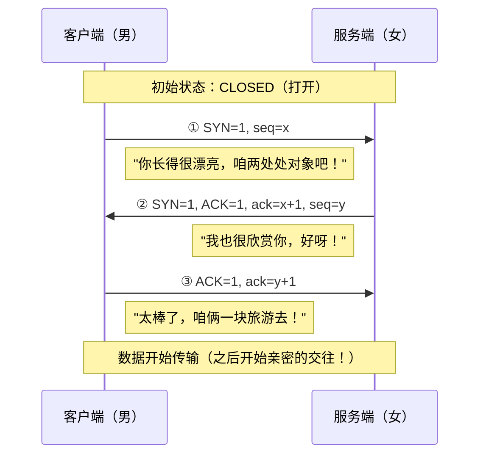
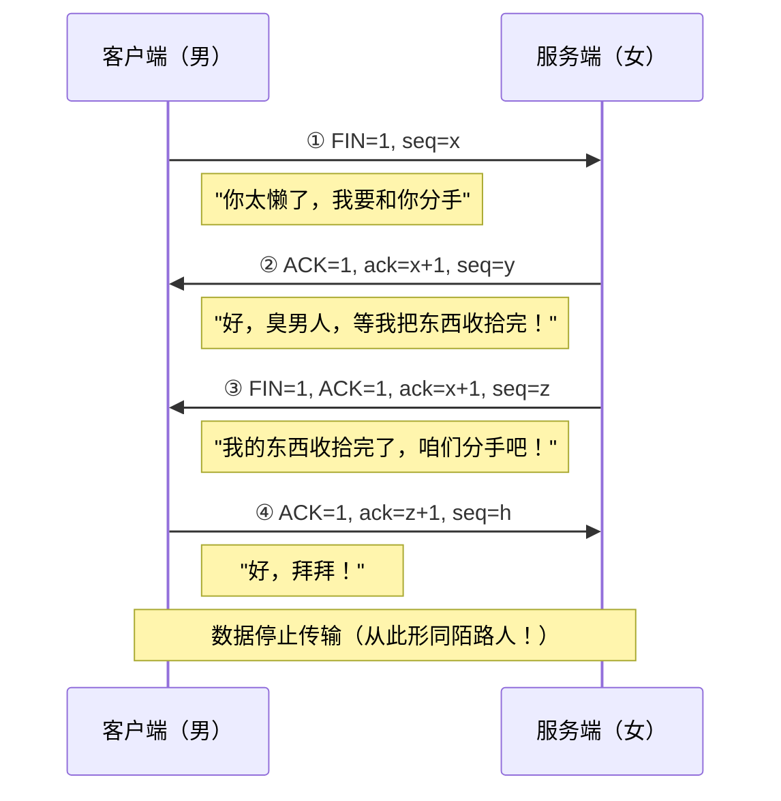
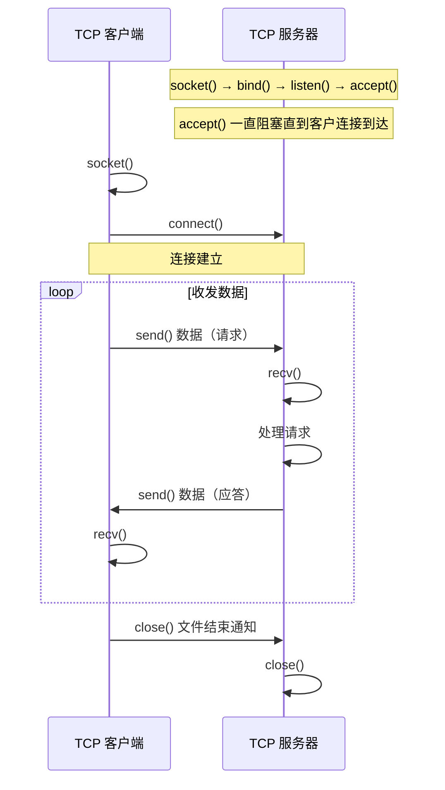

---
{"dg-publish":true,"permalink":"/knowledge/backend/Python-基础/Python网络编程TCP(与UDP对比)/","title":"Python网络编程TCP(与UDP对比)","tags":["网络","python","socket"],"dg-note-properties":{"category":"Python 网络编程","title":"Python网络编程TCP(与UDP对比)","source":"csdn","created":"2021-07-09","tags":["网络","python","socket"],"url":"https://blog.csdn.net/weixin_45536921/article/details/118609495"}}
---


#### TCP 传输方法


##### 1. TCP传输特点


面向连接的传输服务


- 传输特征 ： 提供了可靠的数据传输，可靠性指数据传输过程中无丢失，无失序，无差错，无重复。
可靠性保障机制（都是操作系统网络服务自动帮应用完成的）：
- 在通信前需要建立数据连接
- 确认应答机制
- 通信结束要正常断开连接


三次握手（建立连接）


- 客户端向服务器发送消息报文请求连接
- 服务器收到请求后，回复报文确定可以连接
- 客户端收到回复，发送最终报文连接建立




> **三次握手**：客户端 SYN → 服务端 SYN+ACK → 客户端 ACK，确认双方收发能力均正常。


四次挥手（断开连接）
- 主动方发送报文请求断开连接
- 被动方收到请求后，立即回复，表示准备断开
- 被动方准备就绪，再次发送报文表示可以断开
- 主动方收到确定，发送最终报文完成断开




> **四次挥手**：客户端 FIN → 服务端 ACK → 服务端 FIN → 客户端 ACK。
> 中间服务端可能还有未发完的数据，所以是「四次」而非「三次」。


##### 2. TCP服务端


**服务端 socket 流程（生活化类比）**

| 步骤 | 调用 | 类比 |
|---|---|---|
| 1 | `socket` | 买手机 |
| 2 | `bind` | 绑卡（绑定 IP + 端口） |
| 3 | `listen` | 缴费（进入监听状态） |
| 4 | `accept` | 开机（等待接入） |
| 5 | `send` / `recv` | 接打电话（收发数据） |
| 6 | `close` | 挂断 |


- 创建套接字

```python
    sockfd=socket.socket(family,type)
    功能：创建套接字
    参数：family  网络地址类型 AF_INET表示ipv4
         type  套接字类型 SOCK_STREAM 表示tcp套接字 （也叫流式套接字） 
    返回值： 套接字对象

```
- 绑定地址 （与udp套接字相同）

- 设置监听

```python
    sockfd.listen(n)
    功能 ： 将套接字设置为监听套接字，确定监听队列大小
    参数 ： 监听队列大小

```

```
                                 TCP 监听队列
                         （数量之和 ≤ listen 参数）
    ┌─────────┐         ┌───────────────────────┐
    │ 服务器   │         │  ┌──┐ ┌──┐            │
    │         │◄─accept─┼──│  │ │  │            │ ← 已完成三次握手
    │         │         │  └──┘ └──┘            │   等待 accept 处理
    │         │         │                        │
    │         │         │  ┌──┐ ┌--┐ ┌──┐       │
    │         │         │  │  │ │  │ │  │       │ ← 等待完成三次握手
    │         │         │  └──┘ └--┘ └──┘       │
    └─────────┘         └───────────▲───────────┘
                                    │
                              客户端请求连接
```

> 监听队列分两段：**未完成握手队列（SYN 队列）** + **已完成握手队列（accept 队列）**，
> 两者长度之和不超过 `listen()` 参数值。


- 处理客户端连接请求

```python
    connfd,addr = sockfd.accept()
    功能： 阻塞等待处理客户端请求
    返回值： connfd  客户端连接套接字
            addr  连接的客户端地址

```
- 消息收发

```python
    data = connfd.recv(buffersize)
    功能 : 接受客户端消息
    参数 ：每次最多接收消息的大小
    返回值： 接收到的内容

    n = connfd.send(data)
    功能 : 发送消息
    参数 ：要发送的内容  bytes格式
    返回值： 发送的字节数

```
- 关闭套接字 (与udp套接字相同)


##### 3. TCP客户端


**客户端 socket 流程**

```
    ┌─────────┐
    │ socket  │  创建套接字
    └────┬────┘
         ▼
    ┌─────────┐
    │ connect │  连接服务端
    └────┬────┘
         ▼
    ┌─────────┐
    │send/recv│  收发数据
    └────┬────┘
         ▼
    ┌─────────┐
    │ close   │  关闭连接
    └─────────┘
```


- 创建TCP套接字
- 请求连接

```python
    sockfd.connect(server_addr)
    功能：连接服务器
    参数：元组  服务器地址

```
- 收发消息


注意： 防止两端都阻塞，recv send要配合


- 关闭套接字





##### 4. TCP套接字细节


tcp连接中当一端退出，另一端如果阻塞在recv，此时recv会立即返回一个空字串。


tcp连接中如果一端已经不存在，仍然试图通过send向其发送数据则会产生BrokenPipeError


一个服务端可以同时连接多个客户端，也能够重复被连接


tcp粘包问题


产生原因


- 为了解决数据再传输过程中可能产生的速度不协调问题，操作系统设置了缓冲区
- 实际网络工作过程比较复杂，导致消息收发速度不一致
- tcp以字节流方式进行数据传输，在接收时不区分消息边界


```
┌───────────────── 服务端 ─────────────────┐   ┌───────────────── 客户端 ─────────────────┐
│                                          │   │                                          │
│   ┌────────────────────┐                 │   │                 ┌────────────────────┐   │
│   │ socket服务端程序    │ ← 应用层         │   │  应用层 →       │ socket客户端程序    │   │
│   └─────────┬──────────┘                 │   │                 └─────────┬──────────┘   │
│             ▼                            │   │                           ▼              │
│        ┌────────┐                        │   │                      ┌────────┐          │
│        │  缓存   │ ◄─── 操作系统 ────►   │   │                      │  缓存   │          │
│        └───┬────┘                        │   │                      └───┬────┘          │
│            ▼                             │   │                           ▼              │
│      ┌──────────┐                        │   │                     ┌──────────┐         │
│      │   网卡    │ ◄───────── 数据流 ─────┼───┼─────────────────────│   网卡    │         │
│      └──────────┘                        │   │                     └──────────┘         │
└──────────────────────────────────────────┘   └──────────────────────────────────────────┘
```

> 应用层数据先进入**操作系统缓冲区**，再由内核经**网卡**发送出去，两端的缓存通过物理链路互通。


带来的影响


- 如果每次发送内容是一个独立的含义，需要接收端独立解析此时粘包会有影响。


处理方法


- 消息格式化处理，如人为的添加消息边界，用作消息之间的分割
- 控制发送的速度


##### 5. TCP与UDP对比


传输特征


- TCP提供可靠的数据传输，但是UDP则不保证传输的可靠性
- TCP传输数据处理为字节流，而UDP处理为数据包形式
- TCP传输需要建立连接才能进行数据传，效率相对较低，UDP比较自由，无需连接，效率较高


套接字编程区别


- 创建的套接字类型不同
- tcp套接字会有粘包，udp套接字有消息边界不会粘包
- tcp套接字依赖listen accept建立连接才能收发消息，udp套接字则不需要
- tcp套接字使用send，recv收发消息，udp套接字使用sendto，recvfrom


使用场景


tcp更适合对准确性要求高，传输数据较大的场景
- 文件传输：如下载电影，访问网页，上传照片
- 邮件收发
- 点对点数据传输：如点对点聊天，登录请求，远程访问，发红包


udp更适合对可靠性要求没有那么高，传输方式比较自由的场景
- 视频流的传输： 如直播，视频聊天
- 广播：如网络广播，群发消息
- 实时传输：如游戏画面


- 在一个大型的项目中，可能既涉及到TCP网络又有UDP网络