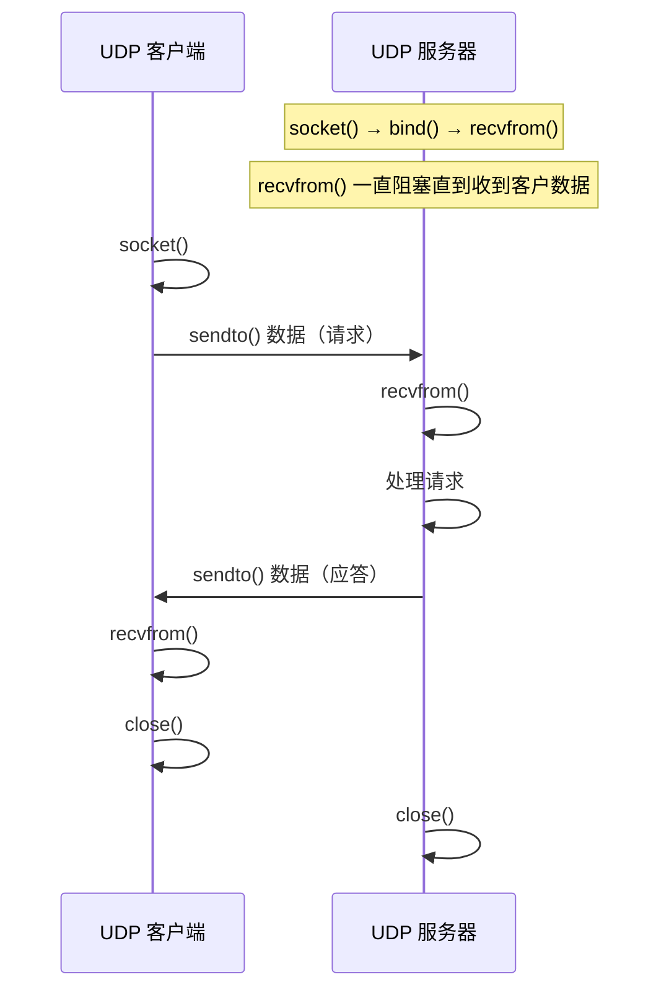

---
{"dg-publish":true,"permalink":"/knowledge/backend/Python-基础/Python网络编程UDP/","title":"Python网络编程UDP","tags":["网络","python"],"dg-note-properties":{"category":"Python 网络编程","title":"Python网络编程UDP","source":"csdn","created":"2021-07-09","tags":["网络","python"],"url":"https://blog.csdn.net/weixin_45536921/article/details/118609323"}}
---


#### UDP 传输方法


##### 1. 套接字简介

- 套接字(Socket) ： 实现网络编程进行数据传输的一种技术手段,网络上各种各样的网络服务大多都是基于 Socket 来完成通信的。
- Python套接字编程模块：```
import socket
```


##### 2. UDP套接字编程

- 创建套接字

```python
    sockfd=socket.socket(family,type)
    功能：创建套接字
    参数：family  网络地址类型 AF_INET表示ipv4
         type  套接字类型 SOCK_DGRAM 表示udp套接字 （也叫数据报套接字） 
    返回值： 套接字对象

```
绑定地址
- 本地地址 ： ‘localhost’ , ‘127.0.0.1’
- 网络地址 ： ‘172.40.91.185’ （通过ifconfig查看）
- 自动获取地址： ‘0.0.0.0’


**`bind()` 地址含义**

```
┌──────────────────── 本地主机 ────────────────────┐   ┌──────────┐
│                                                  │   │ 其他主机  │
│  ┌─── 客户端程序 ───┐  ┌─── 服务端程序 bind() ─┐ │   │          │
│  │                  │  │  ┌──────────────────┐  │ │   │          │
│  │ 127.0.0.1 ───────┼──┼─►│ localhost        │  │ │   │          │
│  │                  │  │  │ 127.0.0.1        │  │ │   │          │
│  │                  │  │  └──────────────────┘  │ │   │          │
│  │                  │  │  ┌──────────────────┐  │ │   │          │
│  │ 172.40.91.188 ───┼──┼─►│ 172.40.91.188    │◄─┼─┼───┤172.40.91.188
│  │                  │  │  └──────────────────┘  │ │   │          │
│  │                  │  │  ┌──────────────────┐  │ │   │          │
│  │ 172.40.91.188 ───┼──┼─►│ 0.0.0.0          │◄─┼─┼───┘          │
│  │                  │  │  └──────────────────┘  │ │              │
│  └──────────────────┘  └────────────────────────┘ │              │
└──────────────────────────────────────────────────┘   └──────────┘
```

| bind 地址 | 谁能连上 |
|---|---|
| `127.0.0.1` / `localhost` | 仅本机客户端 |
| `172.40.91.188`（本机网卡 IP） | 本机 + 同网段其他主机 |
| `0.0.0.0` | 任意来源（监听所有网卡） |


```python
    sockfd.bind(addr)
    功能： 绑定本机网络地址
    参数： 二元元组 (ip,port)  ('0.0.0.0',8888)

```
- 消息收发

```python
    data,addr = sockfd.recvfrom(buffersize)
    功能： 接收UDP消息
    参数： 每次最多接收多少字节
    返回值： data  接收到的内容
            addr  消息发送方地址

    n = sockfd.sendto(data,addr)
    功能： 发送UDP消息
    参数： data  发送的内容 bytes格式
          addr  目标地址
    返回值：发送的字节数

```
- 关闭套接字

```python
    sockfd.close()
    功能：关闭套接字

```

服务端客户端流程




> **UDP 无连接**：没有 `listen`/`accept`/`connect`，直接 `sendto`/`recvfrom`；
> 服务端用 `recvfrom()` 同时获取**数据 + 对方地址**。


##### 3.  UDP套接字特点

- 可能会出现数据丢失的情况
- 传输过程简单，实现容易
- 数据以数据包形式表达传输
- 数据传输效率较高