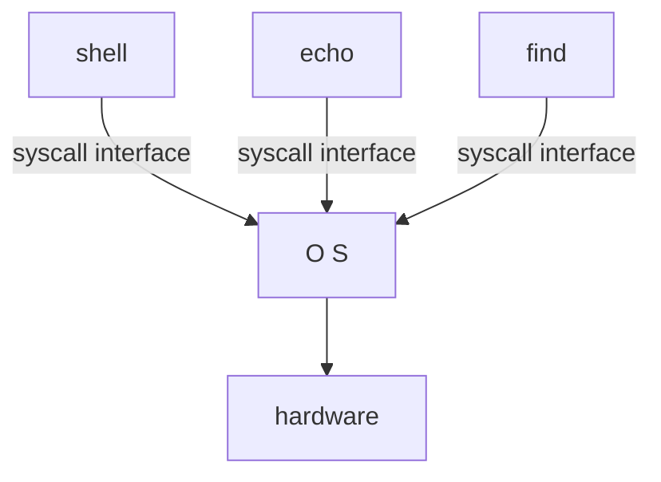
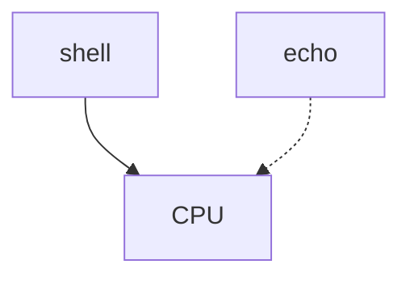
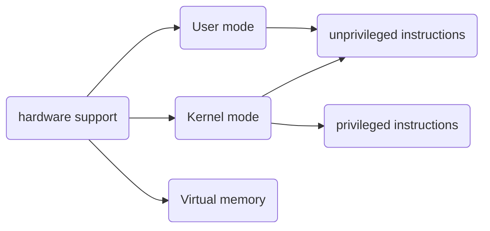
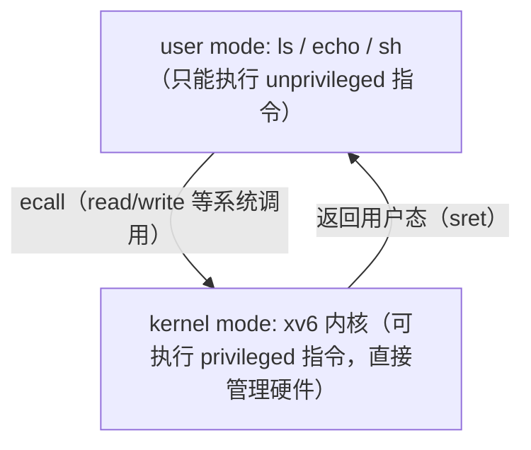
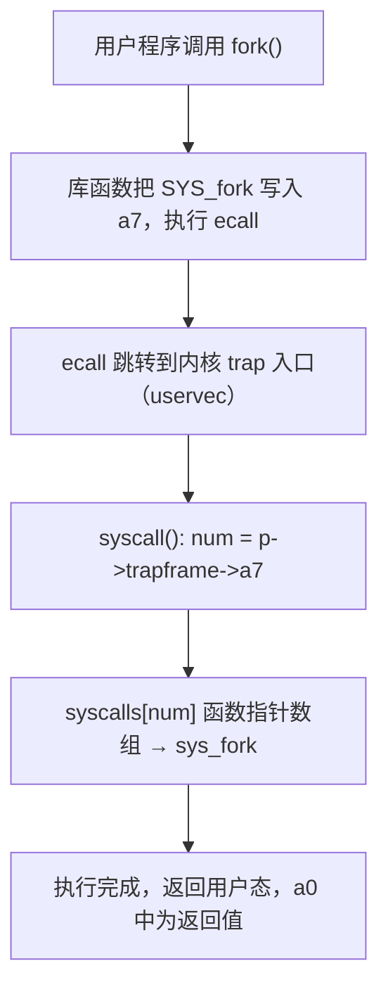
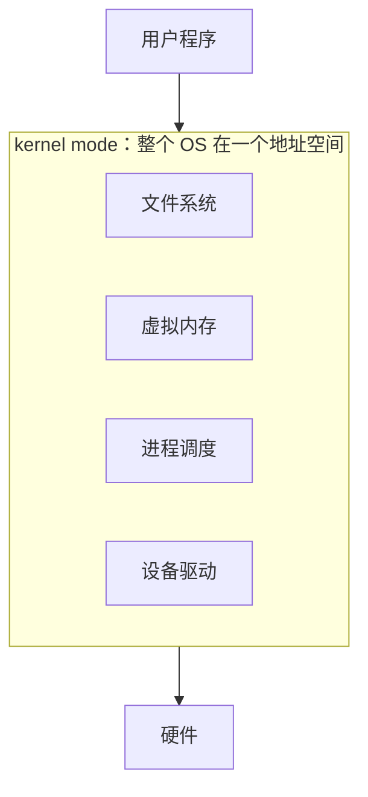
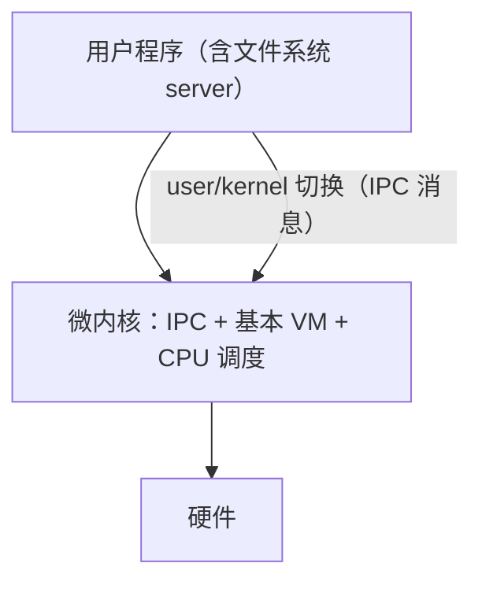
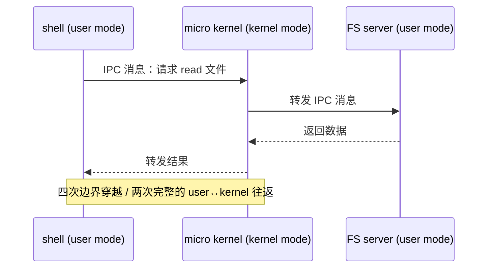
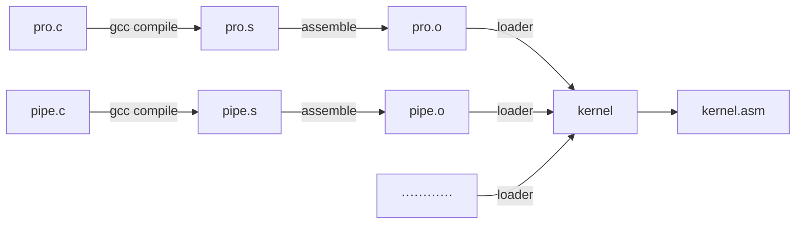
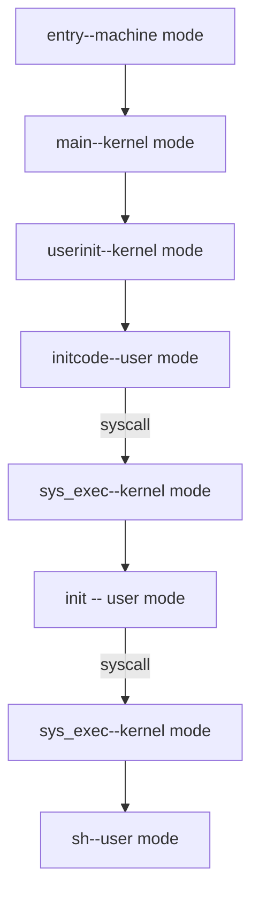

---
{"dg-publish":true,"permalink":"/knowledge/course/mit6.s081/02-OS-Syscalls/","title":"6.S081 02 · 操作系统组织与系统调用","tags":["MIT6.1810","xv6","操作系统","课程笔记"],"dg-note-properties":{"title":"6.S081 02 · 操作系统组织与系统调用","tags":["MIT6.1810","xv6","操作系统","课程笔记"],"date":"2026-11-18","source":"https://pdos.csail.mit.edu/6.828/2020/schedule.html"}}
---


# 6.S081 · 02 操作系统组织与系统调用

> MIT 6.S081 / 6.1810 · Operating System Engineering
> 教材：xv6: a simple, Unix-like teaching operating system（RISC-V 版）
> 本节基于 xv6-riscv 源码

返回 [[knowledge/course/mit6.s081/index\|📚 6.S081 目录]] · [[knowledge/course/index\|📚 课程资源]] · [[首页\|🏠 首页]]

---

## Isolation



操作系统（OS）是硬件（hardware）和应用程序的中间体。下面将假想没有 OS 的情况下，从隔离性（**isolation**）出发看为什么需要 OS。所谓隔离性有两个含义：1. 指应用程序与 hardware 的隔离；2. 指应用程序与应用程序的隔离。

### CPU

多个程序需要使用 CPU 时，需要保证协同调度（Cooperative Scheduling）的机制，即 `shell` 运行一段时间后，需要让 `echo` 也能有机会运行。直接把 CPU 交给应用程序的设计不能保证这种机制：`shell` 与 `echo` 都直接占用同一颗 CPU，谁先跑谁就一直跑下去。



也就是说，如果 `shell` 程序里有死循环，那么 `echo` 永远也无法获取 CPU。

### Memory

如果应用程序直接运行在硬件资源如物理内存上，`shell` 和 `echo` 的内存之间是没有边界的。比如内存地址 0x1000 被 `shell` 占有，而 `echo` 也把数据写到 0x1000，`echo` 就会直接覆盖 `shell` 程序内存的内容——两者看到的是同一份、同一个编址的物理内存，没有任何东西挡住这种越界写入。

```
无 OS 隔离时两个程序共享同一段物理内存：

  0x0000 ┌──────────────┐
         │  ...         │
  0x1000 ├──────────────┤ ← shell 的变量/数据
         │              │ ← echo 也往这里写，直接覆盖 shell
         │  shell data  │
         └──────────────┘
```

以上的两点问题对应着 OS 实现的两个机制：

1. 多进程对 CPU 的分时复用（==Multiplexing==）
2. 物理内存的隔离性（==Isolation==）

### 从 Isolation 的角度看 Unix 接口

**接口通过抽象硬件资源，从而使强隔离性成为可能。** 即：普通的应用程序会通过 Unix 接口使用硬件资源，但它又不能直接使用硬件资源，OS 将帮助应用程序完成这一过程，OS 将会实现 Multiplexing 和 Isolation。

1. 接口 `fork` 创建了进程（process），但实际要使用的是 CPU。process 其实是对 CPU 的抽象。这并不意味着 CPU 和 process 的一一对应：以 RISC-V 处理器为例，它有四个核，当有四个 process 时，可以做到一个 process 占用一个核。但有更多 process 时，则需要 OS 调度 process 来实现分时复用。

   ```mermaid
   graph  LR 
   A[proc1]-->B[CPU]
   C[proc2]-->B[CPU]
   D[proc3]-->B[CPU]
   ```

2. 应用程序使用接口 `exec` 时需要传入一个文件名，而这个文件名对应着一个内存映像：可执行文件（ELF）被加载后，在内存中形成 text（指令）、data（已初始化数据）、bss（未初始化数据）、stack（栈）等若干段，各自占据从 0 开始的一段虚拟地址区间。但应用程序并不能直接访问这段物理内存，它只看到自己的这组虚拟地址。

   ```
   进程的内存映像（虚拟地址视图）：

   低地址  ┌──────────────┐  ← text（代码段，可执行）
           ├──────────────┤  ← data（已初始化全局/静态变量）
           ├──────────────┤  ← bss（未初始化数据）
           ├──────────────┤  ← 堆 heap（向下增长）
           │     ...      │
           │     ...      │
           ├──────────────┤  ← 栈 stack（向下增长）
   高地址  └──────────────┘
   ```

3. 最后一个例子是 files，files 是对磁盘的抽象。在 Unix 中，我们可以对 files 命名、读写，而 OS 将会决定 files 和磁盘中块的对应。

## Denfensive

**OS 需要应对恶意的应用程序**

1. 首先不能因为应用程序有意或者无意地向系统调用传入一些错误参数就导致 OS 崩溃。
2. 应用程序不能打破对它的隔离。应用程序可能是由攻击者写出来，它可能打破对应用程序的隔离进而控制内核；有了内核的控制能力，你可以做任何事情，因为内核掌握着所有硬件资源。

## Hardware 对 Isolation 的支持



Hardware 对强隔离的支持包括了：**user/kernel mode** 和 **virtual memory**。

### user/kernel mode

CPU 用某个控制寄存器的一个模式位（mode bit）来表示操作模式：当 mode bit 设置为 0 时，即为 user mode，CPU 只能运行普通权限指令（unprivileged instructions）；当 mode bit 设置为 1，即为 kernel mode，CPU 可以运行包括特定权限指令（privileged instructions）的所有指令。

1. unprivileged instructions：有两个寄存器相加的 ADD 指令，两个寄存器相减的 SUB 指令，跳转指令 JRC 等等。
2. privileged instructions：主要是操纵硬件的和设置保护的指令，例如设置 page table 寄存器、关闭时钟中断等等。在处理器上寄存器会保存各种状态，而 privileged instructions 也可以使用这些状态寄存器。

user mode/kernel mode 的隔离性体现在，用户空间运行的 `ls` 和 `echo` 程序处于 user mode，~~OS 则处于 kernel mode~~（==这里写的是有问题的，`Xv6` 的全部操作系统服务确实是处在 kernel mode，但这是宏内核（Monolithic kernel），微内核并非如此==）。

用户态程序与内核态之间的分层关系如下：



例如 `ls` 的程序调用 `read/write` 时会需要从 user mode 转化成 kernel mode。

下面将介绍如何具体实现这一转化的过程。

#### user/kernel mode 的转化

将控制权从应用程序转移到内核这一个过程被称为 **Entering Kernel**。在我们使用的 `RISC-V` 指令集中，有一个叫 `ecall` 的指令，`ecall` 会接收一个数字参数，数字参数对应着应用程序想要调用的 `syscall`。`ecall` 会跳转到内核的一个特定位置，这就完成了从 user mode 到 kernel mode 的转化。

以使用系统调用 `fork()` 为例，它并不能直接使用 OS 中的 `fork` 函数，而是调用 `ecall` 指令，并将 `fork` 对应的数字（==systemcall number==）放到 `a7` 寄存器作为参数，之后通过 `ecall` 跳转进 `kernel`，由 `syscall` 实际意义地调用 `fork` 函数：



### virtual memory

基本所有的 CPU 都会支持 virtual memory，CPU 包含了 page table，而 page table 会将 virtual memory addr 和 physical memory addr 做了对应。


在 OS 的设置下，每一个 process 都有自己独立的 page table，这意味着一个 process 不能访问其他 process 的 physical memory addr，因为其他 process 的 physical memory addr 甚至都不在该 page table 中。这样就做到了 memory isolation。

每一个用户进程都有如下的 virtual memory 视图，它们的地址都是从 0 到 $2^n$（RISC-V 上为 0 到 $2^{38}$，即 39 位虚拟地址空间中的用户部分）：一段 text、一段 data、一段 guard page、一段 stack，顶部则是 trapframe 所在的 page 和 trampoline。virtual memory 的具体内容将在下一节页表中讲述。

```
用户进程虚拟地址空间（xv6，从低到高）：

  0x0      ┌──────────────┐
           │ text（代码）  │  R-X
           ├──────────────┤
           │ data / stack │  RW-
           ├──────────────┤
           │ ...          │
           ├──────────────┤
           │ guard page   │  （无 PTE / 无效）
           ├──────────────┤
           │ stack（一页） │  RW-
           ├──────────────┤
           │ trapframe    │  RW-
           ├──────────────┤
  MAXVA    │ trampoline   │  R-X（与内核空间共享）
           └──────────────┘
```

## Monolithic kernel and Micro kernel

使用系统调用之后，控制权从应用程序转移到了 `kernel`，之后 kernel 负责具体的功能并检查参数保证不被坏参数欺骗，所以 `kernel` 也被称为可被信任的计算空间（Trusted Computing Base），即 TCB。可以看出，`kernel` 对于安全性的要求很高，既然如此，是否要让所有的 OS 代码都运行在 kernel mode 上呢？不一定。


### 宏内核（Monolithic kernel）

整个操作系统代码都运行在 kernel mode，大多数的 Unix 操作系统实现都运行在 kernel mode 上，例如 `Xv6`，这种形式被称为 Monolithic Kernel Design（[宏内核](https://en.wikipedia.org/wiki/Monolithic_kernel)）。

1. 优点：tight integration
2. 缺点：more codes, more bugs

结构上是「应用程序 → 系统调用接口 → 一整块内核（文件系统、虚拟内存、进程调度、设备驱动全在同一地址空间）→ 硬件」，内核内部模块之间直接函数调用，没有跨边界开销。



### 微内核（Micro kernel）

将大部分的 OS 代码运行在 kernel 之外的设计被称为 Micro Kernel Design（[微内核](https://en.wikipedia.org/wiki/Microkernel)）。在这种模式下，希望在 kernel mode 中运行尽可能少的代码，内核只有非常少的几个模块：

1. IPC（InterProcess Communication，进程间通信）；
2. 基本虚拟内存（VM）的支持，可能只支持了 page table；
3. 分时复用 CPU（Multiplexing）支持。

而文件系统则和普通的应用程序一样运行在 user mode。这样做的好处当然是为了解决 Monolithic kernel 的冗余，但也会带来不同 mode 之间切换带来的损耗。



以 `shell` 为例，如果它希望调用文件系统，那么就需要两次 user/kernel mode 的来回跳转：



## 编译运行 kernel

下面将看看 `Xv6` 这个 OS 是如何具体实现的。

`Xv6` 主要分为三个部分，分别位于三个文件夹下：

```
xv6-riscv/
├── kernel/    # 内核源码（C + 汇编），全部编译链接成一个二进制 kernel
├── user/      # 用户态程序（sh、ls、echo、init、cat …… 以及你写的 Lab 程序）
└── mkfs/      # 构建工具：生成空文件系统镜像 fs.img
```

1. 第一个是 kernel 的部分，`ls kernel` 以后可以看到 kernel 目录下的所有文件。其中 c 文件全体被编译成一个 ==`kernel`== 二进制文件（运行在 kernel mode）。这个二进制里的 section 顺序由链接脚本决定，`.text` 在最前，起始地址 0x80000000。

   ```
   kernel/
     main.c  proc.c  vm.c  kalloc.c  trap.c  syscall.c  sysproc.c
     exec.c  file.c  fs.c  bio.c  log.c  console.c  uart.c  plic.c
     start.c  entry.S  swtch.S  trampoline.S  kernelvec.S  ...
     （以上 .c / .S 全部编译为目标文件，链接成 kernel）
   ```

2. 第二个是 user 的部分，该目录下的程序是一些用户程序，运行在 user mode。在 Lab1 中，我们已经在这个文件夹下写了一些程序。
3. 最后是 mkfs，它会创建一个空的文件 image（在学完文件系统后，将进行补充）。

现在解释 kernel 里的 c 文件是如何编译成 `kernel` 的二进制文件。和以上三个文件夹处于同一目录下的 `Makefile` 文件会读取 c 文件（以 `pro.c` 为例），调用 gcc 编译器（*compile*），生成一个 `pro.s`（`RISC-V` 汇编语言文件）。对这个 `pro.s` 调用汇编解释器（assemble），生成二进制格式的汇编文件 `pro.o`。


`Makefile` 将会对所有的 C 文件做这样的操作，之后加载器（Loader）将会收集所有的 `.o` 文件，生成最后的 kernel 文件。为了便于我们的学习，`Makefile` 文件将会对 `kernel` 文件反汇编生成 `kernel.asm`。在 `kernel.asm` 中，我们将看到 `RISC-V` 汇编语言描述的 `kernel`。



## QEMU

`qemu` 是 `RISC-V` 指令集 CPU 的模拟 C 程序，我们的 `kernel` 将在这上面运行。`qemu` 的内部是一个循环，它重复地做以下三件事。

1. 读取 4 字节或者 8 字节的 `RISC-V` 指令。
2. 解码该 `RISC-V` 指令，并找到对应的操作码（op code）。
3. 最后在软件中执行该指令。

   ```c
   while(true):
   			read instruction 
         decode instruction(such as add/sub)
         execute instruction
   ```

有两点需要说明：

1. `qemu` 的循环会需要维护寄存器（每个 CPU 的 32 个通用寄存器 + PC + CSR）。
2. `qemu` 支持真正的多线程（每个模拟 CPU 一个线程）。

## Xv6 的启动

### 带有 gdb 调试运行 Xv6

下面将带 `gdb` 运行 `Xv6`，由于缺乏 RISC-V 64 位 Linux 的 `gdb`，这里并不按照课程中的方法调试 `kernel`，而是按照[此文的方法](https://zhuanlan.zhihu.com/p/331492444)直接使用 `gdb-multiarch` 调试 `kernel`。

首先带着 `gdb` 运行“启动 CPU”，即运行 `qemu`。

```shell
make CPUS=1 qemu-gdb
```

来看看传给 `qemu` 的参数（`make` 打印出的实际 qemu 命令行）：

```
qemu-system-riscv64 -machine virt -bios none -kernel kernel/kernel \
  -m 128M -smp 1 -nographic -drive file=fs.img,if=none,format=raw,id=x0 \
  -device virtio-blk-device,drive=x0,bus=virtio-mmio-bus.0 \
  -S -gdb tcp::26000
```

1. `-kernel`：传递了 `kernel/kernel`，即之前所描述的内核二进制文件。这里其实就是 `kernel` 在 `qemu` 上运行的这一过程模拟了 `Xv6` 的内核运行在 `RISC-V` 处理器上这一过程。
2. `-m`：表示该虚拟机的内存，为 128M。
3. `-smp`：表示该虚拟机的 CPU 数量，为 1。
4. `-drive`：表示该虚拟机的硬盘驱动，传入的为同目录下的 `fs.img`。
5. `-S` 让 qemu 启动后立刻暂停、`-gdb tcp::26000` 在 26000 端口等待 gdb 连接。

接下来再打开一个新的终端，键入。

```shell
gdb-multiarch kernel/kernel
```

gdb 会输出类似下面的内容，提示它已识别 RISC-V 64 位、并设好了运行的架构：

```
GNU gdb (Ubuntu ...) 
(No debugging symbols found in kernel/kernel)   ← 若未生成符号，可先 make 后再来
(gdb) set architecture riscv:rv64
(gdb) target remote localhost:26000
Remote debugging using localhost:26000
0x0000000000001000 in ?? ()
(gdb) 
```

此时就可以对 `kernel` 进行调试了。

---

### kernel 的入口

来看看 `kernel.asm` 文件的开头：

```asm
kernel/kernel:     file format elf64-littleriscv

Disassembly of section .text:

0000000080000000 <_entry>:
    80000000:	00009117          	auipc	sp,0x9
    80000004:	8a013113          	addi	sp,sp,-1888
    80000008:	13701073          	csrrw	zero,sscratch,zero
    8000000c:	0000a317          	auipc	t5,0xa
    80000010:	fe030313          	addi	t5,t5,-32
    80000014:	000f0363          	beqz	t5,8000001a <_entry+0x1a>
    80000018:	000f8067          	jr	t5
    8000001c:	0000 a283          	lw	t0,0(ra)

0000000080000020 <_entry2>:
...
0000000080000024 <_entry3>:
    80000024   	csrr	a1, mhartid
    80000028   	addi	a1, a1, 1
    8000002c   	mul	a1, a1, a0
    80000030   	add	sp, sp, a1
    80000034   	jal	800000a0 <start>
```

上述是 `kernel.asm` 开头的关键行。首先注意 `kernel` 的第一个指令储存在地址 0x80000000 处，这是一个被 `qemu` 认可的地址（也就是说如果要 `kernel` 运行在 `qemu` 上，**第一个指令需要在地址 0x80000000 处**，这一点也可以在生成 `kernel` 的 `kernel` 加载器得到体现，即 `kernel.ld` 脚本）。然后注意到一点，第一个函数为 `_entry`。

再来看看指令，可以注意不同 `RISC-V` 指令的字节数不一定相同，到 `addi`（相加的指令）是 2 个字节，而 `csrr`（`mhartid` 表示控制系统寄存器（Control System Register），此指令的含义是将 `mhartid` 的数据加载到寄存器中）则是 4 个字节。

暂停一下，来看看 `kernel.ld`。

*在这里对 ld 脚本稍作补充，ld 脚本主要功能就是将多个 .o 文件和 .a 文件链接成一个可执行文件。它其实就是之前提到的将多个 .o 文件链接成 kernel 的 loader。*

`kernel.ld` 关键内容：

```ld
OUTPUT_ARCH( "riscv" )
ENTRY( _entry )

SECTIONS
{
  . = 0x80000000;

  .text : {
    *(.text .text.*)
    . = ALIGN(0x1000);
    _trampoline = .;
    *(trampsec)
    . = ALIGN(0x1000);
    ASSERT(. - _trampoline == 0x1000, "error: trampoline larger than one page");
    PROVIDE(etext = .);
  }

  .rodata : { ... }
  .data : { ... }
  .bss : { ... }
}
```

有三点需要注意：

1. `ENTRY(_entry)` 指明了 `kernel` 代码段的执行入口：`_entry`，这正是上文所提的 `kernel` 的第一个函数。
2. `. = 0x80000000` 指明了 `kernel` 的起始虚拟地址，这正是 `kernel` 代码段（即 `.text`）第一个指令的地址。
3. `. = ALIGN(0x1000)` 表示 `kernel` 代码段需要保证 4KB 对齐（其实就是页的大小对齐）。

---

### 第一个 shell

好，下面回到用 `gdb` 对 `kernel` 的调试。

1. 设置第一个断点，进入 `_entry`：

   ```
   (gdb) b _entry
   Breakpoint 1 at 0x80000000
   (gdb) c
   Breakpoint 1, 0x0000000080000000 in _entry ()
   (gdb) info registers pc
   pc             0x80000000       0x80000000 <_entry>
   ```

   此时还不存在内存分页（`satp` 为 0），而且还处于独立于 kernel/user mode 之外的 machine mode，还没有隔离性。

2. 设置第二个断点，进入 `main`：

   ```
   (gdb) b main
   Breakpoint 2 at 0x80000a24: file kernel/main.c, line 20.
   (gdb) c
   Breakpoint 2, main () at kernel/main.c:20
   20    consoleinit();
   ```

   模式已经转化为 kernel mode。在 `gdb` 中键入 `layout split`，可以看到 `main` 的源码。`consoleinit()` 将初始化 console，这样才可以打印。（这里对 console 的解释不够详实，将在后面的 lecture 中展开。）

   不断在 `gdb` 中键入 `n`，跳到打印结束，就可以在启动 qemu 的终端看到：

   ```
   xv6 kernel is booting
   ```

3. 接下来 `main` 中将做一系列的初始化：

   ```
   main() 中的调用顺序（节选）：
     consoleinit()   // 初始化 console（UART）
     printfinit()    // 初始化 printf 锁
     kinit()         // 物理页分配器
     kvminit()       // 内核页表
     kvminithart()   // 装入 satp，开启分页
     procinit()      // 进程表
     trapinit(); trapinithart();  // trap 处理
     plicinit(); plicinithart();  // 中断控制器
     binit(); iinit(); fileinit();  // 文件系统
     userinit()      // 第一个用户进程 -> initcode
     scheduler()     // 开始调度
   ```

   这些将在后面的 lecture 中一一介绍。

4. 下面这一步将会创建第一个 user process（用户进程），键入 `si` 进入 `userinit`：

   ```
   (gdb) b userinit
   Breakpoint 3 at 0x80000f3c: file kernel/proc.c, line 90.
   (gdb) c
   Breakpoint 3, userinit () at kernel/proc.c:90
   (gdb) si
   ```

   在 `userinit` 中，它会启动一个小程序 initcode，这个小程序直接由二进制写成（以字节数组 `initcode[]` 嵌在 kernel 中），将运行在 user mode 下。

   为了搞清楚 initcode 的指令，可以在 `user/initcode.S` 里看到汇编版本。我们关注前四个指令：

   ```asm
   # user/initcode.S
   start:
     la a0, init       # 1. 把 init 的地址（字符串 "/init"）加载到 a0
     la a1, argv       # 2. 把 argv 数组的地址加载到 a1
     li a7, SYS_exec   # 3. 把 SYS_exec（exec 的 systemcall number）写到 a7
     ecall             # 4. 进入内核
   ```

   1. 将 init 中的地址加载到 a0 寄存器中。
   2. 将 argv 中的地址加载到 a1 寄存器中。
   3. 将 SYS_exec（`exec` 对应的 systemcall number）加载到 a7 寄存器上。（*一点补充，la 和 li 都是* `RISC-V` 指令集的伪指令，前者加载地址，后者加载立即数）。
   4. 调用 `ecall`。

5. initcode 是第一个 user 程序，为了搞清楚它系统调用了什么，我们设置第三个断点，进入 syscall：

   ```
   (gdb) b syscall
   Breakpoint 4 at 0x80000a10: file kernel/syscall.c, line 130.
   (gdb) c
   Breakpoint 4, syscall () at kernel/syscall.c:130
   130    num = p->trapframe->a7;
   (gdb) p num
   $1 = 7
   ```

   需要注意的是 syscalls 函数采用的是函数指针数组（如下）。

   ```c
   static uint64 (*syscalls[])(void) = {
   [SYS_fork]    sys_fork,
   [SYS_exit]    sys_exit,
   [SYS_wait]    sys_wait,
   [SYS_pipe]    sys_pipe,
   [SYS_read]    sys_read,
   [SYS_kill]    sys_kill,
   [SYS_exec]    sys_exec,
   [SYS_fstat]   sys_fstat,
   [SYS_chdir]   sys_chdir,
   [SYS_dup]     sys_dup,
   [SYS_open]    sys_open,
   [SYS_write]   sys_write,
   [SYS_mknod]   sys_mknod,
   [SYS_unlink]  sys_unlink,
   [SYS_link]    sys_link,
   [SYS_mkdir]   sys_mkdir,
   [SYS_close]   sys_close,
   };
   ```

   `num = p->trapframe->a7` 会读取 systemcall number，这决定了将要读取的系统调用的函数。打印 num，得到 `$1 = 7`，这正是 `exec` 的 systemcall number（`SYS_exec = 7`），与 initcode 的指令完全相符。事实上，我们也可以在 syscall.h 里看到每一个系统调用函数和其数字的对应：

   ```c
   // kernel/syscall.h
   #define SYS_fork    1
   #define SYS_exit    2
   #define SYS_wait    3
   #define SYS_pipe    4
   #define SYS_read    5
   #define SYS_kill    6
   #define SYS_exec    7
   #define SYS_fstat   8
   #define SYS_chdir   9
   #define SYS_dup    10
   #define SYS_open   11
   #define SYS_write  12
   #define SYS_mknod  13
   #define SYS_unlink 14
   #define SYS_link   15
   #define SYS_mkdir  16
   #define SYS_close  17
   ```

   接下来 syscall 会调用 `sys_exec`。以上的过程刚好可以让我们回顾一下从 user mode 通过 `ecall` 转入内核、经 `syscall` 分发到具体函数的过程：

   ```mermaid
   graph TD
   A["initcode: a7=SYS_exec(7)"]-->B["ecall"]
   B-->C["kernel: trap 入口 uservec"]
   C-->D["syscall(): num = trapframe->a7 = 7"]
   D-->E["syscalls[7] = sys_exec"]
   E-->F["sys_exec(): 从用户空间读 path"]
   ```

6. 我们跳进 `sys_exec` 看看：

   ```
   (gdb) b sys_exec
   Breakpoint 5 at 0x80001234: file kernel/sysproc.c, line 44.
   (gdb) c
   Breakpoint 5, sys_exec () at kernel/sysproc.c:44
   44    if(argstr(0, path, MAXARG) < 0)
   ```

   首先它会从用户空间读取参数，即 path，也就是 `exec` 的文件名：

   ```
   (gdb) p path
   $2 = "/init\000..."
   ```

   打印 path 得到 `"/init"`。这表明 initcode 通过系统调用 `exec` 了 init 程序，这也同样是一个 user 程序。

7. 如果继续运行代码，依然会陷入 syscall 的断点，这是因为 init 程序做了类似的事情，它通过系统调用 `fork` 出一个子进程，然后系统调用 `exec` 执行 sh 程序：

   ```
   Breakpoint 4, syscall ()   ← init 调用 fork：a7 = 1 (SYS_fork)
   Breakpoint 4, syscall ()   ← 子进程调用 exec：a7 = 7 (SYS_exec)，path = "/sh"
   ```

   这样第一个 shell 就运行起来啦。

总结下来，从 qemu 开始运行到第一个 shell 运行主要经历了如下的过程。至于其中为什么这么做，比如

1. **为什么需要 init 程序，而不直接调用 sh 程序**
2. initcode 程序为什么要写成二进制。
3. 为什么在 init 程序里需要配置 console（之前已经在 main 里配置了）

希望在后面的 lecture 有所介绍。


