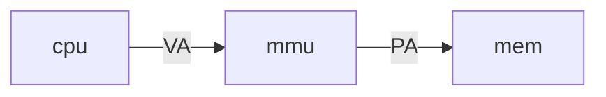
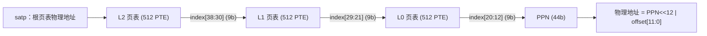
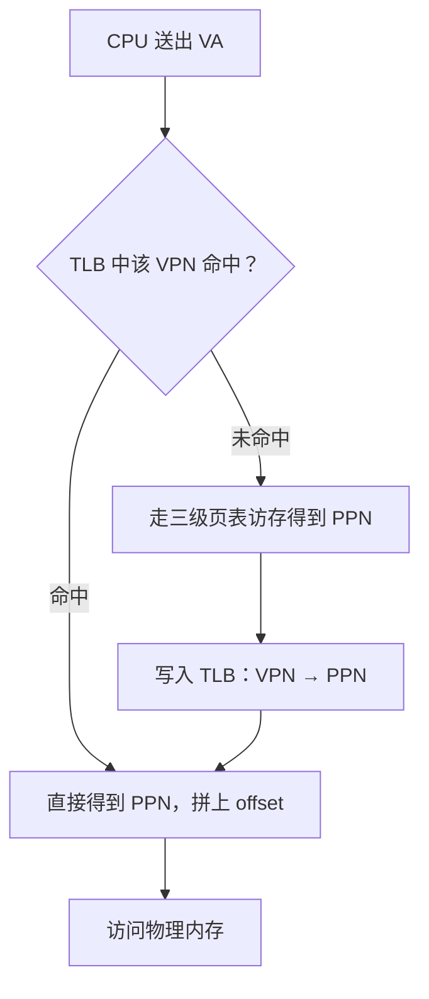

---
{"dg-publish":true,"permalink":"/knowledge/course/mit6.s081/03-Page-Tables/","title":"6.S081 03 · 页表","tags":["MIT6.1810","xv6","操作系统","课程笔记"],"dg-note-properties":{"title":"6.S081 03 · 页表","tags":["MIT6.1810","xv6","操作系统","课程笔记"],"date":"2026-11-18","source":"https://pdos.csail.mit.edu/6.828/2020/schedule.html"}}
---


# 6.S081 · 03 页表

> MIT 6.S081 / 6.1810 · Operating System Engineering
> 教材：xv6: a simple, Unix-like teaching operating system（RISC-V 版）
> 本节基于 xv6-riscv 源码

返回 [[knowledge/course/mit6.s081/index\|📚 6.S081 目录]] · [[knowledge/course/index\|📚 课程资源]] · [[首页\|🏠 首页]]

---

这一 Lecture 的主题将会是页表（page table），它实现了从虚拟地址到物理地址的映射。


1. 首先将介绍地址空间（address space）。
2. 然后将描述实现虚拟内存的 `RISC-V` 硬件。
3. 最后将查看 Xv6 的虚拟内存代码，了解内核地址空间和用户地址空间的结构。

## Address space

内存由一些 DRAM 芯片组成，它会存储 kernel 或者用户程序的代码和数据。为了解决内存隔离性的问题，引入虚拟地址的概念。

物理内存是一块从 0 开始连续编址的 DRAM，kernel 和所有进程的代码、数据都实实在在放在这块内存里，彼此交错排布，没有任何内在的墙把它们分开：

```
物理内存（一块连续的 DRAM，0 ~ 128MB）：

  0x00000000 ┌──────────────────────┐
             │  xv6 kernel 代码/数据│  ← 内核放在 0x80000000 起
  0x80000000 ├──────────────────────┤
             │  kernel text/data    │
             ├──────────────────────┤
             │  free memory pages   │  ← 被 kalloc 切成 4KB 页分配出去
             │  （进程 A 的页）      │
             │  （进程 B 的页）      │
             │  ...                 │
  0x86400000 └──────────────────────┘  ← PHYSTOP
```

要做的就是给每个程序专属的虚拟地址空间，所有程序的地址都是从 0 开始，不同程序间的地址彼此独立。那么如何在一个物理内存上创建多个虚拟内存地址空间？

```
同一块物理内存，被切成几张互不相交的虚拟地址视图：

  进程 A 的虚拟地址         进程 B 的虚拟地址
  0x0 ┌────────────┐       0x0 ┌────────────┐
      │ A 的 text  │           │ B 的 text  │
      ├────────────┤           ├────────────┤
      │ A 的 data  │           │ B 的 data  │
      └────────────┘           └────────────┘
          │                        │
          ▼ 各自的 page table      ▼
      ┌─────────────────────────────────────┐
      │       同一块物理 DRAM                │
      └─────────────────────────────────────┘
   A 用的页与 B 用的页在物理上不同，且 A 的页表里根本没有 B 的页
```

## Page Table

### 页表 1

使用页表（page table）是一种最常见的解决方法。举一个例子，cpu 正在执行一个命令 `sd $7, (a0)`，这个指令表示把立即数 7 写进寄存器 a0 储存的地址对应的内存。寄存器 a0 储存的地址并不是真正的物理内存地址，而是虚拟内存地址，在这个例子里假设这个虚拟地址为 0x1000。cpu 将虚拟内存地址传到内存管理单元 mmu（Memory Management Unit），mmu 将把它翻译成物理内存地址，最后用以索引内存。



### 页表 2

mmu 一旦打开，对于 CPU 来说，执行指令中的地址都是虚拟地址。mmu 中需要一个 table 完成虚拟地址到物理地址的映射，这就是 page table。通常来说，page table 存储在内存中。在 CPU 中有一个叫做 `SATP` 的寄存器，它保存 page table 的地址，这样，mmu 就可以根据这个地址去内存中寻找 table。（现在的讨论中 MMU 似乎并不会保存 page table，只是去内存中找 page table，而事实上 mmu 内部会有 page table 的缓存，就是 TLB 快表，之后讨论。）

```
地址翻译的通路：

  CPU 执行 ld/sd 指令
        │  虚拟地址 VA
        ▼
  ┌─────────────┐   satp 指向根页表
  │    MMU      │◄──────────  satp = 0x000000008000...（根页表物理地址）
  └─────────────┘
        │  读内存中的 page table（多级）
        ▼
   物理地址 PA  ──►  DRAM
        │
        └─► 命中则走 TLB（mmu 内部缓存，见下文）
```

值得注意的是，进程切换的时候 SATP 的寄存器会被内核（也只能被内核修改，执行在 kernel mode 中）修改。这一点我觉得很好地帮我们理解进程切换的含义，内核毫无疑问也保存了所有进程的 page table 在内存中的物理地址（准确来说，保留了一级页表的物理地址）。

### 页表 3

现在来思考上面的页表描述是否合理：假如每一个虚拟地址都对应着 page table 里的一个条目，存放虚拟地址是 64 位，这意味需要 $2^{64}$ 个条目，而这些条目又储存在内存里，所以光是这些条目本身就会耗尽内存。所以实际情况并不是这样，下面将从介绍 `RISC-V` 是如何工作的（注意以下都是硬件层面对页表的支持）：

要做的就是为每个 page 创建一个 PTE（page table entry，页表条目），而不是为每一个地址创建。一个 page 的大小为 4KB，也就是 4096 Bytes，它们是在内存中连续储存的字节。换而言之，一个 page 内 4KB 的地址共享一个条目。

在 `RISC-V` 中，虚拟地址目前只采用了 39 位，物理地址则采用了 56 位。虚拟地址根据 page 的大小分成了两个部分，第一部分是 27 位的 index，它将用来在 page table 中索引 44 位 PPN（physical page number），第二部分是 12 位的 offset，它指在 page 中的偏移。44 位的 PPN 加上 12 位 offset 就是翻译得到的 56 位物理地址。

```
单级（假想）页表：一个 VA 只对应一个 PTE

  虚拟地址（39 位有效，高 25 位未使用）
  ┌──────────────────────┬──────────────┐
  │  index (27 bit)      │ offset (12b) │
  └──────────┬───────────┴──────┬───────┘
             │ 在 page table 中索引
             ▼
         ┌────────────┐
         │ PTE (64b)  │ = PPN(44b) | flags(10b)
         └─────┬──────┘
               │ 取前 44 位
               ▼
  物理地址 = PPN(44b) << 12 | offset(12b)   → 共 56 位
```

*mmu 索引 PPN 更详尽的解释：page table 储存在内存中，SATP 储存了 page table 的**物理内存地址**，mmu 将 SATP 的地址加上 index 就得到了 PTE 的物理内存地址，取存以后得到的 PTE 的前 44 位就是 PPN。*

需要指出的是，虚拟地址的前 25 位现在处于未使用的状态，这随着 CPU 支持虚拟内存的提升将有所减少，而物理地址的 56 位也是一个很大的数字，这是目前绝大多数内存达不到的。

### 页表 4

页表 3 的设计依然不合理，注意到 page table 的 PTE 数量为 $2^{27}$（index=27），这依然是一个很大的数字。如果每一个进程都需要这样一个 1GB 的 page table，那么物理内存很快就被消耗完了（我们的硬件模拟程序 qemu 一共才 128M 的内存）。

```
一个进程一份 2^27 个 PTE × 8 字节 = 1GB 页表
  → 超过 qemu 全部 128MB 内存，完全不可行
```

而且事实上也没有必要，假如一个进程只需要一个 page 的物理内存，那 page table 的其他的条目都被浪费了。所以 page table 实际采取的是一个多级的结构，27bit 的 index 将被分成三个 9bit 的 index（分别为 L2，L1，L0），SATP 寄存器储存的物理地址（一级页表）通过 L2 索引得到 PPN 指向二级页表，二级页表再通过 L1 索引得到 PPN 指向三级页表，最后三级页表通过 L0 索引得到 PPN，这个 PPN 加上 offset 得到物理地址。此时页表中 PTE 的数量为 $2^8$，即 512 个。每个 PTE 为 64 bits，**这里设计的巧妙之处正在于，此时页表的大小也为 4KB，和页的大小正相同**，这方便了内存的统一管理。



还有两点说明：

1. *通常 page directory 是指用来索引 page table 或者其他 page directory 物理地址的 page table，不过在本 lecture 中它和 page table 意思差不多，所以中文统一用页表来表示。*
2. *索引到下一级页表的 PPN 是 44 位，它将加上 12 位为 0 的 bit 才得到下一级页表的物理地址。*

```
一个完整的 64 位 PTE 与三级索引路径：

  satp ─► L2 table ──[9b]──► L1 table ──[9b]──► L0 table ──[9b]──► PPN ──┐
                                                                        │
  VA:  ┌─────────┬─────────┬─────────┬────────────┐                     │
       │L2 (9b)  │L1 (9b)  │L0 (9b)  │offset(12b) │                     │
       └─────────┴─────────┴─────────┴────────────┘                     │
                                                                        ▼
                                        PA: PPN(44b)<<12 | offset(12b)
```

需要注意的是最终得到的物理地址到内存中取的是一个字节 8bit，而在到内存中取 PTE 取的却是 64bit，所以虽然页表和页的大小相同，同为索引，offset 是 12bit，L2（L1，L0）index 为 9bit。

```
取 PTE 取 64bit（8 字节），取数据取 8bit（1 字节）：
  一个 4KB 页表 = 512 个 8 字节 PTE  → 9bit index 正好覆盖 512 项
  一个 4KB 数据页 = 4096 个 1 字节 → 12bit offset 正好覆盖 4096 字节
```

最后来看这样设计的合理之处：理论上来说，每一个进程的虚拟地址空间大小为 $2^{39}$，需要 $2^{27}$ 个 PTE，但实际如果大部分地址没有被使用，那么压根没有必要准备那么多 PTE。我们假设一个进程的地址空间只使用一个 page，那么事实上在页表 3 的设计中，只有第一个 PTE 是被使用的。而多级页表只需要三个（未使用的 PTE 不需要分配下一级页表）。经过计算，页表 3 的方案需要占用 1GB，而多级页表只需要 12KB，大大节省了页表对内存的占用。

```
一个进程只用 1 个 page 时：

  单级页表：2^27 × 8B = 1GB（全部条目都得存在）
  三级页表：3 × 4KB = 12KB（三层各分配一张表，每张只填第 0 项）
```

### PTE 中的标志位

在 PTE 中，后 10 位是标志位（flags），它用来控制地址的权限，我们只关注前 5 个比较重要的。

```
PTE 的 64 位布局：

 63                              10 9  8  7  6  5  4  3  2  1  0
┌─────────────────────────────────┬──────┬──┬──┬──┬──┬──┬──┬──┐
│           PPN (44 bit)          │ RSV  │D │A │G │U │X │W │R │V│
└─────────────────────────────────┴──────┴──┴──┴──┴──┴──┴──┴──┘
                                        ▲        └── 低 10 位 flags ──┘
```

1. V 是 Valid 位，如果 Valid bit 为 1，这表明这是一个合法的 PTE，可以用来地址翻译。像在*我们假设一个进程的地址空间只使用一个 page*的例子中，每级的页表只有第一个 PTE 的 Valid bit 为 1，其他 511 个 PTE 的 Valid bit 均为 0；
2. R 是 Readable 位，表示该进程是否可以读这个 page。
3. W 是 Writable 位，表示该进程是否可以写这个 page。
4. X 是 Executable 位，表明可以从这个 page 执行指令。
5. U 是 User 位，表明该 page 可以被运行在用户空间的进程访问。

---

## TLB

mmu 查找虚拟内存对应的物理地址需要通过三层页表，这意味这多次访存，如果每次都这样做显得效率不高，所以 mmu 会有一个叫 TLB（Translation Lookaside Buffer）缓存一些 PTE 条目。举个例子，一个进程第一次需要访问一个虚拟地址时，mmu 会通过三级页表得到 PPN 后访存（VPN 为 virtual page number，其实也就是前面所说的虚拟地址里 index），TLB 会保存 VPN 和 PPN 的映射。之后该进程需要再访问该虚拟地址或者同 page（VPN 相同）的虚拟地址时，mmu 直接使用 TLB 里的映射。这里利用了局部性原理，同一个 page 的地址很大概率会在接近的时间被访问。



需要注意的是，由于 page table 是隶属于某个进程的，所以当进程切换的时候，操作系统会告诉 CPU 让其清空 TLB，这个指令是 `sfence_vma`。

---

## Kernel Page Table

下面来看 Xv6 里 page table 是怎样被使用的。

下面的结构展示了 kernel 虚拟地址到物理地址的映射。右半张的结构完全是由硬件设计者决定的，DRAM（Dynamic Random Access Memory，也就是内存条）和 I/O device 进行了统一编址。

```
RISC-V virt 机器的物理地址布局（低地址一侧全是 I/O 设备）：

  0x00000000  ┌──────────────────────────────┐
              │ 0x0 保留                      │
  0x00001000  │ boot ROM（引导代码，通电后先跑）│  ← 把 xv6 载入 0x80000000
  0x02000000  │ CLINT（Core Local Interruptor）│
  0x0C000000  │ PLIC（中断控制器）             │
  0x10000000  │ UART0（console / 串口）        │
  0x10001000  │ VIRTIO disk（磁盘）            │
  0x10090000  │ 以太网                         │
              │  ......（其余 Memory-mapped I/O）│
  0x80000000  ├──────────────────────────────┤ KERNBASE
              │ DRAM：kernel text/data        │
              │ free memory                   │
  0x86400000  └──────────────────────────────┘ PHYSTOP = KERNBASE + 128MB
```

1. **从 0x00000000 到 0x80000000**（这个地址是 KERNBASE）：

   这部分的物理地址被 I/O device 使用，这一部分虚拟地址到物理地址的映射是一一对应的（虚拟地址和物理地址大小数值相等）。其中：

   1. 地址 0x00000000 是被保留的。
   2. 地址 0x10090000 对应以太网。
   3. 地址 0x1000 是 boot ROM 的物理地址（这里的启动代码被写死在 ROM），当主板被通电以后，会执行该处的代码，这里是引导加载程序，它会将 Xv6 加载到物理地址为 0x80000000 的内存中，操作系统从那里开始执行。
   4. 地址 0x02000000 是 CLINT（Core Local Interruptor），中断的一部分。
   5. 地址 0x0C000000 是 PLIC（Platform-Level Interrupt Controller），中断控制器会在中断的章节介绍。
   6. 地址 0x10000000 是 UART0（Universal Asynchronous Receiver/Transmitter），它负责 console 和显示器的交互。
   7. 地址 0x10001000 是 VIRTIO disk，这部分负责磁盘交互。

   *需要注意的是，低于 0x80000000 的物理地址被称为 Memory-mapped I/O，这部分对于 CPU 来说和访 DRAM 一样，但实际是在和设备交互。当 CPU 有一个需要读写 0x80000000 以下的地址时，可以认为在 RISC-V 里有一个多路输出选择器（demultiplexer），它会把指令送到正确的 I/O 设备那里。*

2. **从 0x80000000（KERNBASE）到 0x86400000（PHYSTOP）**

   这部分虚拟地址依然是和物理地址相同，这也是实际被使用的 DRAM 内存，需要注意的是此时物理地址和虚拟地址不再是一对一的映射，因为更大的虚拟地址同样会指向这块物理内存。

   这里的 free memory 将用来存放用户进程的 page table：当一个进程被创建的时候，内核会为用户进程分配几个 page 的 page table，填入 PTE，之后某个时间点内核开始运行该进程，内核会将根 page table 的地址填入寄存器 SATP 中。

可以看到 Xv6 在 0x00000000 到 0x86400000 的 page table 映射比较简单，虚拟地址和物理地址的大小是相同的。

```
KERNBASE 以下的映射：VA == PA（一一对应）
  VA 0x00001000 → PA 0x00001000（boot ROM）
  VA 0x02000000 → PA 0x02000000（CLINT）
  VA 0x0C000000 → PA 0x0C000000（PLIC）
  VA 0x10000000 → PA 0x10000000（UART0）
  VA 0x10001000 → PA 0x10001000（VIRTIO disk）
  VA 0x80000000 → PA 0x80000000（kernel text）
```

大于 PHYSTOP 的虚拟地址情况有所不同：kernel stack 处于虚拟地址的高处，它被从高地址到低地址地使用，在它的下面会设置一个叫 Guard page 的保护页。当 kernel stack 耗尽，溢出到 Guard page 时，因为 Guard page 对应的 PTE Valid 位会设置为 0，所以触发 page fault，这样就不会修改到其他内存的数据（体现了 OS 的 Isolation），而且我们也知道 kernel stack 发生错误了。

```
每个进程的 kernel stack 区域（虚拟地址高处）：

  高地址  ┌──────────────────────┐
          │ kernel stack（一页）  │ ← 使用方向：从高处往低处
          ├──────────────────────┤
          │ Guard page            │ ← PTE_V = 0，溢出即 page fault
  低地址  └──────────────────────┘
```

这就体现了 page table 的灵活性：kernel stack 在虚拟地址空间的 kernel data 和大于 PHYSTOP 的高处被映射到同一个物理地址两次，而实际使用时采取高处的虚拟地址，因为设置了 Guard page。另一方面，page table 压根就没有为 Guard page 的虚拟地址映射物理地址，这也节省了物理内存。所以 page table 的映射即可以是一对一，也可以是多对一的、一对多的，甚至不映射。

最后需要注意 page 的权限问题，比如 kernel data 标志设置为 RW-，这意味着你可以读写它，但不能执行它，而 kernel text 设置为 R-X，这意味它可以被读，不能被写，可以被执行。

```
xv6 内核地址空间的标志位示例：
  kernel text  : R-X   （可读、可执行，不可写）
  kernel data  : RW-   （可读写，不可执行）
  kernel stack : RW-
  Guard page   : （无映射 / PTE_V = 0）
```

*==kernel page 使用的 page table 在哪里==？*（即 `kernel_pagetable`，由 `kvminit()` 中的 `kalloc()` 分配一页作为根页表）

---

下面通过对 kernel boot 后的两个函数的讲解看看 Xv6 如何用代码实现。

## kvminit()

## 补充一个函数

```c
void *memset(void *str, int c, size_t n)
```

`memset` 把从 `str` 开始的 `n` 个字节全部写成值 `c`；`kvminit()` 里用它把新分配的根页表整页清零。

现在进入 `kvminit()` 函数内部，来看看做了什么：

```c
void
kvminit()
{
  kernel_pagetable = (pagetable_t) kalloc();
  memset(kernel_pagetable, 0, PGSIZE);

  // uart registers
  kvmmap(UART0, UART0, PGSIZE, PTE_R | PTE_W);

  // virtio mmio disk interface
  kvmmap(VIRTIO0, VIRTIO0, PGSIZE, PTE_R | PTE_W);

  // CLINT
  kvmmap(CLINT, CLINT, 0x10000, PTE_R | PTE_W);

  // PLIC
  kvmmap(PLIC, PLIC, 0x400000, PTE_R | PTE_W);

  // map kernel text executable and read-only.
  kvmmap(KERNBASE, KERNBASE, (uint64)etext-KERNBASE, PTE_R | PTE_X);

  // map kernel data and the physical RAM we'll make use of.
  kvmmap((uint64)etext, (uint64)etext, PHYSTOP-(uint64)etext, PTE_R | PTE_W);

  // map the trampoline for trap entry/exit to
  // the highest virtual address in the kernel.
  kvmmap(TRAMPOLINE, (uint64)trampoline, PGSIZE, PTE_R | PTE_X);
}
```

1. 首先调用 `kalloc` 分配了一个 page 当最高级 page directory，并初始化（`memset` 清零）。
2. 然后调用 `kvmmap` 将不同的 I/O 设备映射到内核的地址空间。

   *kvmmap 第一个参数是虚拟地址起始地址，第二个参数是物理地址起始地址，第三个参数映射的空间大小，第四个是页表为这段内存设置的权限。*

3. 将内核的 text 和 data 段以及 trampoline 段映射到内核的地址空间。

这些地址如 UART0 的常量在 `memlayout.h` 中。

`vmprint` 是我们要实现的函数，它将打印以下信息：

```
page table 0x0000000087f6e000
 ..0: pte 0x0000000021fda801 pa 0x0000000087f6a000
 .. ..0: pte 0x0000000021fda401 pa 0x0000000087f69000
 .. .. ..0: pte 0x0000000021fdac1f pa 0x0000000087f6b000
 .. .. ..1: pte 0x0000000021fda00f pa 0x0000000087f68000
 .. .. ..2: pte 0x0000000021fd9c0f pa 0x0000000087f67000
 ..255: pte 0x0000000021fdb401 pa 0x0000000087f6d000
 .. ..511: pte 0x0000000021fdb001 pa 0x0000000087f6c000
 .. .. ..510: pte 0x0000000021fdd007 pa 0x0000000087f74000
 .. .. ..511: pte 0x0000000020001c0b pa 0x0000000080007000
```

1. 打印此时的 kernel page table 的根目录地址（第一行 `page table 0x...`）。
2. L1 index：`pte` 为 PTE 原始值，`pa` 为 `PPN<<12`，`fl` 标志位 `0x1 = 0000000001`，即 Valid。
3. L2 index：同上，`fl 0x1 = 0000000001`，即 Valid。
4. L3 index：`fl 0x7 = 0000000111`，即 Write | Read | Valid。

## kvminihart()

```c
void
kvminithart()
{
  w_satp(MAKE_SATP(kernel_pagetable));
  sfence_vma();
}
```

`kvminithart()` 主要做两件事：

1. 把内核页表的地址放进 `satp` 寄存器中，使页表开始生效。在这条指令之前，还不存在可用的 page table，所以也就不存在地址翻译。执行完这条指令之后，程序计数器（Program Counter）增加了 4。而之后的下一条指令被执行时，程序计数器会被内存中的 page table 翻译，这是很重要的一步。

   **从这里开始，计算机的世界开始发生改变，不过需要注意这里可以继续执行指令的原因是虚拟地址和物理地址是相等的。**

2. 刷新 mmu 里的 TLB（`sfence_vma()`）。

## walk 函数

`walk` 函数的功能是模拟硬件 MMU 得到虚拟地址对应的最低级的 `page table` 的 PTE，最后返回指向 PTE 的指针：

```c
// Return the address of the PTE in page table pagetable
// that corresponds to virtual address va.  If alloc,
// create any required page-table pages.
pte_t *
walk(pagetable_t pagetable, uint64 va, int alloc)
{
  if(va >= MAXVA)
    panic("walk");

  for(int level = 2; level > 0; level--) {
    pte_t *pte = &pagetable[PX(level, va)];
    if(*pte & PTE_V) {
      pagetable = (pagetable_t)PTE2PA(*pte);
    } else {
      if(!alloc || (pagetable = (pde_t*)kalloc()) == 0)
        return 0;
      memset(pagetable, 0, PGSIZE);
      *pte = PA2PTE(pagetable) | PTE_V;
    }
  }
  return &pagetable[PX(0, va)];
}
```

```C
pte_T *pte=&pagetable[PX(level,va)];
```

这一行是从某级的页表中获取 9 个比特位查找下一级的 PTE，看看代码是如何实现？

*pagetable 是含 512 个 PTE 的数组*

```c
#define PGSHIFT 12  // bits of offset within a page
#define PXMASK          0x1FF // 9 bits
#define PXSHIFT(level)  (PGSHIFT+(9*(level)))
#define PX(level, va) ((((uint64) (va)) >> PXSHIFT(level)) & PXMASK)
```

两点需要注意：

* `alloc` 参数是用来决定如果某下一级页表不存在，那么是否要初始化一个新的页表作为下一级页表。
* 虽然 `walk` 使用的是物理地址进行模拟，但比较有趣的是，因为在设置了虚拟地址和物理地址相等的映射，所以即便在 `satp` 寄存器已经被设置内核进入虚拟地址空间了，这个函数依然可以使用。
