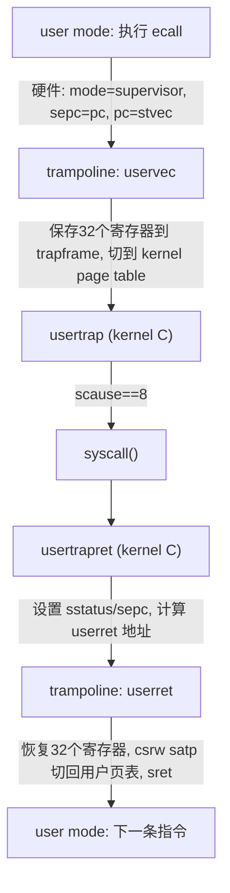

---
{"dg-publish":true,"permalink":"/knowledge/course/mit6.s081/04-Traps/","title":"6.S081 04 · 陷阱与系统调用进出","tags":["MIT6.1810","xv6","操作系统","课程笔记"],"dg-note-properties":{"title":"6.S081 04 · 陷阱与系统调用进出","tags":["MIT6.1810","xv6","操作系统","课程笔记"],"date":"2026-11-18","source":"https://pdos.csail.mit.edu/6.828/2020/schedule.html"}}
---


# 6.S081 · 04 陷阱与系统调用进出

> MIT 6.S081 / 6.1810 · Operating System Engineering
> 教材：xv6: a simple, Unix-like teaching operating system（RISC-V 版）
> 本节基于 xv6-riscv 源码

返回 [[knowledge/course/mit6.s081/index\|📚 6.S081 目录]] · [[knowledge/course/index\|📚 课程资源]] · [[首页\|🏠 首页]]

---

## trap 机制

用户程序和内核的切换被称为 `trap`，主要发生在三种情况下：

1. 用户程序执行系统调用；
2. 用户程序执行时发生 `page fault`，运算时出现除以 0 等错误；
3. 设备触发中断。

在 `trap` 的过程中，需要将硬件转化成适合内核运行的状态，最重要的就是寄存器。寄存器的性能是最佳的，所以我们既希望它可以被用户程序使用，也可以被内核使用。

参与切换的寄存器可以分成两部分：用户可见的 32 个通用寄存器（含栈寄存器 `sp`），以及一组控制和状态寄存器（CSR）。trap 前后关键寄存器的角色如下表：

| 寄存器 | 含义 | trap 之后的状态 |
| --- | --- | --- |
| `ra` `sp` `gp` `tp` `t0-t6` `s0-s11` `a0-a7`（共 32 个） | 用户通用寄存器，含 `sp` | 全部保存进 `trapframe`，返回前恢复 |
| `PC` | 程序计数器 | 保存到 `sepc`（内核再存到 `trapframe->epc`） |
| `MODE` | 当前特权级（user / supervisor） | 由硬件改为 supervisor mode |
| `STVEC` | 内核处理 `trap` 的代码入口地址 | 硬件跳转到 `STVEC` 指向的 `trampoline` |
| `SATP` | 当前页表的物理地址 | 硬件**不**修改，仍为用户页表，由 `uservec` 软件切换 |
| `SEPC` | 保存陷入时的 `PC` | 被硬件写入用户 `pc` |
| `SSCRATCH` | 暂存 `trapframe` 地址的临时寄存器 | 与 `a0` 交换，得到 `trapframe` 地址 |

在 `trap` 开始的时候，需要做以下几件事：

1. 保存 32 个用户寄存器，切换回来的时候将它们恢复，这样做的效果在于让用户程序意识不到发生了 `trap`。
2. 用户程序此时的 `PC` 也将被保存到 `SEPC`。
3. `MODE` 改成 `supervisor mode`。
4. `SATP` 从指向 user page table 改为指向 kernel page table。
5. 跳入内核的 C 程序中。

还有两件事需要注意：

1. 从隔离性和安全性的角度考虑，`trap` 的机制不管是硬件还是内核部分都不能依赖用户空间，比如只能保存寄存器，而不能信任里面的数据。
2. `supervisor mode` 较于 `user mode` 所能做的事情其实很有限，==只有两点==：
   1. read/write 寄存器 —— `SATP`、`STVEC`、`SEPC`、`SSCRATCH`。
   2. 访问 `PTE_U=0` 的地址（反过来，不能访问 `PTE_U=1` 的地址）。

## trap 执行流程

一次用户态系统调用的完整路径如下：用户程序执行 `ecall` → 硬件切换到 supervisor mode 并跳到 `stvec` 指向的 `trampoline`（`uservec`）→ `uservec` 保存全部寄存器、切换到内核页表并跳到 `usertrap` → `usertrap` 调用 `syscall()` → 返回时 `usertrapret` 准备好 `sstatus`、`sepc`、`satp` 并调用 `userret` → `userret` 恢复寄存器并执行 `sret` 回到用户态。



**接下来通过在 `sh` 程序中系统调用 `write` 来具体阐述 `trap` 的发生过程。**

## ecall 指令之前的状态

来看 `sh.asm`，注意 `write` 的第一条指令地址为 `0xdea`：

```asm
0000000000000dea <write>:
.global write
write:
 li a7, SYS_write
     dea:	48c1                	li	a7,16
 ecall
     dec:	00000073          	ecall
 ret
     df0:	8082                	ret
```

于是在 gdb 中在 `0xdea` 处设置断点：

```sh
(gdb) b *0xdea
(gdb) c
```

注意此时还没有调用 `ecall`，让我们查看此时的各种状态信息：

* 首先查看 `pc`：

  ```gdb
  (gdb) p $pc
  $1 = (void (*)()) 0xdea <write>
  ```

  这正是我们设置断点的位置，需要注意的是 `0xdea` 是函数指针类型的地址。

* 然后查看 `satp`：

  ```gdb
  (gdb) p/x $satp
  $2 = 0x8000000000000000
  ```

  但这只告诉了我们 `satp` 存放页表的物理地址，于是在 `qemu` 的界面键入 `ctrl a+c` 进入 `qemu` 的 console，输入 `info mem` 便可以看到页表信息：

  ```text
  qemu> info mem
  virt            phys            size  attr
  0x0000000000000000 0x0000000087f5e000 0x1000  rwxu   # shell 代码/数据段
  0x0000000000001000 0x0000000087f5f000 0x1000  rwxu
  0x0000000000002000 0x0000000087f60000 0x1000  ----   # guard page
  0x0000000000003000 0x0000000087f61000 0x1000  rwxu   # stack page
  0x3ffffff000       0x0000000087f62000 0x1000  rw--   # trapframe page（无 PTE_U）
  0x3fffffe000       0x0000000087f63000 0x1000  r-x-   # trampoline page（无 PTE_U）
  ```

  *标志位 `a`（accessed）表示该 pte 是否被使用过，`d`（dirty）表示该 pte 是否被写过。*

  可以看到 `shell` 的地址分布：

  1. `0x0000` 到 `0x1000` 为 `shell` 的代码和数据段；
  2. `0x2000` 是 guard page；
  3. `0x3000` 是 stack page。

  需要注意的是 `shell` 是一个小程序，地址都很低，而页表中两个很高的地址分别为 `trapframe page` 和 `trampoline page`，它们都没有设置 `PTE_U`。

* 还可以查看 `a0`、`a1` 和 `a2` 寄存器：

  ```gdb
  (gdb) p/x $a0
  $3 = 0x1        # 文件描述符（stdout）
  (gdb) p/x $a1
  $4 = 0x3fffe000 # 指向待写字符串，位于用户栈上
  (gdb) p/x $a2
  $5 = 0x3        # 写入的字符数
  ```

  * `a0`：文件描述符；
  * `a1`：`shell` 想要写的字符串的指针，可以看到字符串在栈上；
  * `a2`：写入的字符数。

* 最后可以查看所有寄存器：

  ```shell
  info reg
  ```

  也可以查看 `write` 函数的指令：

  ```shell
  x/3i 0xdea
  ```

## ecall 指令后的状态

这里有个大坑，那就是不能使用 `gdb-multiarch` 来调试，如果从 `ecall` 处 `si`，并不能跳进内核空间，需要安装 `riscv-gnu-toolchain`（如何安装在 `配置环境.md` 里讲解），并使用

```shell
make CPUS=1 qemu-gdb
```

```shell
riscv32-unknown-elf-gdb kernel/kernel
```

进行调试。`si` 进入，`pc` 从一个很低的地址跳到了很高的地址，这实际进入了 `trampoline page`：

```gdb
(gdb) p/x $pc
$1 = 0x3fffffe000      # trampoline page 起始地址
```

此时 `ecall` 已经完成了这几件事：

1. 更改 `mode` 寄存器，完成从 user mode 到 supervisor mode 的转换（`trampoline page` 的 `PTE_U` 并没有设置，这保证了 `trap` 机制的安全）。
2. 将用户空间 `pc` 的值保存在 `sepc` 寄存器里，打印此时 `sepc` 的值，可以看到保存的正是前面 `ecall` 指令的地址：

   ```gdb
   (gdb) p/x $sepc
   $2 = 0xdec      # 即 ecall 指令地址（0xdea 之后的下一条指令）
   ```

3. 跳转到 `stvec` 寄存器指向的指令，这正是 `trampoline page` 的开始地址（这里是 `trap` 开始的位置）：

   ```gdb
   (gdb) p/x $stvec
   $3 = 0x3fffffe000   # trampoline page 起始地址，与当前 pc 相同
   ```

这都是硬件完成的，这似乎做得太少了，`ecall` 并没有完成以下的操作：

1. 没有更改 `satp`，这意味着此时依然在使用用户页表，某种程度上，这也是为什么每一个用户页表都需要设置到 `trampoline page` 的映射却不设置 `PTE_U` 的原因。（验证一下，在 `qemu` 的控制台打印页表，和 `ecall` 之前完全一样）

   ```text
   qemu> info mem
   virt            phys            size  attr
   0x0000000000000000 0x0000000087f5e000 0x1000  rwxu
   0x0000000000001000 0x0000000087f5f000 0x1000  rwxu
   0x0000000000002000 0x0000000087f60000 0x1000  ----
   0x0000000000003000 0x0000000087f61000 0x1000  rwxu
   0x3ffffff000       0x0000000087f62000 0x1000  rw--
   0x3fffffe000       0x0000000087f63000 0x1000  r-x-
   ```

   与 `ecall` 之前完全相同，仍是用户页表。

2. 没有保存或者使用 32 个用户寄存器，尤其是没有改变 `sp` 寄存器，所以栈寄存器依然指向用户栈而非内核栈：

   ```gdb
   (gdb) p/x $sp
   $4 = 0x3fffe000    # 仍是用户栈地址，没有切换到内核栈
   ```

以上 `ecall` 没做的都是软件需要完成的。本节还讲解了 `risc-v` 为什么要这么设计而不去做这些软件的工作。

* **设计原则**：`risc-v` 的设计原则是尽量少地完成必要的工作。
* **灵活性**：不做这些工作的结果就是给 OS 的设计者提供最大程度的自由。
  1. 比如如果用户页表和内核页表拥有共同的映射，那么系统调用时，OS 甚至可以设计在部分场景下不切换页表。
  2. 在 `trap` 的过程中，某些寄存器可以不用保存，`ecall` 不保存寄存器的设计可以让 OS 选择性地保存寄存器。
  3. 在某些简单的系统调用中，甚至不需要栈，那么 `sp` 都不需要切换。

## uservec

我们现在要做 `ecall` 以上未做的几件事。观察 `trampoline.S` 汇编代码。

1. ```assembly
   csrrw a0,sscratch,a0
   ```

   `csrrw` 指令的作用是交换 `a0` 和 `sscratch` 的寄存器内容，交换后 `a0` 保存的地址就是 `trapframe` 的地址：

   ```gdb
   (gdb) p/x $a0
   $1 = 0x3ffffff000    # trapframe page 的起始地址
   ```

   我们可以在 `proc.h` 里看到 `trapframe` 的结构。

   *在这里打断一下，那就是 `sscratch` 是什么时候保存的 trapframe 地址的？*

   1. 机器启动后都是由内核跳入用户空间，而这一过程都是由 `sret` 指令完成的，此时 `a0` 保存了 `trapframe` 地址。

      ```assembly
      # usertrapret 末尾，fn(TRAPFRAME, satp) 调用前
      ld a0, TRAPFRAME   # a0 = TRAPFRAME 地址，作为 fn 的第一个参数传入
      ...
      sret
      ```

   2. 那么 `a0` 是如何获得的？看 `trap.c` 里 `usertrapret` 函数，传入函数 `fn` 的第一个参数保存在 `a0` 上：

      ```c
      uint64 fn = TRAMPOLINE + (userret - trampoline);
      ((void (*)(uint64,uint64))fn)(TRAPFRAME, satp);   // 参数1 → a0, 参数2 → a1
      ```

      ==这里 `fn` 和强制转化为函数指针的用法将在后面的部分解释。==

   `trapframe` 的完整字段布局（偏移量即注释里的数字，全部为 8 字节）：

   ```c
   struct trapframe {
     /*   0 */ uint64 kernel_satp;   // kernel page table
     /*   8 */ uint64 kernel_sp;     // top of process's kernel stack
     /*  16 */ uint64 kernel_trap;   // usertrap()
     /*  24 */ uint64 epc;           // saved user program counter
     /*  32 */ uint64 kernel_hartid; // saved kernel tp
     /*  40 */ uint64 ra;
     /*  48 */ uint64 sp;
     /*  56 */ uint64 gp;
     /*  64 */ uint64 tp;
     /*  72 */ uint64 t0;
     /*  80 */ uint64 t1;
     /*  88 */ uint64 t2;
     /*  96 */ uint64 s0;
     /* 104 */ uint64 s1;
     /* 112 */ uint64 a0;
     /* 120 */ uint64 a1;
     /* 128 */ uint64 a2;
     /* 136 */ uint64 a3;
     /* 144 */ uint64 a4;
     /* 152 */ uint64 a5;
     /* 160 */ uint64 a6;
     /* 168 */ uint64 a7;
     /* 176 */ uint64 s2;
     /* 184 */ uint64 s3;
     /* 192 */ uint64 s4;
     /* 200 */ uint64 s5;
     /* 208 */ uint64 s6;
     /* 216 */ uint64 s7;
     /* 224 */ uint64 s8;
     /* 232 */ uint64 s9;
     /* 240 */ uint64 s10;
     /* 248 */ uint64 s11;
     /* 256 */ uint64 t3;
     /* 264 */ uint64 t4;
     /* 272 */ uint64 t5;
     /* 280 */ uint64 t6;
   };
   ```

   前 5 个字段（偏移 0–32）是内核侧预置的、进入内核后立刻要用的信息，从偏移 40 开始依次是 31 个用户寄存器（`a0` 暂未保存，留在 `sscratch` 里）。

2. 跳入内核后的第二条指令是把 `ra` 寄存器的内容存到内存中 `a0+40` 的位置：

   ```assembly
   sd ra, 40(a0)     # trapframe->ra = ra
   ```

   此后做的指令基本相似，就是把其余 30 个用户寄存器依照 `trapframe` 的布局逐一保存：

   ```assembly
   sd sp,  48(a0)
   sd gp,  56(a0)
   sd tp,  64(a0)
   sd t0,  72(a0)
   sd t1,  80(a0)
   sd t2,  88(a0)
   sd s0,  96(a0)
   sd s1, 104(a0)
   sd a1, 120(a0)
   sd a2, 128(a0)
   ...
   sd t6, 280(a0)
   ```

   在这一部分的结尾，还做了一个小操作：

   ```assembly
   # save the user a0 in p->trapframe->a0
   csrr t0, sscratch
   sd t0, 112(a0)
   ```

   把原 `a0` 的值也保存在 `trapframe` 上（`sscratch` 依然保留了原 `a0` 的值）。

   *==Q：其实我有点好奇为什么不直接利用 `sscratch` 加上偏移值得到用户寄存器加载到内存的地址？==*

3. 刚才我们把用户寄存器的内容一一存在 `trapframe` 上，现在从 `trapframe` 取一些值到寄存器上，更新栈指针，将 cpuid 放到 `tp` 寄存器上，将 `usertrap` 放到 `t0` 寄存器上，更新页表：

   ```assembly
   # restore kernel stack pointer from p->trapframe->kernel_sp
   ld sp, 8(a0)          # 内核栈顶
   # load the address of usertrap()
   ld t0, 16(a0)         # t0 = usertrap
   # load the kernel page table
   ld t1, 0(a0)          # t1 = kernel_satp
   ld t2, 32(a0)         # t2 = hartid
   # restore tp
   mv tp, t2
   # switch to kernel page table
   csrw satp, t1
   sfence.vma zero, zero
   ```

   我们跳到 `sfence.vma`，看看此时的栈指针和页表：

   ```gdb
   (gdb) p/x $sp
   $2 = 0x3f8000000000     # 已是内核栈地址，不再是 0x3fff... 的用户栈
   ```

   ```text
   qemu> info mem
   virt            phys            size  attr
   0x0000000080000000 0x0000000080000000 0x1000 rwx-
   0x0000000080001000 0x0000000080001000 0x1000 rw--
   ...                                    # 大量内核直接映射
   0x0000003f80000000 0x0000000087f61000 0x4000 rw--   # 该进程的内核栈
   0x0000003ffffff000 0x0000000087f62000 0x1000 rw--
   0x0000003fffffe000 0x0000000087f63000 0x1000 r-x-
   ```

   这是完全不一样的很长的页表。从栈顶指针 `0x3f8000000000` 可以推断出 `sh` 是第二个进程（内核栈按进程槽位排列）。

4. 最后执行：

   ```assembly
   jr t0
   ```

   `uservec` 将跳入 `usertrap` 函数。

* 可以看到 `trampoline page` 的神奇之处：这段代码在所有用户和内核的页表有完全一样的映射，所以切换页表时程序不会崩溃。而每个用户进程有它们独享的 `trapframe`，虽然它们自己并不能访问。

## usertrap

[这里如果要使用 `TUI` 工具又有坑……需要重新编译工具链，怎么坑那么多，重新编译真的很费时间好吧……](https://stackoverflow.com/questions/67162162/the-gdb-in-my-machine-does-not-support-tui-display)

现在跳进 `usertrap`，下面分步讲解这里的代码。

* ```c
  w_stvec((uint64)kernelvec);
  ```

  首先做的是更改 `stvec` 寄存器的内容。之前已经知道该寄存器存放的是处理 `trap` 的最初代码的地址，然而那是处理来自用户空间的 `trap`；`trap` 也可能由内核空间发起，这里切换后 `stvec` 存放的 `kernelvec` 正是处理内核空间 `trap` 代码的地址。

* ```c
  struct proc *p = myproc();
  ```

  确定用户空间运行的进程。之前我们已经多次调用了 `myproc` 函数，现在来看看它是如何工作的：

  1. ```c
     struct proc*
     myproc(void) {
       push_off();
       struct cpu *c = mycpu();
       struct proc *p = c->proc;
       pop_off();
       return p;
     }
     ```

     首先需要知道确认发生 `trap` 的 cpu。

  2. ```c
     int
     cpuid()
     {
       int id = r_tp();
       return id;
     }
     ```

     而确定 cpu 的方法正是从 `tp` 寄存器里取，在 `uservec` 做的一个工作正是把用户进程 `trapframe` 里的 `kernel_hartid` 放进 `tp` 寄存器。

* ```c
  p->trapframe->epc = r_sepc();
  ```

  在 `trapframe` 中保存用户程序的计数器。由于在内核中可能会切换到另一个进程，`sepc` 寄存器就会被覆盖；将计数器保存在 `trapframe` 以后，当我们需要恢复该进程的时候，就可以取 `trapframe` 上的 `epc`。再次提醒，==每个用户进程拥有它独享的 `trapframe`==。

* 在 `scause` 寄存器中，存放着进入 `trap` 的原因。

  *我想有一个问题需要注意，那就是像把 trap 的原因放入 `scause` 这些 OS 没有参与的工作基本都是硬件做的，之后不再赘述。*

  ```c
    if(r_scause() == 8){

      if(p->killed)
        exit(-1);
      p->trapframe->epc += 4;
      intr_on();

      syscall();
    }
  ```

  1. 读取 `scause` 寄存器的值，确认是 8 —— 即为系统调用之后进入；
  2. 如果该进程被杀死了，那么退出；
  3. 由于系统调用进入 `trap` 的指令是 `ecall`，和后面要说的中断不同，不需要再执行一遍此指令，于是 `epc` 加上 4（`ecall` 指令为 4 字节），`trap` 返回时直接执行下一个指令；
  4. `trap` 的硬件会把中断关闭，但系统调用又需要中断，所以这里显式打开。

  然后进入 `syscall` 进行系统调用。

  `scause` 的常见取值与含义对照：

  | `scause` | 含义 |
  | --- | --- |
  | 8 | 用户态 `ecall`（系统调用） |
  | 12 | instruction page fault |
  | 13 | load page fault |
  | 15 | store page fault |
  | 最高位置 1 时 | 外部/软件/定时器中断 |

* 我们略过系统调用的函数，直接来看看之后的操作：

  ```c
  if(p->killed)
      exit(-1);
  usertrapret();
  ```

  确认用户进程没有被杀死，进入 `usertrapret` 函数。

## usertrapret

* ```c
  intr_off();
  ```

  关中断，这是因为接下来一步里，将把 `stvec` 寄存器的内容修改成用户空间发生 `trap` 时跳入的代码，如果此时在内核发生中断，那么会发生错误。

* 修改 `stvec` 寄存器的内容成 `uservec`：

  ```c
  w_stvec(TRAMPOLINE + (uservec - trampoline));
  ```

* ```c
  p->trapframe->kernel_satp = r_satp();         // kernel page table
  p->trapframe->kernel_sp = p->kstack + PGSIZE; // process's kernel stack
  p->trapframe->kernel_trap = (uint64)usertrap;
  p->trapframe->kernel_hartid = r_tp();         // hartid for cpuid()
  ```

  和 `uservec` 的部分操作做镜像。

  但我有点好奇，`trapframe` 在 `trap` 中会被修改吗？如果没有，那么需要做这些操作吗？

  ==我的理解这是第一次从内核进入用户空间的时候做的操作，或者说这是 `trapframe` 初始化的一部分。==

* ```c
    unsigned long x = r_sstatus();
    x &= ~SSTATUS_SPP; // clear SPP to 0 for user mode
    x |= SSTATUS_SPIE; // enable interrupts in user mode
    w_sstatus(x);
  ```

  设置 `sstatus` 寄存器，`sret` 指令将根据 `sstatus` 的标志位工作：

  1. 设置 SSTATUS_SPP 为 0，则返回 user mode；
  2. 设置 SSTATUS_SPIE 为 1，则返回用户空间后打开中断。

* 生成 SATP 值：

  ```c
  uint64 satp = MAKE_SATP(p->pagetable);
  ```

* ```c
  uint64 fn = TRAMPOLINE + (userret - trampoline);
  ((void (*)(uint64,uint64))fn)(TRAPFRAME, satp);
  ```

  这部分是跳入 `userret` 的汇编中。由于编译的时候并不能确认 `userret` 的地址，所以需要通过计算得到。另外需要将该地址强制类型转化为函数指针后，传递两个参数进入函数。传递的参数 `TRAPFRAME` 保存在 `a0` 寄存器，`satp` 保存在 `a1` 寄存器中。

* **另外这里有一点需要注意：我们在内核 C 程序可以修改 `sepc` 这样的寄存器，却不能修改那 32 个用户寄存器，这一工作需要汇编语言来完成，因此 `usertrapret` 并不能恢复用户寄存器，这一工作将由 `trampoline` 完成。**

## userret

回到 `trampoline` 的代码。

* ```assembly
      # switch to the user page table.
        csrw satp, a1
        sfence.vma zero, zero
  ```

  `csrw a, b` 做的就是把 b 加载到 a 里而 b 不变；`csrrw a, b, c` 做的才是交换 a、c 的值。这里切换回用户页表（`a1` 中是 `usertrapret` 算好的用户 `satp`）。

* ```assembly
       # put the saved user a0 in sscratch, so we
        # can swap it with our a0 (TRAPFRAME) in the last step.
        ld t0, 112(a0)
        csrw sscratch, t0
  ```

  将 `p->trapframe->a0`（偏移 112）加载到 `t0`，再写进 `sscratch`。`t0` 寄存器只是一个无情的中间寄存器（为什么这样子）。

* 和 `uservec` 做镜像操作，恢复用户寄存器：

  ```assembly
  ld ra, 40(a0)
  ld sp, 48(a0)
  ld gp, 56(a0)
  ld tp, 64(a0)
  ld t0, 72(a0)
  ld t1, 80(a0)
  ld t2, 88(a0)
  ld s0, 96(a0)
  ld s1, 104(a0)
  ld a1, 120(a0)
  ld a2, 128(a0)
  ...
  ld t6, 280(a0)
  ```

* ```assembly
  	# restore user a0, and save TRAPFRAME in sscratch
        csrrw a0, sscratch, a0

        # return to user mode and user pc.
        # usertrapret() set up sstatus and sepc.
        sret
  ```

  交换 `a0` 和 `sscratch`：`sscratch` 又保存 `trapframe` 地址，`a0` 保存系统调用返回值。

  `sret` 做这样几件事：

  1. 切换成 user mode；
  2. 将 `sepc` 寄存器内容拷贝到 `pc` 中。

* 跳到下一个指令，一切回到最初的模样：`a0` 里是 `write` 的返回值，`trapframe` 地址又回到 `sscratch`，为下一次 `trap` 做好准备。

整轮进出中 `sscratch` 的取值变化可以概括为：

| 时刻 | `sscratch` 内容 | `a0` 内容 |
| --- | --- | --- |
| 用户态正常运行 | `trapframe` 地址 | 用户自己的 `a0` |
| `uservec` 执行 `csrrw` 后 | 用户原 `a0` | `trapframe` 地址 |
| `uservec` 用 `csrr t0, sscratch` 存完 `a0` 后 | 用户原 `a0` | `trapframe` 地址 |
| `usertrap` / `usertrapret` 期间 | 用户原 `a0` | C 代码使用 |
| `userret` 执行 `csrrw a0, sscratch, a0` 后 | `trapframe` 地址 | 用户原 `a0`（即系统调用返回值） |
