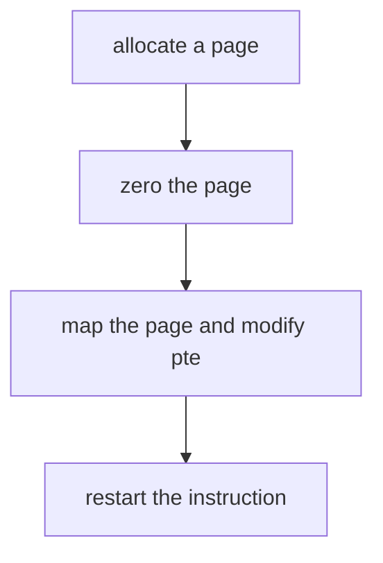
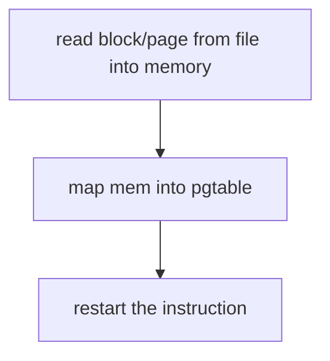

---
{"dg-publish":true,"permalink":"/knowledge/course/mit6.s081/05-Page-Faults/","title":"6.S081 05 · 缺页异常","tags":["MIT6.1810","xv6","操作系统","课程笔记"],"dg-note-properties":{"title":"6.S081 05 · 缺页异常","tags":["MIT6.1810","xv6","操作系统","课程笔记"],"date":"2026-11-18","source":"https://pdos.csail.mit.edu/6.828/2020/schedule.html"}}
---


# 6.S081 · 05 缺页异常

> MIT 6.S081 / 6.1810 · Operating System Engineering
> 教材：xv6: a simple, Unix-like teaching operating system（RISC-V 版）
> 本节基于 xv6-riscv 源码

返回 [[knowledge/course/mit6.s081/index\|📚 6.S081 目录]] · [[knowledge/course/index\|📚 课程资源]] · [[首页\|🏠 首页]]

---

fault 听上去不是一个好词，然而 page fault 却是一个很精巧的机制。本讲将讲述基于它实现的几个功能：

* **lazy allocation**
* **zero fill on demand**
* **cow (copy-on-write fork)**
* **demand paging**
* **mmap (memory mapped files)**

在目前的 xv6 这些一个都没有实现，之后的多个实验需要完成这些功能。事实上，在目前的 `usertrap()` 可以看到，如果发生了 page fault，那么进程直接被杀死了：

```c
 } else {
    printf("usertrap(): unexpected scause %p pid=%d\n", r_scause(), p->pid);
    printf("            sepc=%p stval=%p\n", r_sepc(), r_stval());
    p->killed = 1;
 }
```

虚拟内存有两个优点：

1. **Isolation**
2. **level of indirection**

隔离性（Isolation）已经在之前的 Lecture 中很好地被展示了，这层抽象（level of indirection）却似乎有点无聊。因为在目前的映射关系基本都是静态的，甚至除了 `trampoline page` 和 `trapframe page` 以外，虚拟和物理地址之间都是直接映射；而通过 page fault，我们将可以**动态地**更新 page table。

## page fault 需要的信息

page fault 和 syscall 一样进入 `trap`，那么 `trap` 过程中内核需要哪些信息才能处理 page fault 呢？

* **出错的虚拟地址**，发生 page fault 时由硬件存放在 `stval` 寄存器中。

* **出错的原因**，发生 page fault 时由硬件存放在 `scause` 寄存器中。按 RISC-V 手册，page fault 有三种：

  | Exception code | 名称 | 典型场景 |
  | --- | --- | --- |
  | 12 | Instruction page fault | 如 `jr a1`，`a1` 的地址出错 |
  | 13 | Load page fault | 如 `ld a1, (a2)`，`a2` 的地址出错 |
  | 15 | Store page fault | 如 `sd a1, (a2)`，`a2` 的地址出错 |

  还可以看到，我们通过 `ecall` 进入内核时 `scause` 对应 8。

* **出错指令的地址**：在 Lecture 4 中我们知道，硬件会把 `pc` 的值保存到 `sepc`，而内核会保存 `sepc` 值到 `trapframe->epc`。因为处理完 page fault 以后，我们将重新执行该指令，因此保存它是有必要的。

## Lazy page allocation

### Eager page allocation

用户进程的地址空间自低向高依次是 text、data、bss（未初始化数据）、heap，heap 之上是用户栈。如果用户需要更多的内存，会使用系统调用 `sbrk`：

```text
低地址                                                    高地址
+--------+--------+--------+------------------------+----------+
| text   | data   | bss    | heap →（sbrk 向右增长） |  stack   |
+--------+--------+--------+------------------------+----------+
                            ↑ 旧 sz        ↑ 新 sz = 旧 sz + n
```

```c
uint64
sys_sbrk(void)
{
  int addr;
  int n;

  if(argint(0, &n) < 0)
    return -1;
  addr = myproc()->sz;
  if(growproc(n) < 0)
    return -1;
  return addr;
}
```

`sbrk` 会增加用户进程的大小，扩大 heap 区，并分配物理内存建立与新 heap 区的映射，这就是 eager page allocation。而用户程序往往并不知道自己需要多少内存，所以它会倾向于申请明显多于自己需要的内存，这就会导致一个问题：有一些物理内存可能进程一直用不到。这不是一个大问题，但可能会带来浪费。

### modify `sbrk`

利用 page fault 可以采取一个更聪明的机制 —— lazy page allocation。对于 `sbrk` 修改代码如下：

```c
uint64
sys_sbrk(void)
{
  int addr;
  int n;

  if(argint(0, &n) < 0)
    return -1;
  addr = myproc()->sz;
  myproc()->sz=myproc()->sz+n;
 // if(growproc(n) < 0)
 //  return -1;
  return addr;
}
```

现在，我们只增长进程的大小，却不给它建立新 heap 区和物理内存的映射。进程会以为自己已经增长了内存，因此可以访问 `sz` 到 `sz+n` 的地址，当它去访问的时候，就会触发 page fault。*遇到问题，[这样解决](https://itcn.blog/p/30081334288.html)。*

看看效果：boot 以后键入 `echo hi`，会得到一个 page fault。这是因为 `shell` 会先 fork 出一个子进程，而子进程会通过 `exec` 执行 `echo`。在这个过程中，`shell` 会调用 `sbrk` 来申请一些内存，然后出错。观察输出信息，可以看到：

```text
$ echo hi
usertrap(): unexpected scause 0xf pid=3
            sepc=0x12a8 stval=0x4008
```

* `scause` = 0xf，pid = 3，这说明这是一个 `store` page fault，且发生在 pid=3 的进程，这应该是 `shell`；
* `sepc` = 0x12a8，这是发生 page fault 的指令地址；
* `stval` = 0x4008，这是触发 page fault 的虚拟内存地址。

查看 `shell` 汇编中 0x12a8，正是一个 `store` 指令：

```asm
    12a4: ...
    12a8: 00b7a023        sd  a1, 0(a5)     # 触发 store page fault
```

沿着 0x12a8 向前看，会发现它属于 `malloc` 函数：

```asm
00000000000012xx <malloc>:
    ...
    12a8: 00b7a023        sd  a1, 0(a5)
    ...
```

这是非常合理的，因为 `malloc` 的实现正是通过 `sbrk`。这说明前面调用了 `sbrk`，然后这里想要储存寄存器的内容到并没有建立映射的 heap 中，然后发生错误。另一个佐证就是 `shell` 开始只有 4 个 page，而无法访问的内存地址为 0x4008，这是第 5 个 page 的地址。

### modify trap

现在 xv6 的 `trap` 也需要修改了，它需要添加 page fault handler 做以下这几件事：



修改 `usertrap()`，添加对 page fault 的处理：

```c
 } else if((which_dev = devintr()) != 0){
    // ok
  }else if(r_scause()==15){
    //page fault handler
    uint64 va=r_stval();
    printf("page fault %p\n",va);
    uint64 ka=(uint64)kalloc();
    if (ka==0){
      p->killed=1;
    }else{
      memset((void*)ka,0,PGSIZE);
      va=PGROUNDDOWN(va);
      if (mappages(p->pagetable,va,PGSIZE,ka,PTE_U | PTE_R | PTE_W)!=0){
        kfree((void*)ka);
        p->killed=1;
      }
    }
  }
```

现在应该可以 work 了吧，然而 `echo hi` 却出现以下信息：

```text
$ echo hi
page fault 0x4008
panic: uvmunmap: not mapped
```

出现了新的 page fault，这说明第一个 page fault 已经被处理了。但 `uvmunmap` 在报错，这是为什么？其实很好理解：用户空间的部分地址最开始并没有建立映射，也没有因为发生 page fault 建立映射，那么当然会发生 not mapped。所以最后还需要修改 `uvmunmap` 函数。

### modify `uvmunmap`

把

```c
    if((*pte & PTE_V) == 0)
      panic("uvmunmap: not mapped");
```

改为

```c
    if((*pte & PTE_V) == 0)
      //panic("uvmunmap: not mapped");
      continue;
```

现在就 ok 了，我们将在 `lazy lab` 实现更多。

```text
$ echo hi
hi
```

## Zero Fill On Demand

用户进程的地址空间除了 data 区和 text 区以外，还有 bss 区，这里存放未初始化或者初始化为 0 的全局或者静态变量。

```text
+---------+---------+-------------------------+
|  text   |  data   |  bss（全为 0，可多页）   |
+---------+---------+-------------------------+
                      ↑ 所有虚拟页都映射到同一个物理页
                      物理内存: [ zero page ]  ← 只分配一个
```

编译之后，生成的数据存放在外存；当我们执行 `exec` 将数据加载到内存的时候，可以运用一些 tricks：比如 bss 区既然全是 0，而且里面也许有很多 page，那么我们在内存只分配一个物理 page，让 bss 区所有虚拟地址 page 都映射到该 page 上。

==但此时需要将 bss 区对应的 PTE 设置为只读，而不能写==，这样写入该区内存的指令就会触发 page fault。同 lazy allocation 一样，我们分配物理内存并建立映射，并注意设置触发页的 PTE 可读可写，最后重新执行指令。

* 到目前为止，我们已经见识了基于 page fault 可以做些节省物理内存的工作，但这是**有代价的**：在 `trap` 的 Lecture 中我们已经见识了 `trap` 的需要相当大量的指令，这意味着时间的代价是不可忽略的。

## Copy On Write Fork

回顾运行 `echo` 的过程：`shell` 会 fork 一个和自己拥有完全一样地址空间的子进程，随后子进程调用 `exec`，舍弃子进程的地址空间，取而代之的是包含了 `echo` 的地址空间。

观察原来 `fork` 的代码，它调用的 `uvmcopy` 函数做的是创建新的物理内存，并把父进程的内容一页一页地拷贝进去，并建立映射：

```c
 // Copy user memory from parent to child.
  if(uvmcopy(p->pagetable, np->pagetable, p->sz) < 0){
    freeproc(np);
    release(&np->lock);
    return -1;
  }

int
uvmcopy(pagetable_t old, pagetable_t new, uint64 sz)
{
  pte_t *pte;
  uint64 pa, i;
  uint flags;
  char *mem;

  for(i = 0; i < sz; i += PGSIZE){
    if((pte = walk(old, i, 0)) == 0)
      panic("uvmcopy: pte should exist");
    if((*pte & PTE_V) == 0)
      panic("uvmcopy: page not present");
    pa = PTE2PA(*pte);
    flags = PTE_FLAGS(*pte);
    if((mem = kalloc()) == 0)
      goto err;
    memmove(mem, (char*)pa, PGSIZE);
    if(mappages(new, i, PGSIZE, (uint64)mem, flags) != 0){
      kfree(mem);
      goto err;
    }
  }
  return 0;

 err:
  uvmunmap(new, 0, i / PGSIZE, 1);
  return -1;
}
```

考虑到 `exec` 之后，子进程的地址空间将会被完全舍弃，这里逐页拷贝父进程内容的行为就显得有些浪费。所以我们可以优化的一件事就是用 cow（copy on write）fork 来替代 fork。cow fork 不会去创建新物理内存和拷贝，而是直接把子进程的虚拟内存映射到父进程的物理内存上：

```text
fork 之前:            父进程 ---> [物理页 A]
cow fork 之后:        父进程 ---> [物理页 A] ←--- 子进程
                    两边 PTE 都清掉 PTE_W，只保留 PTE_R
写时:                 写方触发 store page fault → 拷贝一份 [物理页 A'] → 只把写方的 PTE 改回可写
```

这时候对 PTE 的设置无疑需要比前一节更小心，因为我们不希望进程间会发生内存被对方写的情况。为了保证隔离性，我们设置父与子进程的 PTE 都只为**可读**。当我们想要向父或者子进程的内存写入时，就会触发 page fault —— 没错，熟悉的感觉来了。

* 假设子进程使用 `store` 指令写入某页物理内存，page fault handler 做以下的处理。现在子进程的 pte 已经修改为可读可写，再重新运行指令就可以了。

  ```mermaid
  graph TD
  A[allocate a page]-->B[copy the page]-->c[map the page and modify pte]-->D[restart the instruction]
  ```

* **注意，lazy allocation 和 zero fill on demand 这两种机制由于新创建的内存全部填 0，所以可以使用相同的 page fault handler；但 cow fork 的 page fault handler 因为还需要拷贝原物理内存的内容，所以需要考虑新的 page fault handler。事实上 PTE 的 bit 9 标志位（RSW 软件可用位）可以用于识别出这是由于 cow fork 触发的 page fault**。

  ```text
  RISC-V PTE 位布局（64 位）：
  bit 63..54 | 53..10 | 9..8 | 7 | 6 | 5 | 4 | 3 | 2 | 1 | 0
   reserved  |  PPN   | RSW  | D | A | G | U | X | W | R | V
                        ↑
                    bit 9: 自定义为 PTE_C，标识 COW 页
  ```

* 最后需要注意一点：之前的用户进程物理内存（除了 `trampoline page`）只属于这个用户进程，所以结束进程的时候释放物理内存。但由于 cow fork 的存在，一块物理内存可能被多个用户进程共享，所以==需要对每一页物理内存维护一个引用计数==，当引用计数为 0 的时候，才能释放该页内存。

## Demand Paging

### Demanding Page (1)

回到开头那张地址空间布局图：当我们用 `exec` 加载 bss 段的时候只用了一个物理 page，把 data 和 text 段完整加载进了内存。

```text
exec 后的传统做法：
  text  [已读入内存，独占物理页]
  data  [已读入内存，独占物理页]
  bss   [多个虚拟页 → 同一个 zero page，只读]
```

按照前几小节的经验，为什么不等到需要 data 和 text 段的时候再加载这些内存呢？事实上，一个程序二进制文件需要占有的内存也许是很大的，没有必要全部加载到内存里。仿照之前的做法，我们干脆 `exec` 的时候不给 data 和 text 段建立映射，将 pte 的 valid 位设置为 0。

==这里和之前设置 pte 为可读的情况不同==，*因为调用 `exec` 的时候，是新进程覆盖原进程，原进程的物理内存数据是被舍弃的；由于新进程的文件数据压根没有加载进内存，此时物理内存连读都不可以，所以设置 pte 的 valid 位为 0。*

`exec` 终究是要执行新应用程序的，所以接下来会跳到应用程序的第一条指令也就是 text 段的地址为 0 处。这时候会触发 page fault。page fault handler 会做这几件事：



与之前不同在于，这时候需要考虑文件系统。在这里并没有说明这样的问题：

* 如何识别这是由于 demanding page 导致的 page fault？
* 既然不在 `exec` 的时候读文件，之后怎么读，需要保存文件描述符吗？

### Demanding page (2)

现在考虑更实际的问题：如果内存已经被耗尽，而此时又发生了 page fault，此时该怎么办呢？这不仅仅是 demanding page 的问题，而是所有的 page fault handler 都需要考虑的问题。策略很容易想到，那就是 **evict page**。接下来关键便在于 evict 哪个 page？

* 采取 LRU（Least Recently Used）策略，即选择最近最少被使用的 page。
  1. 每个 pte 有一个 dirty 位 —— 即 bit 7，用于标识该 page 是否被写过；
  2. 还有一个 access 位 —— 即 bit 6，用于标识该 page 是否被读或者被写过。

  ```text
  常用 PTE 位（xv6 命名）：
  bit 0  PTE_V  valid      页表项有效
  bit 1  PTE_R  可读
  bit 2  PTE_W  可写
  bit 3  PTE_X  可执行
  bit 4  PTE_U  用户可访问
  bit 6  PTE_A  access     是否被访问过（LRU 依据）
  bit 7  PTE_D  dirty      是否被写过（回写依据）
  bit 8  PTE_RSW / COW 标记见下
  ```

* 具体采用哪个标识位作为 LRU 策略 evict a page 可以取决于 OS 怎么设计。
* 如果用 access bit 进行排名，作为 LRU 策略的凭据，OS 还会做的事情就是定时恢复 access bit 为 0，比如每 100 ms 恢复一次，这样才能保证 access 位的有效性。

## Mmap（Memory Mapped Files）

### 系统调用 mmap

系统调用 mmap 是为了操纵文件，它的做法是把部分或者完整的文件加载到内存，然后使用 `store` 或者 `load` 来操纵文件数据。

### 参数

`mmap(va, len, prot, flags, fd, offset)`

* `va`：文件加载到内存的虚拟地址
* `len`：加载数据的长度
* `prot`：文件数据在内存中的权限，可读或者可写
* `flags`：标志位
* `fd`：打开的文件描述符
* `offset`：文件的偏移量

### unmap

结束对文件数据在内存的操作以后，会使用 `unmap` 的系统调用，将文件内存中 dirty bit 为 1 的页写回文件。

### Lazy 实现

OS 可以通过 lazy 的方法实现：`mmap` 的时候并不立马把文件拷贝进内存，而是通过一个 VMA 的结构体记录还没有加载进文件数据的虚拟内存所对应的文件描述符和偏移量。page fault 发生时，如果触发的虚拟内存在 VMA 记录的范围内，就加载文件的数据从磁盘到内存。同样的，之后使用 `unmap` 的系统调用将映射了文件数据的内存中 dirty bit 为 1 的页写回文件。

```text
struct VMA {
   uint64 addr;    // 起始虚拟地址
   uint64 length;  // 长度
   int    prot;    // 权限
   int    flags;
   struct file *f; // 文件描述符对应的 file
   uint64 offset;  // 文件内偏移
}
```

内核处理 mmap 相关 page fault 的判定顺序：

| 判定 | 条件 | 动作 |
| --- | --- | --- |
| 1 | `stval` 落在某 VMA 区间内 | 读文件对应 offset 的页，建立映射，重跑指令 |
| 2 | `stval` 不属于任何 VMA | 走普通 lazy / cow / 报错逻辑 |
| 3 | `unmap` 时 PTE_D==1 | 把该页写回文件 |
| 4 | `unmap` 时 PTE_D==0 | 直接丢弃，不用回写 |
