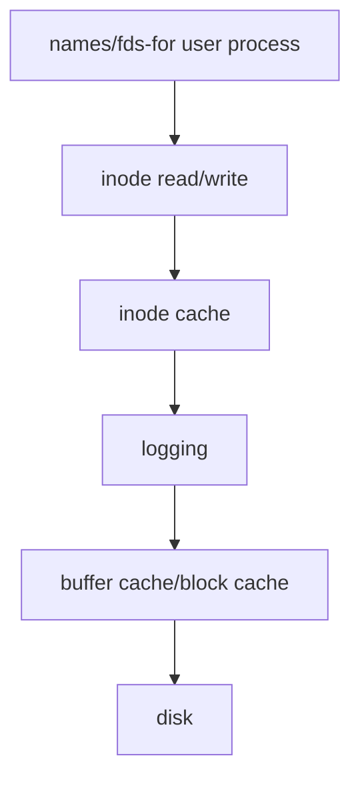

---
{"dg-publish":true,"permalink":"/knowledge/course/mit6.s081/10-File-System/","title":"6.S081 10 · 文件系统","tags":["MIT6.1810","xv6","操作系统","课程笔记"],"dg-note-properties":{"title":"6.S081 10 · 文件系统","tags":["MIT6.1810","xv6","操作系统","课程笔记"],"date":"2026-11-18","source":"https://pdos.csail.mit.edu/6.828/2020/schedule.html"}}
---


# 6.S081 · 10 文件系统

> MIT 6.S081 / 6.1810 · Operating System Engineering
> 教材：xv6: a simple, Unix-like teaching operating system（RISC-V 版）
> 本节基于 xv6-riscv 源码

返回 [[knowledge/course/mit6.s081/index\|📚 6.S081 目录]] · [[knowledge/course/index\|📚 课程资源]] · [[首页\|🏠 首页]]

---

现在来介绍文件系统，这将使用三讲的时间，这讲和下一讲将使用 Xv6，第三讲将基于 Linux。我们一直在使用文件系统，文件系统有如下的特性

* **User-friendly names/pathname**：文件系统提供了对于用户友好的文件名，也就是**层级**的路径文件名。这可以帮助用户组织目录中的文件。
* **Share files between users/processes**：通过将文件命名为易记的名字，可以便于用户之间和进程之间更简单地共享文件。
* **Persistence/durability**：我们已经看过了 Xv6 的诸多子系统——内存，进程等等，文件系统和他们最大的不一样便在于提供持久化。文件系统的持久化一个例子就是如果现在关闭了计算机，过几天文件依然在计算机的相同位置（disk 中），这和一旦计算机重启则会消失的进程等其他资源（在内存中）完全不同。

**我们现在要学习文件系统内部的机制**

## 文件系统的有趣机制

文件系统和 OS 其他子系统首先的不一样在于：它所在的硬件是速度通常远慢于内存的磁盘（disk）。文件系统内部还有一些比较有趣的机制：

* **Abstraction is useful**：还记得在 Lecture2 的时候，我们曾说过文件是对硬件（disk）的抽象，文件系统是如何做到这一点的？
* **Crash safety**：这和持久化有关，即如果使用文件系统的时候，计算机突然崩溃了。那么需要保证

  1. 重启以后计算机的文件系统依然保持完好。
  2. 磁盘上的文件数据依然存在，且用户可以使用大部分文件。
* **Disk layout**：和 memory layout 类似，在文件系统需要在**磁盘中**（重启的时候，数据能全部恢复）通过维护一些数据结构来表示文件或者目录的结构和内容，在 Xv6 中，这些数据结构比较简单，真实的文件系统则会更复杂。

* **Performance**：disk 的速度很慢，例如向 SSD disk 写数据通常是一个毫秒（ms）级别的操作。在 1ms 里，CPU 和内存之间可以做很多工作，所以考虑到性能

  1. 一方面我们要避免进行读写 disk（即 I/O 操作），所以提供了 **buffer cache**。
  2. 另一方面我们可以让 CPU 的运行和 I/O 操作==并行==进行，所以需要进程间的==并发==（**concurrency**）支持。

  *这里说并行是指 I/O 操作和进程之间，而并发是指进程之间*

  比如，一个进程需要去做路径名的查找，它需要和 disk 交互，那么它交互过程中等待 I/O 结束时，另一个进程便可以在 CPU 上运行。

## 文件系统实现

### 通过 API 初窥文件系统

我们先来看文件系统的 API

1. ```c
   fd=open("x/y",FLAG);
   ```

   `open` 系统调用将会在目录 x 创建文件 y，并返回文件描述符。

2. ```c
   write(fd,"abc",3);
   ```

   `write` 系统调用将通过文件描述符向文件写入 "abc" 这三个字符。

3. ```c
   link("x/y","x/z");
   ```

   `link` 系统调用可以用来给刚才创建的 "x/y" 文件创建另一个名字

4. ```c
   unlink("x/y")
   write(fd,"def",3);
   ```

   `unlink` 系统调用可以用来删除特定的文件名

现在我们透过这些接口可以窥见文件系统实现的一些细节。

* `open` 接口使用的路径名是由用户选择的字符串，而不是一串数字。

* `write` 接口并没有使用 offset 的参数，这意味着==文件系统一定维护了文件的 offset==。下一次写文件的时候会从第 4 个数据开始写。

* `link` 接口的出现说明文件系统的内部需要维护某种机制（==指针？==）使得多个文件名指向同一个文件。

* `unlink` 接口使用删除文件名，只要文件描述符还存在，则依然可以通过文件描述符写文件，**这就说明在文件系统内部，文件描述符必然和某个对象关联**，而且该对象不依赖文件名。

  ==**典型的文件系统实现了上述的 API，但我们需要意识到文件系统只是存储系统的一种，比如数据库就通过不同的方式存储数据，它提供的 API 完全不同。**==

### 文件系统的结构

Xv6 文件系统最核心的数据结构是

* **inode**

  1. `inode` 代表一个文件的对象，存放文件的信息，不依赖文件名

  2. 在文件系统里引用一个 `inode` 不是通过文件名，而是通过 `inode` 的编号

  3. ```mermaid
     graph LR;
     inode-->A[link count]
     inode-->B[openfd count]
     ```

     `inode` 维护两个数据

     1. `link count`，这个数据是所有指向该 `inode` 的文件名数量。
     2. `openfd count`，这个数据是当前打开了文件的文件描述符计数。

     只有这两个数据都为 0 的时候，文件才会被删除。

* **file descriptor**

  `fd` 是文件在进程中的抽象，另外很重要的一点就是之前提到的，`fd` 必然维护着一个对文件读写的 offset。

### 文件系统层次



文件系统较为复杂，所以可以按照分层的方式来理解

| 层次 | 位置 | 作用 |
| --- | --- | --- |
| **disk** | 硬件 | 文件系统的底层，实际保存数据的地方，提供**持久化存储** |
| **buffer cache**（block cache） | 内存 | 对磁盘数据的缓存，避免对磁盘的频繁读写 |
| **logging** | 内存 | 保证持久性（崩溃恢复），下一讲具体讲解 |
| **inode cache** | 内存 | inode 大小通常小于一个 disk block，多个 inode 放在同一个 disk block；为单个 inode 提供同步（synchronization）操作 |
| **inode** | 内存 | 实现 `write` / `read` |
| **file name / fd** | 用户进程 | 文件名和文件描述符 |

*下面的层次都在内存里*：buffer cache、logging、inode cache、inode；只有 disk 在硬件上。

*disk block 类似于 memory page，是不同存储层次组织和分配数据的最小单位*

## 文件系统使用 disk

### 存储设备

磁盘（disk）是一个传统的叫法，它也就是存储设备（storage device），之后会混用这两个词，我们熟悉的有

* **SSD**：0.1\~1ms 的时间读写一个 disk block
* **HDD**：10ms 的时间读写一个 disk block

磁盘还有两个描述大小的术语：

| 术语 | 定义者 | 含义 | 典型值 |
| --- | --- | --- | --- |
| **sector** | 硬件特性 | 磁盘驱动可以读写的最小单元（内存中程序可读写的最小单位为字节） | 过去通常是 512 字节 |
| **block** | 文件系统 | 实际的 OS 读写磁盘的最小单元 | Xv6 中 1024 字节 = 2 个 sector |

我们现在来看硬件的结构，总线连接上存储设备，同时连接内存和 cpu。所以一个文件系统在 cpu 运行，代码和一些数据存储在内存，最后会以读写 block 的形式储存在 SSD 或者 HDD。另外，和磁盘交互的程序被称为磁盘驱动。

```text
        CPU ──────── Memory
          │             │
          └── Bus ──────┴──── Disk Controller ──── Storage (SSD / HDD)
                                 (磁盘驱动, 通过 PCIE 等标准协议交互)
```

* 读写 block 的接口很简单，主要就是由磁盘驱动提供 `write/read`：我们可以提供 block 的编号给接口，磁盘驱动会通过写存储设备的控制寄存器，然后存储设备自己会完成工作。

  *磁盘驱动和 console 驱动的代码结构是类似的，都有 bottom 和 top 的部分，同时提供中断和读写控制寄存器的代码*

* 尽管不同的存储设备内部有不一样的属性，但从文件系统的视角来看，磁盘驱动基本可以用相同的方式来编程。

* 磁盘驱动会使用一些标准协议如 **PCIE** 和磁盘交互。

### Disk Layout

磁盘从文件系统的角度看就是以 block 为单位的数组，Xv6 采用如下磁盘布局：

| Block 区间 | 名称 | 大小 | 内容 |
| --- | --- | --- | --- |
| Block 0 | **boot sector** | 1 block | 启动操作系统的代码（不存放全部 OS），之后再从文件系统加载更多 OS 内容 |
| Block 1 | **super block** | 1 block | 描述文件系统：如文件系统由多少 block 构成；大部分文件系统信息可由 super block 构造 |
| Block 2 – 31 | **log** | 30 blocks | 日志，用于崩溃恢复 |
| Block 32 – 44 | **inodes** | 13 blocks | 每个 inode 64 字节，多个 inode 打包进一个 block（每个 block 16 个 inode） |
| Block 45 | **bitmap block** | 1 block | 记录数据 block 是否空闲 |
| Block 46 – 999 | **data block** | 954 blocks | 存储文件和目录的内容 |

```text
 block: 0    1    2 .................. 31   32 ......... 44   45      46 ............. 999
       +----+----+------------------------+------------------+-----+---------------------+
       |boot|sb  |        log (30)        |  inodes (13 blk) |bitmap|   data blocks        |
       +----+----+------------------------+------------------+-----+---------------------+
       <--------------------------- meta blocks (0..45) -------------------------->
```

* **boot sector**：Block0 通常可以存放 boot sector 的代码来启动操作系统（并不意味着存放全部的 OS），这些代码会之后再从文件系统加载更多 OS 的内容

  *在 qemu 上 boot 运行 Xv6 时，并没有使用这种方式，而是将内核的镜像内容直接加载到物理内存的 0x80000000 处，并没有从虚拟磁盘读 boot sector 的内容*

* **super block**：Block1 通常被称为 super block，描述了文件系统：比如文件系统由多少 block 构成。我们可以通过 super block 来构造大部分的文件系统信息。

* **log**：log 存储在从 Block2 到 Block32（不包含 Block32）这 30 个 block

* **inodes**：inode 存储在 Block32 到 Block45（不包含 Block45），每个 inode 是 64 字节，多个 inode 会打包成一个 block。

* **bitmap block**：处于 Block45，只占据了一个 block，记录了数据 block 是否空闲

*以上的 46 个 block 也被叫做 meta block*

* **data block**：数据 block 是从 Block46 开始，存储了文件和目录的内容。

我们还可以通过 inode 的编号来计算 inode 处于哪个 block

$$block = 32 + (inode \times 64) / 1024$$

需要指出，文件系统可以在重新启动后通过这些磁盘上的数据结构重新构建，这就达到了持久性的目的。

## inode

现在来介绍 inode，如下是 Xv6 中 inode 的结构体（这是磁盘上 inode 的数据结构，和内存的不同，因此命名为 dinode）

```c
struct dinode {
  short type;              // File type
  short major;             // Major device number (T_DEVICE only)
  short minor;             // Minor device number (T_DEVICE only)
  short nlink;             // Number of links to inode in file system
  uint size;               // Size of file (bytes)
  uint addrs[NDIRECT+1];   // Data block addresses
};
```

这是一个 64 字节的数据结构，字段布局如下：

| 偏移 | 字段 | 类型 | 字节数 | 含义 |
| --- | --- | --- | --- | --- |
| 0 | `type` | short | 2 | inode 的类型，表示 inode 为文件还是目录（0 = 空闲） |
| 2 | `major` | short | 2 | 主设备号（仅 `T_DEVICE`） |
| 4 | `minor` | short | 2 | 次设备号（仅 `T_DEVICE`） |
| 6 | `nlink` | short | 2 | link 计数器，跟踪多少文件名指向该 inode |
| 8 | `size` | uint | 4 | 字节为单位的文件数据大小 |
| 12 | `addrs[]` | uint[13] | 52 | 数据 block 地址：`addrs[0..11]` 为 direct，`addrs[12]` 为 indirect |

* `addrs`：这是一个 13 位的数组，放入 0~12 block number
  1. block number 0~block number 11 都是 direct block number，每个 block number 都直接对应着磁盘里的一个包含文件数据的 block
  2. block number 12 是 indirect block number，这个 block number 对应着一个 block，这个 block 包含了 256 direct block number。

```text
 dinode (64B)
 +--------+--------+--------+--------+---------+------------------------------------------+
 | type   | major  | minor  | nlink  | size    | addrs[0..12]                             |
 | 0      | 2      | 4      | 6      | 8       | 12 ................................ 63    |
 +--------+--------+--------+--------+---------+------------------------------------------+
                                                addrs[0..11]: 11 个 direct block
                                                addrs[12]   : 1 个 indirect block
                                                              └─> 一个 block = 256 个 uint = 256 个 direct block
```

基于以上的内容，我们可以知道文件最大可以储存 $(256+12)\times 1024$ 字节 = 268KB 的数据，这是一个很小的长度。所以我们需要提供一种机制来拓展文件系统支持文件的大小，方法就是**构建 double indirect block number**。

* 现在 indirect block number 指向的 block 包含的不是 256 个 direct block number 而是 256 个 indirect block number，每个 indirect block number 再指向包含 256 个 direct block number 的 block。这样每个 inode 支持的最大文件长度变成了 $256 \times 256 \times 1KB = 64MB$。

```text
 addrs[12] ──> [ 256 个 indirect block number ]
                     │
                     ├──> [ 256 个 direct block number ] ──> 数据 block
                     ├──> [ 256 个 direct block number ] ──> 数据 block
                     └──> ... (共 256 个 indirect block)
 容量 = 256 × 256 × 1024 B = 64 MB
```

* 每个 block 有 1024 字节，现在一个 block number 为 4 个字节，因此每个 block 可以包含 256 个 block number。block number 4 字节的限制意味磁盘最大为 $2^{32}B$ 即 $4TB$，然而现在磁盘的大小可能大于这个数字，所以就需要采取更大的 block number。

这样的结构类似多级的 page table，本质是一个树状的结构。进一步的，我们可以使用 B 树来组织 block。

### 思考 why inode?

*现在来思考==为什么需要 inode 来组织文件的 block==？*

首先磁盘的 block 和物理内存的 page 是类似的，每个进程都需要一个页表，这是因为每个进程虽然虚拟地址空间很大，但实际并不需要那么多的物理 page，所以我们通过页表来建立虚拟页到已分配到该进程物理页的映射。

1. 现在如果把文件和进程做类比，那么文件的 inode 就可以类比为进程的页表。

2. 事实上，我们现在就可以推定并不是每一个 block number 处都会分配 block，比如现在文件的数据只有 2 个字节，我们只需要给 inode 分配一个 block。并且在文件系统中，必然会需要提供一个接口类似内存管理的 `kalloc` 来分配 block。

3. 有了页表，进程就知道需要到物理内存哪里取数据，类似的，有了 inode，我们就知道要读取比如文件的第 8000 个字节需要去哪个读取。

   流程是这样的

   ```mermaid
   graph TD;
   通过8000/1024计算出inode.addrs数组的位置-->A[得到数据位于的block number]-->B[通过8000%1024计算出字节在block里的offset]
   ```

4. 基于以上，我们可以知道通过 inode 的信息就足够我们实现对文件的 `read/write`。

### 目录（directory）

目录和文件都使用 inode，Xv6 使用 `type` 字段来区分目录和文件。目录和文件不同在于，它对应的 block 存储不是文件的数据，而是 directory entries，每个 entry 对应着一个文件或者目录，格式如下（`struct dirent`，16 字节）：

| 偏移 | 字段 | 类型 | 字节数 | 含义 |
| --- | --- | --- | --- | --- |
| 0 | `inum` | ushort | 2 | 文件或目录对应的 inode 编号 |
| 2 | `name` | char[DIRSIZ] | 14 | 文件或者目录的名称 |

```text
 一个 directory entry (16 B):
 +--------+------------------------+
 | inum   | name (DIRSIZ = 14)     |
 | 2 B    | 14 B                   |
 +--------+------------------------+
 一个 1024 B 的目录 data block 可容纳 1024/16 = 64 个 entry
```

* 前 2 个字节是文件或目录对应的 inode 编号 inum
* 后 14 字节是文件或者目录的名称

怎么样通过这些 entry 来实现路径名查找呢？（以查找路径名 "/y/x" 为例）

1. 首先我们知道这是从根目录出发查找，则先需要先查找 root inode（root inode 的 inum 往往是固定的，在 Xv6 中，这个编号是 1，从之前的 disk layout 可知，inode1 位于 block32 的 64 到 128 字节）
2. 现在我们通过读取 root inode 的所有 indirect block number 和 direct block number 来扫描目录的所有 block。
3. 扫描目录 block 中所有的 directory entry，查看是否有目录名为 "y"。如果有，则目录 "y" 也有对应的 inum，假设这个 inum 为 251，则接下来去找 inode251，再去扫描其 block 寻找下一级的目录或者文件。

这种层次化的路径名是文件系统可以理解的，所以对于用户来说，便可以在某级目录下保存用户友好的文件名。

#### 在 Xv6 中利用 B 树优化路径名查找

（原始笔记此小节未展开。）

## File system 工作示例

现在看文件系统的工作

* 启动 Xv6 的最后将使用 `mkfs`，它将参数里包含的所有文件传进 `fs.img` 这个文件镜像中。
* `mkfs` 创建的这个文件系统中，一个包含了 1000 个 block，其中 46 个 meta block，布局即前面 Disk Layout 一节列出的表格（block 0 为 boot，1 为 super block，2~31 为 log，32~44 为 inodes，45 为 bitmap，46~999 为 data）。在 file system lab 中，我们将会支持更大的文件系统。

现在稍微修改 Xv6 的代码，使得对文件和某块 block 进行操作时，可以打印出来，在 Xv6 运行

```shell
echo "hi" > x 
```

出现以下输出：

```text
$ echo "hi" > x
write 33          # 为文件 x 创建 inode
write 33          # 第一次：修改 inode 的 type 字段，从空闲到文件
write 33          # 第二次：给 inode 写入内容，如 linkcount
write 46          # 在根目录的 data block 写入 x 的 directory entry
write 32          # 修改根目录 inode 的 size 字段
write 33          # 文件 x 的 inode 收尾更新
write 45          # 更新 bitmap，把空闲 block 位从 0 置 1
write 595         # 向新分配的 data block 595 写入 "hi"
write 595         # 同上（逐字符写入）
write 33          # 修改文件 x 的 inode 的 size 字段
write 595         # 写入换行符 "\n"
write 33          # 修改文件 x 的 inode 的 size 字段
```

1. 首先是创建文件 x
   1. **write 33**：说明文件系统会为文件 x 创建一个 inode。
   2. **第一次 write 33**：会修改 inode 的 `type` 字段从空闲到文件，这表示该 inode 已经被使用了。
   3. **第二次 write 33**：会给 inode 写入内容，比如 linkcount 等等。
   4. **write 46**：block 46 是第一个 data block，也是根目录的 data block。文件 x 是根目录下的文件，此时是在根目录的 data block 里写入表示文件 x 信息的 directory entry。
   5. **write 32**：是因为根目录的大小已经发生变化，所以修改根目录的 inode 的 `size` 字段
   6. **最后 write 33**：
2. 将 "hi" 写进文件里
   1. **write 45**：这里会更新 bitmap：文件系统会扫描 bitmap block，找到还没使用的 block 对应的 bit 位（为 0），并设置为 1。（这表明将该 data block 分配给文件 x）
   2. **write 595**：文件系统在上一步分配了 block 595 给文件 x，所以文件 x 的 inode 第一个 direct block number 是 595。现在要向 block 595 写入两个字符，因此调用了两次。
   3. **write 33**：修改文件 x 的 inode 的 `size` 字段。（这里 inode 因为第一次被添加了 data block，所以还需要更新 direct block number）
3. 将 "\n" 换行符写进文件
   1. **write 595**：现在要向 block 595 写入一个字符。
   2. **write 33**：修改文件 x 的 inode 的 `size` 字段。

## Xv6 创建 inode

现在我们看看创建一个文件的时候代码做什么：（以 `open("/x",O_CREATE)` 为例）

首先是系统调用的 `open` 函数

```c
uint64
sys_open(void)
{
  char path[MAXPATH];
  int fd, omode;
  struct file *f;
  struct inode *ip;
  int n;

  if((n = argstr(0, path, MAXPATH)) < 0 || argint(1, &omode) < 0)
    return -1;

  begin_op();

  if(omode & O_CREATE){
    ip = create(path, T_FILE, 0, 0);
    if(ip == 0){
      end_op();
      return -1;
    }
  }
	//
  ...
  //
}
```

* `omode` 是 `open` 文件的标志位，当我们需要创建文件的时候，会使用 `create` 函数以绝对路径 `path` 为参数为该文件创建 `inode`

`create` 函数

```c
static struct inode*
create(char *path, short type, short major, short minor)
{
  struct inode *ip, *dp;
  char name[DIRSIZ];

  if((dp = nameiparent(path, name)) == 0)
    return 0;

  ilock(dp);

  if((ip = dirlookup(dp, name, 0)) != 0){
    iunlockput(dp);
    ilock(ip);
    if(type == T_FILE && (ip->type == T_FILE || ip->type == T_DEVICE))
      return ip;
    iunlockput(ip);
    return 0;
  }

  if((ip = ialloc(dp->dev, type)) == 0)
    panic("create: ialloc");

  ilock(ip);
  ip->major = major;
  ip->minor = minor;
  ip->nlink = 1;
  iupdate(ip);

  if(type == T_DIR){  // Create . and .. entries.
    dp->nlink++;  // for ".."
    iupdate(dp);
    // No ip->nlink++ for ".": avoid cyclic ref count.
    if(dirlink(ip, ".", ip->inum) < 0 || dirlink(ip, "..", dp->inum) < 0)
      panic("create dots");
  }

  if(dirlink(dp, name, ip->inum) < 0)
    panic("create: dirlink");

  iunlockput(dp);

  return ip;
}
```

* 在 `create` 函数中，我们首先会使用 `nameiparent` 得到该路径文件所在目录 inode `dp`，在例子中就是 x 所在根目录的 inode，同时从路径（"/x"）解析出文件名 `name` "x"。
* 然后使用 `dirlookup(dp, name, 0)` 遍历目录的 dir entry 查看文件 x 是否存在。
* 如果文件不存在，则使用 `ialloc` 给文件 x 分配一个 inode。

```c
struct inode*
ialloc(uint dev, short type)
{
  int inum;
  struct buf *bp;
  struct dinode *dip;

  for(inum = 1; inum < sb.ninodes; inum++){
    bp = bread(dev, IBLOCK(inum, sb));
    dip = (struct dinode*)bp->data + inum%IPB;
    if(dip->type == 0){  // a free inode
      memset(dip, 0, sizeof(*dip));
      dip->type = type;
      log_write(bp);   // mark it allocated on the disk
      brelse(bp);
      return iget(dev, inum);
    }
    brelse(bp);
  }
  panic("ialloc: no inodes");
}
```

* 给文件分配一个 inode 的核心思路很简单，那就是遍历所有 inode，如果这是一个空闲的 inode，那就将其 `type` 修改为文件，返回该 inode 就好。


* 但是由于之前所强调的文件系统的层次，这一过程复杂一点，是这样

  1. 想要遍历 inode 的时候，用 `bread` 函数获取每个 inode 所在 block 在内存的 block cache

     ```c
     struct buf*
     bread(uint dev, uint blockno)
     {
       struct buf *b;
     
       b = bget(dev, blockno);
       if(!b->valid) {
         virtio_disk_rw(b, 0);
         b->valid = 1;
       }
       return b;
     }
     ```

     其中使用了 `bget` 函数，参数是设备号和 block 号

     ```c
     static struct buf*
     bget(uint dev, uint blockno)
     {
       struct buf *b;
     
       acquire(&bcache.lock);
     
       // Is the block already cached?
       for(b = bcache.head.next; b != &bcache.head; b = b->next){
         if(b->dev == dev && b->blockno == blockno){
           b->refcnt++;
           release(&bcache.lock);
           acquiresleep(&b->lock);
           //acquire(&b->lock); what if we use spinlock
           return b;
         }
       }
     
       // Not cached.
       // Recycle the least recently used (LRU) unused buffer.
       for(b = bcache.head.prev; b != &bcache.head; b = b->prev){
         if(b->refcnt == 0) {
           b->dev = dev;
           b->blockno = blockno;
           b->valid = 0;
           b->refcnt = 1;
           release(&bcache.lock);
           acquiresleep(&b->lock);
           return b;
         }
       }
       panic("bget: no buffers");
     }
     ```

     `bcache` 维护的是一个双向循环链表，结构示意：

     ```text
     bcache.head <-> buf <-> buf <-> buf <-> ... <-> buf <-> (回到 head)
                   (最近使用)                             (最久未使用)
     
     查找：从 head.next 沿 next 正向遍历  -> 命中 dev/blockno 则 refcnt++ 并返回
     替换：从 head.prev 沿 prev 反向遍历  -> 找 refcnt == 0 的 buf，回收（LRU）
     ```

     1. 数据结构 `bcache` 维护了一个 block cache 的链表，首先需要做的就是**从头节点从头到尾**遍历所有的 block cache，查看是否有满足参数的 block。例如 block33 就在 block cache 中，那么就可以返回该 block。

        *准确来说，返回的是 block33 在内存中缓存的地址*

     2. 如果没有，则说明需要查找的 block 在内存没有缓存，这时候会==从尾节点从尾到头地==遍历 `bcache`，找到引用数为 0 的 block，初始化它并返回。（这里是在做 block cache 的替换）。表示内存里 block cache 的数据结构是 `buf`

        ```c
        struct buf {
          int valid;   // has data been read from disk?
          int disk;    // does disk "own" buf?
          uint dev;
          uint blockno;
          struct sleeplock lock;
          uint refcnt;
          struct buf *prev; // LRU cache list
          struct buf *next;
          uchar data[BSIZE];
        };
        ```

        `struct buf` 字段一览：

        | 字段 | 类型 | 含义 |
        | --- | --- | --- |
        | `valid` | int | 数据是否已从磁盘读入 |
        | `disk` | int | 磁盘是否"拥有"该 buf |
        | `dev` | uint | 设备号 |
        | `blockno` | uint | block 编号 |
        | `lock` | sleeplock | 保护该 block 数据的睡眠锁 |
        | `refcnt` | uint | 引用计数，0 表示无人使用、可被回收 |
        | `prev` / `next` | struct buf * | LRU 缓存双向链表指针 |
        | `data[BSIZE]` | uchar[] | 实际的 block 数据缓存（BSIZE = 1024） |

        *需要注意的如下*

        * 此时还并没有**真正地**从 disk 里读 block，只是分配了一块 block cache
        * 之所以 block cache 需要用链表组织起来，和要使用 LRU 算法作为 cache 替换策略有关。每次使用一块 block cache 之后的时候，需要它放在链表头部，这样需要 cache 替换的时候，就从链表尾向前遍历（即取 `refcnt=0` 且最不常使用的 block cache）

     3. 返回到 `bread`，对 block 写。

  2. 获取到 inode 所在的 block，现在要做的就确定

  3. `brelse` 释放对应 block cache 的 sleep lock，还做了一件刚刚提到的事就是把无引用的 block cache 放到链表头部

  ```c
  void
  brelse(struct buf *b)
  {
    if(!holdingsleep(&b->lock))
      panic("brelse");
  
    releasesleep(&b->lock);
  
    acquire(&bcache.lock);
    b->refcnt--;
    if (b->refcnt == 0) {
      // no one is waiting for it.
      b->next->prev = b->prev;
      b->prev->next = b->next;
      b->next = bcache.head.next;
      b->prev = &bcache.head;
      bcache.head.next->prev = b;
      bcache.head.next = b;
    }
    
    release(&bcache.lock);
  }
  ```

  开始我在这里略有疑惑的是在 `brelse` 之前，引用数应该一直保持为 1 才对（其他进程无法获得 sleeplock）。但实际上，在

  ```c
  releasesleep(&b->lock);
  //这里
  acquire(&bcache.lock);
  ```

  其他进程就可能增加了对 block cache 的引用。

## Sleeplock

1. `bcache` 使用的是 spinlock，**保证一个 block 在 buffer cache 出现一次**。

2. 每个 block cache 使用的是 sleep lock

   ```c
   void
   acquiresleep(struct sleeplock *lk)
   {
     acquire(&lk->lk);
     while (lk->locked) {
       sleep(lk, &lk->lk);
     }
     lk->locked = 1;
     lk->pid = myproc()->pid;
     release(&lk->lk);
   }
   
   void
   releasesleep(struct sleeplock *lk)
   {
     acquire(&lk->lk);
     lk->locked = 0;
     lk->pid = 0;
     wakeup(lk);
     release(&lk->lk);
   }
   ```

   * 和 spinlock 很大的一点不一样在于获取它以后，是属于==某个进程的==，这是因为获取它以后的并不会和 spinlock 一样关中断。不关中断的话，获取 sleep lock 以后就可以进行 I/O 操作了（使用 spinlock 的话，单核无法处理 I/O 结束的中断）

     ```c
     // Long-term locks for processes
     struct sleeplock {
       uint locked;        // Is the lock held?
       struct spinlock lk; // spinlock protecting this sleep lock
       
       // For debugging:
       char *name;         // Name of lock.
       int pid;            // Process holding lock
     };
     ```

   * 另外一点就是如果进程 A 获取 block 33 后，进程 B 也想获取 block 33 的话，在使用 spinlock 的情况下，它就只能在 CPU 上空转，而使用 sleeplock 的话，它没获得锁就会 `sleep`，直到进程 A 释放 sleep lock。
