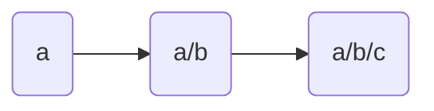
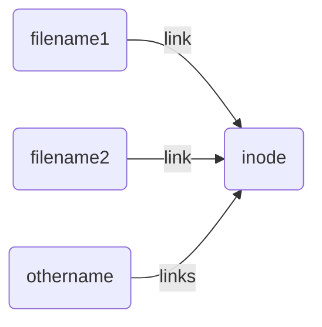

---
{"dg-publish":true,"permalink":"/knowledge/course/mit6.s081/20-xv6-Manual/","title":"6.S081 · xv6 手册精读","tags":["MIT6.1810","xv6","操作系统","课程笔记"],"dg-note-properties":{"title":"6.S081 · xv6 手册精读","tags":["MIT6.1810","xv6","操作系统","课程笔记"],"date":"2026-11-18","source":"https://pdos.csail.mit.edu/6.828/2020/schedule.html"}}
---


# 6.S081 · xv6 手册精读

> MIT 6.S081 / 6.1810 · Operating System Engineering
> 教材：xv6: a simple, Unix-like teaching operating system（RISC-V 版）
> 本节基于 xv6-riscv 源码

返回 [[knowledge/course/mit6.s081/index\|📚 6.S081 目录]] · [[knowledge/course/index\|📚 课程资源]] · [[首页\|🏠 首页]]

---

## 第一章 操作系统接口

### 1.1 进程和内存

#### fork 与 exec

首先它们都是*系统调用*的接口。

* `fork` 在父进程中创建了一个子进程，并使用 `wait` 在父进程中等待子进程结束、回收。
* **`fork` 返回值在子进程中为 0，父进程中为子进程的 pid**。

```C{}
int pid=fork();
if (pid>0){
    pid=wait((int*)0);//wait()函数参数的是一个地址，调用后参数是子进程的退出状态
}else if (pid==0){
    exit(0);
}
```

* `exec` 有两个参数：可执行文件的文件名与字符串参数数组。

```C{}
char* argv[3];
argv[0]="echo";
argv[1]="hello";
argv[2]=0;
exec("bin/echo",argv);
```

|  | exec | fork |
|---- | ---- | ---- |
| 内存内容是否相同  | 不同  |相同|
| 是否~~覆盖~~原有内存空间 | 是 | 否 |

---

### 1.2 I/O 和文件描述符

#### 文件描述符

文件描述符是一个强大的抽象，它在名称上指向文件，实际上可以指向任何 I/O 对象，即也可以指向*设备*或者*管道*，在下面的描述中默认这一点。在 Xv6 中最小的文件描述符为 0，如果出现了负值则说明出现了错误。

#### write 和 read

`read` 和 `write` 都是*系统调用*的接口，以==字节==为单位读写文件（通过*文件描述符*）。需要注意一点，`buf` 本质上是指针，第二个参数需要传入指针。

```C
write(fd,buf,n) //fd为文件描述符，
read(fd,buf,n)//buf为读或者写的字符串
```

1. 引用文件的==每个==文件描述符都有一个与之关联的*偏移量*，且每次 `read` 和 `write` 都从此偏移量处开始读取或者写入。

2. 每个进程都有一个文件描述符的*私有空间*，里面有三个从 0 开始的打开的文件描述符。进程从==文件描述符 0==（标准输入 *input*）读取，将输出写入==文件描述符 1==（标准输出 *output*），并将错误写入==文件描述符 2==（标准错误）。

3. 当文件没有更多的字节可读时，`read` 返回 0。读取或者写入正常的情况下，`read` 和 `write` 返回读取或者写入的字节数。（说明这一条是为了理解下面这一段代码）

```C{}
char buf[512];
int n;
for(;;){
    n=read(0,buf,sizeof(buf));
    if (n==0){
        break;
    }
    if (n<0){
        fprintf(2,"read error");
        exit(1);
    }
    if(write(1,buf,n)!=n){
        fprintf(2,"write error");
        exit(1);
    }
}
```

#### close、open 和 dup

这三个都是关于文件和文件描述符的系统调用。

* `close` 释放一个文件描述符，使其将来可以被 `open`、`dup`、`pipe` 重用。

```C
close(0)
```

* `open` 将打开文件，并使用编号最小的未使用文件描述符。它有两个参数，第一个是文件名的字符串，第二个是一组 flags（表示 open 后对文件做什么）。

```C
int fd=open("a.txt",O_RDONLY)
```

| 宏定义 | 功能说明 |
|----|----|
| O_RDONLY | read only |
| O_WRONLY | write only |
| O_RDWR | read and write |
| O_CREATE | create one if the file does not exist |
| O_TRUNC | 截断文件，会清空文件已有内容，即保留长度为 0 |

* `dup` 复制一个现有的文件描述符，生成一个引用同样 I/O 对象的文件描述符。复制得到的文件描述符和原文件描述符==共享文件偏移量==。（注意一点，共享偏移量是 `fork` 和 `dup` 独有的，见以下代码）

```C{}
if (fork()==0){
    write(1,"hello ",6);
    exit(0);
}else{
    wait((int*)0);
    write(1,"world\n",6);
}
```

```C{}
int fd=dup(1);
write(1,"hello ",6);
write(fd,"world\n",6);
```

#### I/O 重定向（以及为什么 fork 和 exec 分离）

现在需要将之前的对比表格实现升级：

|  | exec | fork |
|---- | ---- | ---- |
| 内存内容是否相同  | 不同  |相同|
| 是否~~覆盖~~原有内存空间 | 是 | 否 |
| 保留原有的文件表（即文件描述符） | 是 | 是（准确来说是复制） |

`exec` 和 `fork` 都保留了文件表，这是实现 I/O 重定向的前提。

现在看如下代码，*I/O 重定向*的实现。`fork` 和 `exec` 之间改变了文件描述符的引用对象，这一过程并没有影响主进程。但如果 `fork` 和 `exec` 没有分离，那么只能先改变主进程的 I/O，fork/exec 之后再变回来，显得笨拙。

```C{}
char *argv[2];
argv[1]='cat';
argv[2]=0;
if (fork()==0){
    close(0);
    open("a.txt",O_RDONLY);
    exec("cat",argv);
}
```

---

### 1.3 管道

#### pipe

管道是小型内核缓冲区，提供了一种进程通信方式，它和文件不一样，需要一对文件描述符，一个用于读取，一个用于写入。

如下示例：

```C{}
int p[2];
char *argv[2];
argv[0]="wc";
argv[1]=0;
pipe(p);
if (fork()==0){
    close(0);
    dup(p(0));
    close(p[0]);
    close(p[1]);
    exec("/bin/wc",argv);   
}else{
    close(p[0]);
    write(p[1],"hello world\n",12);
    close(p[1]);
}
```

几点需要注意：

* `exec` 执行的时候，读取使用的是文件描述符 0（默认为标准读取，此处为管道读取）。
* `dup` 使用的文件描述符是 0，即==未使用的最小编号文件描述符==。
* 在子进程中，关闭文件描述符 `p[1]` 是必要的。因为管道在读取的过程中，当没有数据可用时会进入等待。==如果要结束读取，只有所有写入端的文件描述符都关闭。==

因为 `pipe` 的存在，我们可以在 shell 里做以下的操作：

``` shell
echo hello world | wc
```

这一操作将 `echo` 的写端重定向到 pipe，`wc`（这是一个用户程序）读端重定向到 pipe，然后运行 `echo` 和 `wc`。

这等效于以下命令：

```shell
echo hello world > /tmp/xyz; wx < tmp/xyz
```

### 1.4 文件系统

#### chdir、mkdir 和 mknod



如果代码文件处于根目录中，而我们要打开根目录下 /a/b/c 的文件，则有两种方法：

1. ```C++
    chdir("/a");
    chdir("/b");
    open("c",O_RDONLY);  
   ```
   *系统调用 `chdir`* 会切换当前进程到参数对应的目录。

2. ```C++
    open("/a/b/c",O_RDONLY);
    ```
   这样并不会改变进程的当前目录。

*`mkdir`* 是创建一个目录：

```C++
mkdir("/dir");
fd=open("/dir/file",O_CREATE | O_WRONLY);
```

*`mknod`* 则是创建一个引用设备的特殊文件，其实就是文件的 inode（索引节点）：

```C++
mknod("/console",1,1);
```

#### link、inode 和 fstat

inode 可以认为是和 link 一对多的关系，即同一个底层文件（inode）可以有多个名字（link）。



inode 包含了文件状态的信息，我们可以通过系统调用 *`fstat`* 检索文件的信息。使用标准库示例如下：

```C{}
#include<sys/stat.h>
#include<unistd.h>
#include<fcntk.h>
main()
{
   struct stat buf;
   int fd;
   fd = open("/etc/passwd", O_RDONLY);
   fstat(fd, &buf);
   printf("/etc/passwd file size +%d\n ", buf.st_size);
}
```

这个 stat 类型的结构体在 xv6 这个操作系统中被定义为：

```C{}
#define T_DIR 1
#define T_FILE 2
#define T_DEVICE 3

struct stat{
    int dev;// 文件系统的磁盘设备
    uint ino;//Inode编号
    short type;//文件类型
    short nlink;//指向文件的链接数
    uint64 size;//文件字节数
};
```

现在使用系统调用 *`link`*：

```C++{}
open("a",O_CREATE | O_WRONLY);
link("a","b");
```

这样文件 a 和 b 就指向了同一个 inode，此时调用 **`fstat`**，两者将返回同样的 `ino`（inode 编号），`nlink` 为 2。

注意一点：

==只有当文件的链接数为零且没有文件描述符引用的时候，文件的 inode 和包含其内容的磁盘块才会释放==

```C++
unlink("a");
```

---

## 第二章 操作系统架构

操作系统需要支持多个程序得到运行：

1. 这既要保证所有进程都有机会在 CPU 上得到处理。
2. 同时不同进程之间也应该保持一定的隔离性，比如保证一个进程的错误不会影响另一个。
3. 但不同进程之间也不能过于隔离，因此管道（pipe）的出现又保证了进程间的通讯。

   ```mermaid
   graph LR
   process1--pipe-->process2
   ```

`Xv6` 理论上运行在 `RISC-V` 处理器上，关于 `RISC-V` 指令集的官方中文版参考手册为 [The RISC-V Reader : A Open Architecture Altas](http://riscvbook.com/chinese/RISC-V-Reader-Chinese-v2p1.pdf)。实际操作中，Xv6 的编写基于 `qemu` 模拟的硬件（除处理器外，还包括内存、磁盘等）。

### 2.1 抽象系统资源

为了实现程序与硬件资源的隔离，将资源抽象成服务：

1. `open`、`read`、`write`、`close` 等系统调用为文件服务，抽象了磁盘资源。
2. 一个进程利用 `exec` 创建内存映像，内存资源被抽象。

### 2.2 用户态、核心态

1. 用户态 = 用户模式 = 目态
2. 核心态 = 管理模式 = 管态

---

### 2.4 Xv6 模块化的文件

kernel 源代码模块化地分成若干文件，在下列表格中简述它们的功能：

|      File       |                  Description                   |
| :-------------: | :--------------------------------------------: |
|     `bio.c`     |              文件系统的磁盘块缓存              |
|   `console.c`   |            连接到使用者的键盘和屏幕            |
|    `entry.S`    |                最开始的启动指令                |
|    `file.c`     |                文件描述符的支持                |
|    `exec.c`     |                `exec` 的系统调用               |
|     `fs.c`      |                    文件系统                    |
|   `kalloc.c`    |                 物理页面分配器                 |
|  `kernelves.S`  | 处理 *来自内核的 traps* 以及 *计时器 interrupts* |
|     `log.c`     |           文件系统日志记录和崩溃记录           |
|    `main.c`     |           启动过程中对其他模块初始化           |
|    `pipe.c`     |                      管道                      |
|    `plic.c`     |               `RISC-V` 中断处理器              |
|   `printf.c`    |               格式化输出到控制台               |
|    `proc.c`     |                  进程及其调度                  |
|  `sleeplock.c`  |       睡眠锁（Locks that yield the CPU）       |
|  `spinlock.c`   |    自旋锁（Locks that don't yield the CPU）    |
|    `start.c`    |           早期 machine-mode 启动代码           |
|    `string.c`   |            C string 和 byte-array 库           |
|    `swtch.c`    |                    线程切换                    |
|   `syscall.c`   |            选择调用哪个系统调用函数            |
|   `sysfile.c`   |             文件相关的系统调用函数             |
|   `sysproc.c`   |             进程相关的系统调用函数             |
| `trampoline.S`  |            切换用户和内核的汇编代码            |
|    `trap.c`     |             处理 traps 和 interrupts           |
|    `uart.c`     |             串口控制台设备驱动程序             |
| `virtio_disk.c` |                 磁盘设备驱动程序               |
|     `vm.c`      |               管理页表和地址空间               |

---

### 2.5 进程

每一个进程有一个独立的虚拟地址空间。硬件只支持 39 位的虚拟地址转换，而在 Xv6 中只使用 64 位指针的低 38 位，因此 MAXVA = $2^{38}-1$，即 `0x3fffffffff`。Xv6 则为每个进程维护一个页表，使之可以映射到物理地址。

从 0 开始的用户虚拟地址空间布局（由低地址到高地址）：

| 区域 | 内容说明 |
| :--- | :--- |
| 用户代码段 / 数据段（text + data） | 进程的指令和全局数据 |
| 栈区（stack） | 用户栈，向下增长 |
| 堆区（heap） | 动态分配的内存 |
| trapframe | 包含当前进程内核栈的指针、当前 CPU 的 `hartid`、`usertrap` 的地址和内核页表的地址 |
| trampoline page | 被映射到每一个用户进程和内核进程的相同虚拟地址（位于 `MAXVA` 附近），保证切换页表后指令的连续性 |

```text
高一端虚拟地址 (接近 MAXVA)
+--------------------------+  <- MAXVA
|      trampoline page     |  用户/内核同一虚拟地址映射
+--------------------------+
|        trapframe         |  kstack ptr / hartid / usertrap / kernel satp
+--------------------------+
|          堆区 heap        |
|            ^             |
|            |  增长方向    |
+--------------------------+
|          栈区 stack       |
|            v             |
+--------------------------+
|  用户代码段 / 数据段       |  <- 0
+--------------------------+  0
```

#### Xv6 的内核和进程

Xv6 的内核为进程维护了许多状态，存在一个名为 `proc`（`kernel/proc.h`）的结构体里。其中目前比较重要的有：

1. `p->state`，表明该进程的状态。处于 allocated（已分配）、ready to run（就绪态）、running（运行态）、waiting for I/O（阻塞态）、exiting（终止态）。
2. `p->pagetable`，指向该进程页表的指针。
3. `p->kstack`，内核栈。每个进程有两个栈，一个是用户自己的栈，一个 kernel 为它分配的栈。当进程执行用户指令时，只有它的用户栈在使用，它的内核栈是空的。当进程进入内核（由于系统调用或中断）时，内核代码在进程的内核栈上执行。


---

### 2.6 启动 Xv6 直到第一个 shell

CPU 将从 `_entry` 处开始启动 Xv6，`_entry` 要做的主要就是设置一个栈区，这样 Xv6 可以运行代码。它首先要做的就是把 `stack0 + (hartid * 4096)` 加载到栈指针寄存器 `sp` 中：

```asm
# kernel/entry.S
_entry:
        # set up a stack for C.
        # stack0 is declared in start.c,
        # with a 4096-byte stack per CPU.
        # sp = stack0 + (hartid * 4096)
        la sp, stack0
        li a0, 1024*4
        csrr a1, mhartid
        addi a1, a1, 1
        mul a0, a0, a1
        add sp, sp, a0
        # jump to start() in start.c
        call start
```

*补充：`hartid` 是运行当前代码的硬件线程（hart）的 ID。*

（此处原笔记作者留注：本节还有很多问题，待补充。）

### 2.7 观察从内核空间跳到用户空间

再次启动 gdb 调试 kernel。在 `_entry` 之后，0x1000 是 boot 代码（`entry.S`，即 OpenSBI 的跳板）的物理地址。

按照手册操作，键入 `stepi` 以后无法继续，原笔记作者未找到问题所在——此处为观察过程中遇到的调试中断，`gdb` 停在 `_entry` 首条指令处不再前进。

---

## 第三章 页表

在 lecture3 中可以看到页表允许一些特殊的映射，比如：

1. 映射相同的内存到不同的地址空间（a trampoline page）。
2. 使用未映射的 page 保护内核和用户栈区。

### 3.1 分页硬件

运行 `Xv6` 的 RISC-V 使用的 MMU 为 SV39 Memory Management Unit，这意味着它只使用虚拟地址的低 39 位。在逻辑上，翻译地址的页表是一个包含 $2^{27}$ 个 PTE（page table entry）的数组，PTE 包含 PPN（physical page number）以及各种标志位（flag）。

硬件上的支持使 OS 利用页表以 $2^{12}$ 字节的对齐块（这样的块叫做 page）的粒度将虚拟地址翻译成物理地址。

在最简单的单级设计中：

1. 虚拟地址中的 27 位作为 index 在页表数组中索引得到 PTE，取得 44 位的 PPN；
2. 虚拟地址中的后 12 位作为字节块的 offset，44 位的 PPN 和 12 位的 offset 得到翻译后的物理地址。

SV39 的虚拟地址（39 位）划分：

```text
 38      30 29      21 20      12 11        0
+----------+----------+----------+-----------+
|  VPN[2]  |  VPN[1]  |  VPN[0]  |  offset   |
|  9 bits  |  9 bits  |  9 bits  |  12 bits  |
+----------+----------+----------+-----------+
   \__________ 27 位索引 ______/   \_ 页内偏移 _/
```

物理地址（56 位）由 44 位 PPN 拼 12 位 offset 得到：

```text
 55                      12 11            0
+-------------------------+---------------+
|         PPN (44)        |  offset (12)  |
+-------------------------+---------------+
```

实际的设计中采取一种更节省内存的方式，即三级页表。后 12 位的页内 offset 并没有改变，但索引 PPN 的方法有所不同：27 位的 index 被划分成 3 级（L2、L1、L0）。L2 用于索引根（1 级）页表，得到 2 级页表；L1 用于索引 2 级页表得到 3 级页表；L0 用于索引 3 级页表，最终得到 PPN，依然可以得到最后的物理地址。

三级页表查找过程：

```text
satp(根页表物理页号)
   |
   v
+----------------------+
| 根页表 (512 × PTE)    | <-- VPN[2] 选表项 -> 得到下一级页表的 PPN
+----------------------+
   |
   v
+----------------------+
| 二级页表 (512 × PTE)  | <-- VPN[1] 选表项 -> 得到下一级页表的 PPN
+----------------------+
   |
   v
+----------------------+
| 三级页表 (512 × PTE)  | <-- VPN[0] 选表项 -> 得到最终物理页的 PPN
+----------------------+
   |
   v
物理地址 = (PPN << 12) | offset
```

每个页表页 4096 字节，每项 PTE 8 字节，因此每级页表恰好 512 项（$2^9$）。

这样设计的优点很明显，那就是节省内存：因为如果在一个页表中只有第一项的 PTE 是有效的，那么其他的 511 项就不需要分配下一级的页表。但缺点也很明显，那就是翻译过程需要访问内存三次；为了减少从内存中加载 PTE 的开支，在 MMU 中设置了 TLB，即快表，它会将最近访问的 PTE 缓存（这都是局部性原理的应用）。

下面介绍主要的五种标志位：

1. `PTE_V`，指示 PTE 是否存在。如果此位未设置，引用 PTE 时会触发页面故障异常（page-fault exception）。
2. `PTE_R`，指示指令是否可读取页面。
3. `PTE_W`，指示指令是否可写入页面。
4. `PTE_X`，控制 CPU 是否可以将页面的内容解释为指令并执行它们。
5. `PTE_U`，控制用户模式下是否被允许访问页面。如果该标志位没有设置，则该 PTE 只能在管理模式下被使用。

RISC-V PTE 的 64 位位域（低 10 位为标志/状态位）：

```text
 63            54 53      10 9   8 7 6 5 4 3 2 1 0
+----------------+----------+-----+-+-+-+-+-+-+-+-+-+
|    reserved    |  PPN(44) |RSW-2|D|A|G|U|X|W|R|V|
+----------------+----------+-----+ +-+-+-+-+-+-+-+-+
                                     
 bit0 V   : 有效（Valid）
 bit1 R   : 可读（Read）
 bit2 W   : 可写（Write）
 bit3 X   : 可执行（eXecute）
 bit4 U   : 用户态可访问（User）
 bit5 G   : 全局映射（Global）
 bit6 A   : 已被访问（Accessed）
 bit7 D   : 已脏（Dirty）
 bit8-9 RSW : 保留给软件使用（Reserved for Software）
```

*1L = long int 1，1U = unsigned int 1*

为了使用页表，内核需要将根页表的物理地址存入 `satp` 寄存器（需要注意页表的数组大小虽然是 $2^9$，但是 PTE 的大小为 8 字节，所以页表大小和页的大小相同，都是 4096 字节），CPU 会通过 `satp` 寄存器指向的页表生成所有地址。每个进程都有自己专属的页表获得私有地址空间，而只需要改变 `satp` 寄存器存放的页表地址就能实现进程切换。

### 3.2 内核地址空间

Xv6 为每个进程维护一个页表，用于进行用户地址空间的映射；此外，Xv6 还专门为内核维护一个页表，通过这个页表，内核会配置其地址空间的布局。内核虚拟地址到物理地址的映射如下：

| 虚拟地址范围 | 映射到 | 说明 |
| :--- | :--- | :--- |
| `0` ~ `KERNBASE`（0x80000000） | qemu 模拟的 I/O 设备接口地址 | “直接映射”到特殊的物理 I/O 地址（lecture4 讲解如何与 I/O 设备交互） |
| `KERNBASE`（0x80000000）~ `PHYSTOP`（0x86400000） | RAM（物理内存） | “直接映射”：虚拟地址 = 物理地址 |
| `PHYSTOP`（0x86400000）~ `MAXVA`（$2^{38}$） | 不再“直接映射” | 包含 trampoline page 与各进程内核栈 |

```text
MAXVA (0x3fffffffff)
+--------------------------+
|        trampoline page   |  映射到持有蹦床代码的物理页面
+--------------------------+
|  guard page (PTE_V = 0)  |  每个内核栈低处的保护页，栈溢出即 panic
+--------------------------+
|       kernel stack       |  每个进程一个内核栈页
+--------------------------+
|  guard page (PTE_V = 0)  |
+--------------------------+
|            ...           |
|  kernel text / data      |  PTE_R | PTE_X 可读可执行
+--------------------------+
|    PHYSTOP 0x86400000    |  以上为直接映射的 RAM
+--------------------------+
|    KERNBASE 0x80000000   |  以上为直接映射的 I/O 设备地址
+--------------------------+
|    I/O devices (0x0)     |
+--------------------------+
```

* 蹦床页面（trampoline page）在内核虚拟地址的顶部，被映射到持有蹦床代码的物理页面（此页面已经被“直接映射”过一次了）。
* 内核栈页面：内核为每一个进程分配了内核栈，这些内核栈的页面同样被映射到虚拟地址较高处（蹦床页面低处）。在每一个内核栈的低处都会设置一个保护页（guard page），保护页的 PTE 是无效的（即 `PTE_V` 没有设置），这样一旦发生栈溢出就会触发一个异常 `panic`，防止了其他内核内容被改写。

`memlayout.h` 中定义了蹦床页面和内核栈页面的地址。另外需要注意，在内核的页面中，trampoline page 和 kernel text 的 `PTE_R` 和 `PTE_X` 是被设置的，这意味着它们是可读和可执行的，而其他设置 `PTE_W` 的页面则是可写的。

### 3.3 创建一个地址空间

下面来看看具体代码中是如何实现地址空间的映射：

> 以 `kvm` 开头的函数操作内核页表，以 `uvm` 开头的函数操作用户页表。

* **数据结构**：`pagetable_t`，这实际上是一个指向根页表页的指针。
* **函数**：`walk` 已经在 lecture3 中介绍过了，还有一个重要的函数是 `mappages`，该函数的作用就是装载虚拟地址和物理地址的映射到页表中。代码实现如下：

```c
// kernel/vm.c
int
mappages(pagetable_t pagetable, uint64 va, uint64 size, uint64 pa, int perm)
{
  uint64 a, last;
  pte_t *pte;

  a = PGROUNDDOWN(va);
  last = PGROUNDDOWN(va + size - 1);
  for(;;){
    if((pte = walk(pagetable, a, 1)) == 0)
      return -1;
    if(*pte & PTE_V)
      panic("remap");
    *pte = PA2PTE(pa) | perm | PTE_V;
    if(a == last)
      break;
    a += PGSIZE;
    pa += PGSIZE;
  }
  return 0;
}
```

分解来看看每一部分的代码：

1. 由于需要映射的虚拟地址不一定页对齐，所以先将虚拟地址的后 12 位化为 0，消除了虚拟地址的页内偏移量，需要调用 `PGROUNDDOWN(a)` 这个宏。

   ```c
   #define PGROUNDDOWN(a) (((a)) & ~(PGSIZE-1))
   ```

2. 调用 `walk` 函数，获取初始虚拟地址的 PTE。由于设置了 `alloc` 参数（此处传入 1），如果该虚拟地址没有对应的物理地址，函数就会分配一个物理页面，并把物理地址放进 PTE。最后返回的是指向最低一级页表 PTE 的指针。

3. 取得指向 PTE 的指针后，现在要做的就是修改 PTE 的值：物理地址左移 12 位再右移 10 位就获得了 PPN。

   ```c
   #define PA2PTE(pa) ((((uint64)pa) >> 12) << 10)
   ```

   PPN 加上权限 flags（`PTE_W`、`PTE_U`、`PTE_R`）和有效位 `PTE_V` 便可以得到 PTE 的值：

   ```c
   *pte = PA2PTE(pa) | perm | PTE_V;
   ```

4. 以一个页面大小为间隔，建立下一组虚拟地址和物理地址的映射，如此直到最后（`a += PGSIZE; pa += PGSIZE;`）。

* **内核页面初始化**：如 lecture3 中介绍的，`main` 调用 `kvminit` 建立虚拟地址和 I/O 设备及内存的映射。

  1. 分配一个物理页面当作根页表页：

  ```c
  kernel_pagetable = (pagetable_t) kalloc();
  ```

  2. 使用 `kvmmap` 建立映射。

  除此以外，在进程初始化的函数 `procinit` 中，还为每个进程的内核栈建立了映射，虚拟地址的间隔为两个页面：

  ```c
  #define KSTACK(p) (TRAMPOLINE - ((p)+1)* 2*PGSIZE)
  ```

  但建立映射时，只为一个页面分配了物理页面（另一个页面作为 guard page，不建立有效映射）。

```c
// kernel/proc.c: procinit() 中为每个进程内核栈建映射
for(p = proc; p < &proc[NPROC]; p++) {
  initlock(&p->lock, "proc");
  p->kstack = KSTACK((int)(p - proc));
  kvmmap(p->kstack, kalloc(), PGSIZE, PTE_R | PTE_W);
}
```

* 初始化内核页表或者更新页表后，需要调用 `kvminithart` 函数来安装内核页表，主要做两步：

  ```mermaid
  graph LR
  A[将物理地址写入寄存器satp]-->B[使用sfence.vma指令刷新CPU中的TLB]
  ```

* `satp` 寄存器一旦被设置，下一步就进入虚拟地址的空间了，这是一个全新的世界，所有地址都要经过 MMU 的翻译再使用。

### 3.4 物理内存分配

在 `kalloc.c` 可以看到内核使用链表管理 Kernel data 末尾到 `PHYSTOP` 这段物理内存，一次分配和释放一个 4KB 的页面。

```text
物理内存布局：
低地址
+----------------------+
|   kernel text/data   |
+----------------------+
|   end                | <-- 空闲内存从这里开始
+----------------------+
|   空闲页面 (4KB × N)  |     由 kmem.freelist 链表串起来
|        ...           |
+----------------------+
|   PHYSTOP 0x86400000 |
+----------------------+
高地址
```

### 3.5 物理内存分配的代码

下面介绍物理内存的分配器（allocator）：

* **数据结构**

  1. 使用一种叫 `run` 的数据结构作为链表的节点。`run` 本身就储藏在空闲的页面中，或者说，`run` 的数值就是页面的物理地址。

  ```c
  struct run {
    struct run *next;
  };
  ```

  2. 链表的数据结构如下：空闲的链表和锁被封在一个结构体中，受到自旋锁的保护，会防止被不同进程同时占用。在这里暂不赘述 `spinlock` 的种种，只需要知道*如果资源已经被占用，自旋锁并不会使资源调用者进入睡眠状态，而是让调用者一直循环查看锁是否已经被释放*。

  ```c
  struct {
    struct spinlock lock;
    struct run *freelist;
  }kmem;
  ```

* **分配器的初始化**

  `main` 调用 `kinit` 初始化分配器，`kinit` 调用 `freerange` 将从内核末尾到 `PHYSTOP` 的所有内存添加到空闲列表中，其中的每一页都会调用 `kfree`。

  这里的代码有一些有趣的 tricks，来仔细看看。

  1.

  ```c
  #define PGROUNDUP(sz)  (((sz)+PGSIZE-1) & ~(PGSIZE-1))
  void freerange(void *pa_start, void *pa_end){
  	char * p;
  	p=(char *)PGROUNDUP((uint64)pa_start);
    for(; p + PGSIZE <= (char*)pa_end; p += PGSIZE)
      kfree(p);
  }
  ```

  * 首先依然是考虑到页对齐的问题，物理地址需要使用 `PGROUNDUP` 的宏进行转化。`PGROUNDUP` 和 `PGROUNDDOWN` 在处理已经是页对齐的物理地址时，获得的结果是一样的；对于其他的物理地址，`PGROUNDUP` 向上取整到下一个页面边界（`PGROUNDDOWN` 则向下取整）。

    ```text
    PGSIZE = 0x1000

    a = 0x80000123
    PGROUNDDOWN(a) = 0x80000000   (向下取整)
    PGROUNDUP(a)   = 0x80001000   (向上取整)

    a = 0x80001000  (已对齐)
    PGROUNDDOWN(a) = 0x80001000   (两者相同)
    PGROUNDUP(a)   = 0x80001000
    ```

  * 然后就是一些强制类型转换的使用：
    1. 物理地址（pa）的最开始的数据类型是 `void *`，使用 `PGROUNDUP` 时需要转化为 `uint64`，这样 pa 就能进行 `int` 的算术运算。
    2. 使用 `for` 循环的时候，这时 pa 转化为 `char *`，这时 pa 加 `+1` 本质是加了一个字节，所以跳到下一个页面的时候加上 `PGSIZE`。

  2.

  ```c
  void
  kfree(void *pa)
  {
    struct run *r;

    if(((uint64)pa % PGSIZE) != 0 || (char*)pa < end || (uint64)pa >= PHYSTOP)
      panic("kfree");

    // Fill with junk to catch dangling refs.
    memset(pa, 1, PGSIZE);

    r = (struct run*)pa;

    acquire(&kmem.lock);
    r->next = kmem.freelist;
    kmem.freelist = r;
    release(&kmem.lock);
  }
  ```

  * 依然是强制类型转换，pa 转换成了 `struct run *`，此时 pa 又成了指向结构体的指针 r。
  * pa 的页面现在被释放了，所以给里面每个字节的内存都填满数值为 1 的**垃圾**，这样如果有代码访问到这页空闲内存会立马崩溃。
  * 采用**头插法**将页面的前置 r 插入空闲列表中。

### 3.6 进程地址空间

用户的进程地址空间分布有所不同。首先看到进程寻址空间最大为 `MAXVA`：

```c
#define MAXVA (1L << (9 + 9 + 9 + 12 - 1))//这个数值为256G
```

`MAXVA` 由 SV39 的 39 位地址位宽得出：9 + 9 + 9 + 12 = 39 位。

```text
MAXVA (0x3fffffffff)
+--------------------------+
|      trampoline page     |  与内核页表同一虚拟地址
+--------------------------+
|        trapframe         |
+--------------------------+
|          堆 heap         |
+--------------------------+
|      guard page (无效)    |  PTE_V = 0，栈溢出即触发 page fault
+--------------------------+
|        stack page        |  单个页面，栈顶存放 argv 等
+--------------------------+
|      用户 text/data      |
+--------------------------+
 0
```

* 当用户进程向 Xv6 请求更多用户内存时，Xv6 会使用 `kalloc` 来分配物理页面，然后将相关的 PTE 添加到进程页表中。事实上，用户进程的大多数地址都是未被使用的。
  * **stack**：栈是一个单独的页面，`exec` 后栈的初始内容如下——栈的顶部存放着命令行的参数，即字符串以及指向字符串的指针（注意这里的参数是由低地址到高地址地存放）。由于 `argv` 本质是一个二维的数组，所以在后面还存放了指向字符串指针的指针。最后存放了指向 `main` 函数当前指向指令的地址（指针）。

  ```text
  用户栈（单页，从高地址向低地址看栈顶）
  +--------------------------+  高地址
  |  ...                     |
  +--------------------------+
  |  argv 各字符串内容         |  "echo" / "hello" ...
  +--------------------------+
  |  argv[] 数组（指向字符串）  |  argv[0] -> "echo", argv[1] -> "hello", argv[2] = 0
  +--------------------------+
  |  argc                    |
  +--------------------------+
  |  返回地址 / 指向 main 的指令地址 |
  +--------------------------+  <- sp（栈顶）
  |  (空)                    |
  +--------------------------+  低地址
  ```

  * **guard page**：在栈的正下方 Xv6 放置了一个无效（`PTE_V` 为 0）的保护页（guard page）。

### 3.7 sbrk

`sbrk` 是一个用于用户进程增加或者减少内存的系统调用。

---

## 第四章 陷阱指令与系统调用

> 注：该章笔记尚未展开。

---

## 第八章 文件系统

文件系统组织和存储数据，需要解决的核心问题是**持久化**。

> 注：该章笔记尚未展开。
