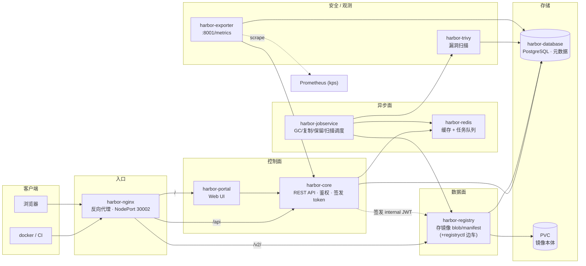

---
{"dg-publish":true,"permalink":"/knowledge/devops/Harbor制品仓库实战/","tags":["DevOps","制品仓库","Harbor","Trivy","镜像仓库","供应链安全","生命周期管理"],"dg-note-properties":{"date":"2026-10-20","tags":["DevOps","制品仓库","Harbor","Trivy","镜像仓库","供应链安全","生命周期管理"]}}
---


# Harbor 制品仓库实战（生命周期管理 · 安全扫描 · CI 集成）

> 以本机三节点 k3s 上自建的 Harbor 2.11.2 为靶子，把「制品仓库」从概念落到实操。
> 本文所有命令与输出均在真实环境跑通，配套部署记录见 `knowledge/devops/practices/04-k3s部署实战.md`。

## 一、Harbor 是什么，和谁比

Harbor 是 CNCF 毕业项目，是「企业级容器镜像仓库」——在裸 `registry:2` 之上补齐了四类企业能力：

| 能力 | 裸 Docker Registry | Harbor |
|:----|:----|:----|
| 仓库管理 | 只有 API | 项目/仓库/制品三级模型 + Web UI |
| 权限 | 无 | 项目级 RBAC + Robot Account + LDAP/OIDC |
| 安全扫描 | 无 | 内置 Trivy，推送即扫 + 漏洞门禁 |
| 镜像复制 | 无 | 跨 Harbor/跨云复制、Proxy Cache |
| 生命周期 | 无 | 保留策略、不可变 Tag、配额、GC |

**它在制品家族里的位置**（面试高频对比）：

| 制品类型 | 首选仓库 | 说明 |
|:----|:----|:----|
| **容器镜像** | **Harbor** | 镜像专用、扫描、复制 |
| Java jar/war、npm、pip、Go | Nexus / Artifactory | 依赖代理 + 私有包 |
| 通用二进制（.bin/.elf/.hex/.tar.gz） | Nexus Raw / Artifactory Generic | 任意文件 |
| Helm Chart | Harbor（自带 chartmuseum 兼容） | K8s 应用包 |

一句话记法：**镜像用 Harbor，依赖/多语言用 Nexus，多形态二进制用 Artifactory Raw。**

### Nexus 的三仓模型（对照理解 Harbor 的 Proxy Cache）

- **Proxy（代理仓）**：代理远程上游（Maven Central / PyPI / docker.io），首次拉取即缓存，加速 + 断网可用。
- **Hosted（宿主仓）**：存自己的制品。
- **Group（聚合仓）**：把多个仓库聚合成一个 URL 对外暴露。

Harbor 的 **Proxy Cache 项目**就是「Proxy」思想的镜像版：把 Harbor 当 docker.io / 其他 registry 的拉取缓存，解决弱网/断网拉镜像问题；**Registry Replication** 则是 Harbor↔Harbor↔ACR 的同步。

---

## 二、组件架构（一张图看懂）

Harbor 是**微服务架构**——一个镜像仓库拆成一堆 Pod 各司其职，按「数据面 / 控制面 / 异步面」分组：



**逐个组件用途**（对应本环境 9 个 Pod）：

| 组件 | 角色 | 关键点 |
|:----|:----|:----|
| **harbor-nginx** | 统一入口 / 反向代理 | 路由分发（`/v2`→registry、`/api`→core、`/`→portal）+ TLS 终止 |
| **harbor-portal** | Web UI | 纯前端静态资源，**本身不干活**，数据全来自 core API |
| **harbor-core** | 核心 API | 认证鉴权 / 项目 / 策略 / Webhook；用 internal token 给各组件签发短期 JWT —— **core 挂则全站登录挂** |
| **harbor-registry** | 镜像存储 | 上游 CNCF distribution/registry v2，**真正存 blob/manifest**；旁带 registryctl 边车（GC / 健康检查） |
| **harbor-database** | 元数据 | PostgreSQL：用户 / 项目 / 仓库 / tag / robot / 扫描报告 / 审计 —— **不存镜像本身** |
| **harbor-redis** | 缓存 + 队列 | jobservice 通过它取异步任务，兼缓存 session |
| **harbor-jobservice** | 异步任务引擎 | GC / 复制 / 保留清理 / 扫描调度都由它执行（UI 点「立即 GC」实际是它跑） |
| **harbor-trivy** | 漏洞扫描 | 推送即扫，结果回写 database，是 `prevent_vul` 门禁的依据 |
| **harbor-exporter** | 指标导出（可选） | 暴露 `:8001/metrics` 给 Prometheus（下文第四节启用） |

**记忆锚点**：
- **数据面** = nginx + registry（镜像进出的路）
- **控制面** = core + portal（API 和界面）
- **异步面** = jobservice + redis（重活后台干）
- **存储** = database（元数据）+ registry PVC（镜像本体）—— **这两个才是真正要持久化 / 备份的**
- **安全 / 观测** = trivy（扫描）+ exporter（指标）

---

## 三、部署要点（原生 YAML，不用 helm 管理）

本环境用 `helm template` **仅做渲染**产出纯 YAML，再 `kubectl apply`（用户要求不用 helm 管理，避免 release 与静态 YAML 双头管理——这条和监控栈的教训一致）。

组件构成（8 个 Pod，全钉 Lenovo worker）：

```
portal(UI)  core(API)  jobservice(异步任务)  registry(+registryctl)
nginx(网关)  database(PG)  redis  trivy(扫描器)  [exporter 可选]
```

### ⚠️ 部署两大坑

**坑 1：`EXT_ENDPOINT` 必须是「所有客户端都能访问」的地址。**
初次装完默认 `EXT_ENDPOINT=http://192.168.31.79:30002`（Lenovo 家宽内网）→ 外部机 `docker login` 超时。原因：Harbor 的 **token service 返回的 realm** 和 blob 上传的 **Location** 都取自 `EXT_ENDPOINT`，指向不可达内网 IP 就全断。改成公网地址并重启 core 才通：

```bash
kubectl -n harbor patch cm harbor-core --type merge -p '{"data":{"EXT_ENDPOINT":"http://101.133.228.245:30002"}}'
kubectl -n harbor rollout restart deploy/harbor-core
```

**坑 2：helm 渲染出的 YAML 不带 `metadata.namespace`。**
直接 `kubectl apply` 会落到 `default` 命名空间。要用 `kubectl apply -n harbor -f`，并注意 NodePort 冲突（旧 default 里的 service 占着端口会导致新 service 建不出来）。

---

## 四、对接监控体系（Prometheus / Grafana / 告警）

Harbor 自带 `harbor-exporter` 暴露 Prometheus 指标，本环境把它接进了既有的 kube-prometheus-stack（release = `kps`）。

### 4.1 打开指标（不改动已有部署）

原则：**只 apply 增量资源**，绝不重渲染整份 YAML 覆盖线上——否则会冲掉 trivy 手工 patch 的 `SCANNER_TRIVY_VULN_TYPE=os`。

```bash
# metrics-values.yaml
metrics:
  enabled: true
  serviceMonitor: { enabled: true, interval: 30s, additionalLabels: { release: kps } }

# 渲染出全量后，只挑出 exporter 的 CM/Secret/Svc/Deploy + ServiceMonitor 增量对象 apply
helm template harbor ./harbor -f custom-values.yaml -f metrics-values.yaml --namespace harbor > all.yaml
kubectl apply -n harbor -f <挑选出的 5 个增量对象>
```

exporter 是一个 Deployment，指标在 `:8001/metrics`（约 215 行 `harbor_*` 指标）。

### 4.2 ⚠️ 两个坑

**坑 A：ServiceMonitor selector 过宽，抓出一个永远 down 的假目标。**
Helm 渲染的 ServiceMonitor selector 是 `matchLabels:{release: harbor, app: harbor}`——这会把 **harbor-core 的 Service 一起选中**。core 的 Service 上虽列了 `http-metrics:8001`，但 **core 容器根本没监听 8001**（containerPort 只有 8080），于是 Prometheus 里出现 `up{job="harbor", svc=harbor-core}=0` 的永久假告警。

修法——给 exporter 的 Service 打组件标签，并把 SM selector 收紧：

```bash
kubectl -n harbor label svc harbor-exporter component=exporter --overwrite
kubectl -n harbor patch servicemonitor harbor --type merge \
  -p '{"spec":{"selector":{"matchLabels":{"release":"harbor","app":"harbor","component":"exporter"}}}}'
```

**坑 B：`additionalLabels` 与 chart 基础标签键冲突。**
chart 的基础标签里本来就有 `release: harbor`，我们再叠 `release: kps` → **同一 map 出现重复 `release` 键**。YAML 重复键「后写覆盖先写」，实测侥幸 `release: kps` 生效，但顺序脆弱、不可依赖；用 4.2 的 patch 显式钉死 selector 才稳。

### 4.3 Grafana 面板

Dashboard 以 ConfigMap + `grafana_dashboard=1` 标签交付，Grafana sidecar 自动发现并加载到 `Harbor` 文件夹：

```bash
kubectl apply -f harbor-dashboard.yaml   # ConfigMap(monitoring, label grafana_dashboard=1)
# sidecar 日志：Writing /tmp/dashboards/harbor-overview.json → reload 200 OK
```

关键面板：`harbor_health` / `harbor_project_total` / `harbor_project_artifact_total` / `harbor_project_quota_usage_byte` / `harbor_artifact_pulled` / `harbor_task_concurrency` / `up{job="harbor"}`。

> **datasource uid** 必须对齐现有 Prometheus（本环境 `uid=prometheus`），否则面板报 "datasource not found"。

### 4.4 告警规则

以 PrometheusRule 交付（label `release=kps`，被 kps Prometheus 的 ruleSelector 选中）：

| 告警 | 表达式 | 含义 |
|:----|:----|:----|
| HarborExporterDown | `up{job="harbor"} == 0` 持续 5m | 指标抓取断了 |
| HarborUnhealthy | `harbor_health != 1` 持续 3m | Harbor 自报不健康 |
| HarborProjectQuotaHigh | 用量/配额 > 85% 持续 15m | 项目存储将满 |

### 4.5 本环境实测

| 项 | 结果 |
|:----|:----|
| exporter | 1/1 Running，`:8001/metrics` 215 行 |
| Prometheus 目标 | `up{job="harbor"}=1`（仅 exporter，core 假目标已消除） |
| 指标样例 | `harbor_project_total`、`harbor_project_artifact_total`、`harbor_artifact_pulled{project_name=…}`、`harbor_task_concurrency{type=IMAGE_SCAN}` |
| Grafana | `harbor-overview` 仪表盘已自动加载（Harbor 文件夹） |
| 告警规则 | `harbor.rules` 组 3 条已加载 |

---

## 五、实操一：项目 RBAC + 自动扫描 + 漏洞门禁

### 建项目（私有 + 自动扫描 + 高危阻断）

```bash
curl -u admin:*** -X POST $H/api/v2.0/projects -H 'Content-Type: application/json' -d '{
  "project_name":"demo-lifecycle",
  "public":false,
  "metadata":{
    "auto_scan":"true",        // 推送后自动扫描
    "prevent_vul":"true",      // 开启漏洞门禁
    "severity":"high",         // 阈值：High 及以上
    "reuse_sys_cve_allowlist":"true"
  }
}'
```

### ⭐ 核心考点：`prevent_vul` 拦的是 **pull，不是 push**

这是最容易误解的一点。很多人以为「有洞推不上去」，实测：

- **推送**：nginx:1.14.2（含 Critical 31 / High 82）**能推上去** ✅
- **拉取**：同一个镜像**被拒** ❌

```
Error response from daemon: current image with 217 vulnerabilities cannot be pulled
due to configured policy in 'Prevent images with vulnerability severity of "High" or higher from running.'
To continue with pull, please contact your project administrator to exempt matched vulnerabilities
through configuring the CVE allowlist.
```

**设计逻辑**：制品库要留痕、可审计，允许"入库"；门禁卡在**部署落地（拉取）**这一步——"有洞的镜像可以存档，但不许在你的集群里跑起来"。这跟 CI 里「编译产物要归档，但高危不过闸」是同一思想。

**配套机制：CVE Allowlist**——把"已知但业务必须用、风险可接受"的 CVE 加入忽略清单，门禁放行（`reuse_sys_cve_allowlist` 表示复用系统级清单）。

> 对应 Jenkins 侧：镜像维度门禁（Harbor 这里）+ 代码维度门禁（你做过）合起来才叫完整的供应链闸门。

---

## 六、实操二：制品生命周期管理

它石岗位原话「**具备软件制品生命周期管理经验**」，指的就是这一节——**光会 push/pull 不算，会管才算**。

### 6.1 保留策略（Retention Policy）

按规则自动清理旧制品。本环境建了两条（`algorithm: or`，任一满足即保留）：

```bash
curl -u admin:*** -X POST $H/api/v2.0/retentions -H 'Content-Type: application/json' -d '{
  "scope":{"level":"project","ref":2},              // 项目级，ref=project_id
  "trigger":{"kind":"Schedule","settings":{"cron":"0 0 0 * * *"}},
  "algorithm":"or",
  "rules":[
    // 规则1：每个仓库保留最近 push 的 2 个带 tag 制品
    {"action":"retain","template":"latestPushedK","params":{"latestPushedK":2},
     "tag_selectors":[{"kind":"doublestar","decoration":"matches","pattern":"**","extras":"{\"untagged\":false}"}]},
    // 规则2：untagged 制品保留 1 天
    {"action":"retain","template":"nDaysSinceLastPush","params":{"nDaysSinceLastPush":1},
     "tag_selectors":[{"kind":"doublestar","decoration":"matches","pattern":"**","extras":"{\"untagged\":true}"}]}
  ]
}'
```

常用模板：`latestPushedK`（最近推送 N 个）、`latestPulledN`（最近拉取 N 个）、`nDaysSinceLastPush`（保留 N 天内推送）、`nDaysSinceLastPull`。**实操口诀：保留最近 N 个 + 清理 untagged。**

### 6.2 不可变 Tag 规则（Immutable Tag）

防止生产 tag 被覆盖误推（对应 ACR 里"唯一 tag 强制刷缓存"的体系化解法）：

```bash
curl -u admin:*** -X POST $H/api/v2.0/projects/demo-lifecycle/immutabletagrules \
  -H 'Content-Type: application/json' -d '{
  "disabled":false,
  "scope_selectors":{"repository":[{"kind":"doublestar","decoration":"repoMatches","pattern":"**"}]},
  "tag_selectors":[{"kind":"doublestar","decoration":"matches","pattern":"**"}]
}'
```

**实测验证**（务必分清"真拦"和"假拦"）：

- 推**新 tag** → 成功 ✅
- **覆盖**已有 tag → `unknown: Failed to process request due to 'alpine:3.20' configured as immutable.` ✅

> ⚠️ **血泪**：第一次验证时看到 `unauthorized... action: push` 就以为拦住了——其实是 **login token 过期**的假阳性。不可变规则的真报错一定是 `configured as immutable`。**验证门禁要认准特定报错，别被 generic 错误骗了。**

### 6.3 垃圾回收（GC）—— 高频面试点

**删了 tag ≠ 释放磁盘空间。** 制品被删后，其底层 blob 仍被引用计数持有，必须跑 GC 才真正回收：

```bash
# dry_run=true 先预演，确认后再正式跑
curl -u admin:*** -X POST $H/api/v2.0/system/gc/schedule -H 'Content-Type: application/json' \
  -d '{"schedule":{"type":"Manual"},"parameters":{"delete_untagged":true,"dry_run":false}}'
```

实测：GC job `Success`。注意 **GC 与镜像 push 并发时会互相干扰**，生产上通常安排在低峰期，并配合只读模式。

---

## 七、实操三：Robot Account + Webhook（CI 集成正解）

### 7.1 Robot Account——别再拿 admin 推镜像

给 CI 用的专用凭据：最小权限、可单独吊销、有过期时间。

```bash
curl -u admin:*** -X POST $H/api/v2.0/robots -H 'Content-Type: application/json' -d '{
  "name":"ci-pusher",
  "duration":30,
  "level":"project",
  "permissions":[
    {"kind":"project","namespace":"demo-lifecycle",
     "access":[{"resource":"repository","action":"push"},{"resource":"repository","action":"pull"}]}
  ]
}'
# 返回：name=robot$demo-lifecycle+ci-pusher  secret=***（只显示一次）
```

**实测最小权限**：用该 robot 推本项目的 `demo-lifecycle/*` → 成功；推项目外的 `library/*` → `unauthorized` ✅。这就是「最小权限」的实拍。

### 7.2 Webhook——把 push/scan 事件回灌 CI

```bash
curl -u admin:*** -X POST $H/api/v2.0/projects/demo-lifecycle/webhook/policies \
  -H 'Content-Type: application/json' -d '{
  "name":"notify-jenkins",
  "targets":[{"type":"http","address":"http://<jenkins>/generic-webhook-trigger/invoke?token=harbor-demo","skip_cert_verify":true}],
  "event_types":["PUSH_ARTIFACT","SCANNING_COMPLETED","SCANNING_FAILED"],
  "enabled":true
}'
```

### 7.3 完整闭环

```
[Jenkins] 构建镜像 → 用 Robot Account push 到 Harbor
        → Harbor 自动 Trivy 扫描 + 门禁（prevent_vul）
        → SCANNING_COMPLETED / FAILED 事件 Webhook 回调 Jenkins
        → Jenkins 更新状态 / 触发 CD → k3s 用 imagePullSecret 拉取（高危被拦）
```

---

## 八、Trivy 扫描部署坑（弱网环境专属）

Harbor 内置 Trivy 首次扫描时，若网络受限会**永远卡在 `Running`**。定位方法：进 trivy Pod 看进程在连谁——

```
tcp  ESTABLISHED  trivy  185.199.109.154:443   ← 卡在 GitHub（拉库）
```

**根因**：Trivy 首次运行**强制要下载 Java DB**（用于分析 Java 依赖），弱网下卡死。

**修法（按需收敛扫描范围）**：把漏洞类型收为纯 OS 包，绕开 Java DB：

```bash
kubectl -n harbor patch sts harbor-trivy --type=strategic -p '{"spec":{"template":{"spec":{
  "containers":[{"name":"trivy","env":[
    {"name":"SCANNER_TRIVY_VULN_TYPE","value":"os"}
  ]}]}}}}'
```

改完立即扫描成功：nginx:1.14.2 → `Success | Critical 31 / High 82`。

> 取舍：`vuln-type=os` 只扫系统包漏洞，**不扫应用依赖（如 Java/npm 库）**。若镜像含 Java 制品，需先解决 Java DB 的网络可达性（挂代理 / 预置 DB / 用国内镜像源）。**这是"弱网换扫描覆盖度"的典型权衡，要能说清。**

---

## 九、面试速答清单

1. **Harbor vs 裸 registry vs Nexus**：企业能力四件套（RBAC/扫描/复制/生命周期）；镜像用 Harbor、依赖用 Nexus。
2. **`prevent_vul` 拦的是 push 还是 pull**：**pull**——制品可存档，高危不许跑。
3. **删了镜像为什么磁盘没释放**：blob 引用计数仍在，要跑 **GC**。
4. **怎么防止 `latest`/生产 tag 被覆盖**：**不可变 Tag 规则**。
5. **CI 用什么身份推镜像**：**Robot Account**（最小权限 + 可吊销），不用 admin。
6. **Harbor 怎么和 CI/CD 打通**：Robot 推 + Webhook 回调（`PUSH_ARTIFACT` / `SCANNING_*`）。
7. **Proxy Cache 与 Nexus Proxy 的关系**：同一思想——代理上游 + 本地缓存，弱网/断网可用。
8. **保留策略怎么配**：`latestPushedK` 保最近 N 个 + 清理 untagged，OR 组合。

---

## 十、本环境实测记录（2026-10-20 部署 + 10-21 监控接入）

| 项 | 结果 |
|:----|:----|
| Harbor 版本 | v2.11.2-201d421d，auth=db_auth |
| 部署 | 原生 YAML（helm template 渲染），8 Pod 全 Running，钉 Lenovo |
| 项目 | `demo-lifecycle`（private + 自动扫描 + prevent_vul High） |
| 自动扫描 | nginx:1.14.2 → Success，Critical 31 / High 82 / Medium 54 / Low 43 |
| 漏洞门禁 | 拉 nginx:1.14.2 被拒 ✅；拉 alpine:3.20 通过 ✅ |
| 保留策略 | id=1，latestPushedK=2 + untagged 1 天，cron 每日 0 点 |
| 不可变 Tag | id=1，全仓库全 tag；覆盖 `alpine:3.20` 报 `configured as immutable` ✅ |
| GC | 手动执行 Success |
| Robot Account | `robot$demo-lifecycle+ci-pusher`；推本项目 ✅ / 推 library 被拒 ✅ |
| Webhook | `notify-jenkins`（PUSH_ARTIFACT / SCANNING_COMPLETED / SCANNING_FAILED） |
| **监控接入（10-21）** | exporter 1/1 Running，215 行指标；Prometheus `up{job="harbor"}=1` |
| **Grafana 面板** | `harbor-overview`（Harbor 文件夹，sidecar 自动加载） |
| **告警规则** | `harbor.rules`（HarborExporterDown / HarborUnhealthy / HarborProjectQuotaHigh） |

---

## 相关文档

- [[knowledge/devops/practices/04-k3s部署实战\|k3s 部署实战]]（Harbor 部署细节与集群坑）
- [[knowledge/devops/roadmap/04-制品与配置管理\|DevOps 知识体系 · 制品与配置管理]]